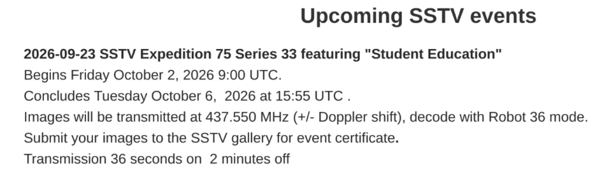
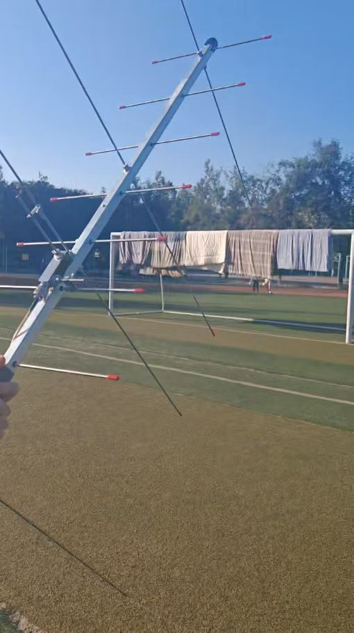
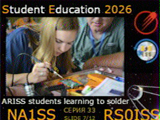
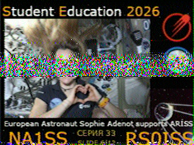
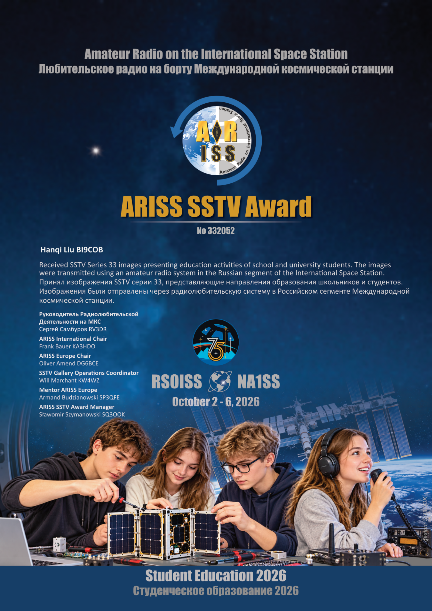

import { Steps } from '@astrojs/starlight/components';

## 活动概况

ARISS于2026年9月23日发布了最新一次SSTV下传活动，活动名“SSTV Expedition 75 Series 33 featuring "Student Education"”，公布活动自UTC时间2026年10月2日9\:00开始，至2026年10月6日15\:55结束。通知原文在[https://www.ariss.org/upcoming-sstv-events.html](https://www.ariss.org/upcoming-sstv-events.html)。

SSTV图像将在频率$437.550\mathrm{MHz}$，需要注意多普勒偏移，使用Robot 36模式解码。SSTV图像下传活动24小时进行，每张图片需要$36\mathrm{s}$完整传送完毕，每两张图片之间暂停$2\mathrm{min}$。

## 装备清单

- 接收机：宝锋5RH Pro
- 天线：U7V4八木天线
- 软件：Look4Sat、Robot36

## 活动流程

<Steps>

    1. 在Look4Sat上找到ISS主站“ISS (ZARYA)”，NORAD ID为25544，观察最近过境事件。最终定于AOS为北京时间2026年10月6日16\:34的一次过境，最大仰角$\angle 59.8\degree$，比较良好。该次过境由西北向东南从东侧过境，选择接收场地为西邮校内长安校区小操场。
    
    2. 活动当天拼接起八目天线，连接馈线与手台，检查手台各项参数。提前到达场地，打开Look4Sat与Robot36软件。
    
    3. 接收过程中不断注意调整天线方位与仰角，并仔细校对Look4Sat提供的“Mode U \- SSTV \- Robot\-36 (SSTV/\-)”的“RX”参数与手台上的当前频率，以免因UHF段较大的多普勒效应影响接收质量。
    
    4. 将接收到的图像与本次接收活动的各项信息写做报告邮件，发送给ARISS活动主办方，获取电子版证书。

</Steps>

## 活动成果

本次活动共成功获取两张SSTV图像。

发送报告邮件后获得证书。

