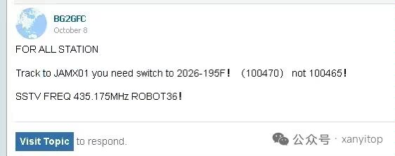
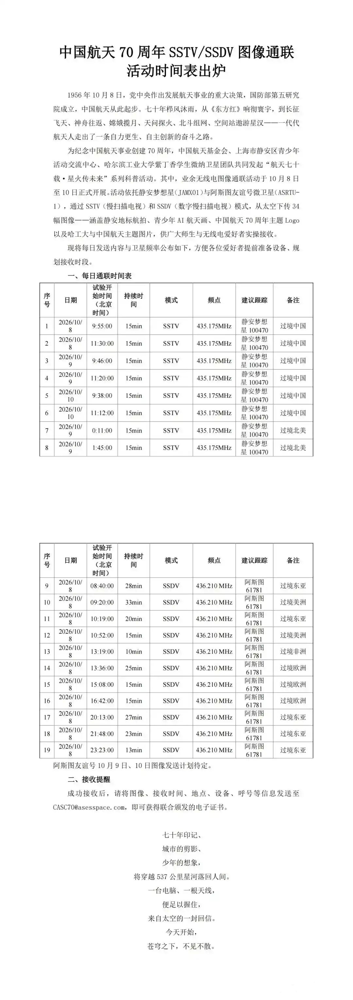
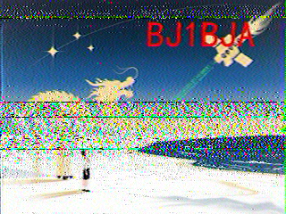
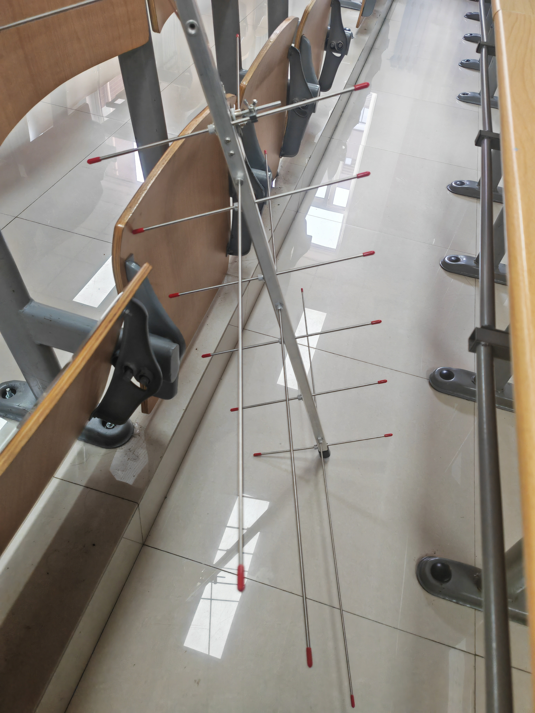

## 活动简介

2026年为中国航天事业创建七十周年，于北京时间2026年10月8日到10月10日，上海市静安区青少年活动交流中心的静安梦想星（JAMX01）将下传SSTV，哈尔滨工业大学的阿斯图友谊号（ASRTU\-1）将下传SSDV，本次活动聚焦于JAMX01下传的SSTV。

本次活动由于主办方信息公开不到位，导致很多信息主要靠网友互相告知。例如Look4Sat等追星软件使用的较为权威的星历中，名为“JAMX01”的、NORAD ID为100465的那颗卫星并不是本次的JAMX01卫星，而另一颗名为“2026\-195F”的、NORAD ID为100470的卫星才是真正的JAMX01。而且Look4Sat等软件并未为所谓的“2026\-195F”卫星录入发射器信息，难以实时进行多普勒对频，好在活动结束最后一天时星历及时进行了改正。官方也没公布下传频率，而是靠网友们互相告知为$435.175\mathrm{MHz}$，模式为Robot36。

此外本次活动也不是24小时全天发射，而是只有活动这三天期间，每天上午两场过境国内时才发射，其余时间并不发射，导致窗口期较短。但好在经实践证明，本次下传为一段小朋友的语音后一张图为一个周期，几乎是连续下传。

## 接收成果

每次过境的窗口期大约为10分钟多一点，能够接收6张图片，前4张如下，后2张因仰角不足而质量较差、无法解码。

## 设备

