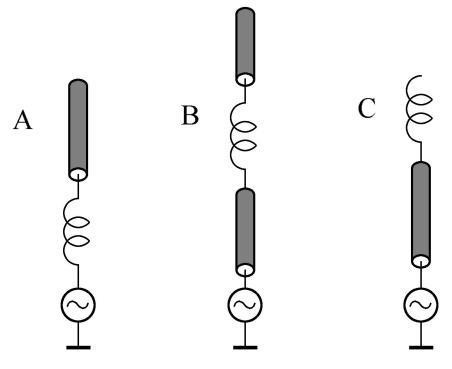

import { Aside } from '@astrojs/starlight/components';

## 天线的基本作用与增益

**天线** 是收发电磁波的换能器。发射天线把发射机输出的 **射频电流** 转化为向空间辐射的 **无线电波** ；接收天线则把空间中的无线电波重新转换为接收机中的 **射频电信号** 。天线本身并不放大功率，也没有把射频变成音频或红外线的功能——它只是在导体上建立起时变电流，使电磁场离开导线成为自由空间波。

为了比较天线的辐射能力，人们引入了 **增益** 概念。天线增益指：在相同输入功率下，待测天线在最大辐射方向上的功率密度与某个参考天线对应方向功率密度之比。参考天线可以是理想化的 **点源天线（isotropic radiator）** ：假想一个几何点，能把全部射频能量均匀地、各向同性地辐射到所有方向。以它做基准得到的是 **$\mathrm{dBi}$** 。也可以是实际常用的 **半波长偶极天线（half-wave dipole）** ，以它做基准得到的是 **$\mathrm{dBd}$** 。半波偶极天线本身相对于理想点源有约 $2.15\mathrm{dBi}$ 的增益，因此

$$
    G_{\mathrm{dBi}} = G_{\mathrm{dBd}} + 2.15
$$

反过来说 $G_{\mathrm{dBd}} = G_{\mathrm{dBi}} - 2.15$。当厂家只标" $\mathrm{dB}$ "而不说明基准和方向时，这个数值缺乏参考价值，因为不清楚是以什么为参考、沿哪个方向测得的。半波偶极天线从中间馈电，两臂各约为 $\dfrac{1}{4}$ 波长，常被作为天线增益的实用基准（$0\mathrm{dBd}$），所以 $0\mathrm{dBd} = 2.15\mathrm{dBi}$ 。

下面通过几个例子说明增益换算的实际应用。

> 例题：甲天线增益 $6.15\mathrm{dBi}$ ，乙天线增益 $1\mathrm{dBd}$ 。若两副天线按同样条件架设并用同样功率驱动，则在它们最大发射方向的同一远方地点接收时，两天线给出的信号功率关系为？
>
> 1. 统一基准，把乙的 $\mathrm{dBd}$ 折成 $\mathrm{dBi}$ ： $G_{\mathrm{B}} = 1 + 2.15 = 3.15\,\mathrm{dBi}$ 。
> 2. 求增益差： $\Delta G = 6.15 - 3.15 = 3\,\mathrm{dB}$ 。
> 3. 把 $\mathrm{dB}$ 差换算成功率比：$\dfrac{P_{\mathrm{A}}}{P_{\mathrm{B}}} = 10^{\dfrac{\Delta G}{10}} = 10^{\dfrac{3}{10}} \approx 2$ 。
>
> 结论：甲天线在最大辐射方向的信号功率约为乙天线的 **$2$ 倍** 。

> 例题：甲天线增益 $0\mathrm{dBd}$ ，乙天线增益 $2\mathrm{dBi}$ 。同样条件、同样功率驱动，信号功率关系为？
>
> 1. 甲换为 $\mathrm{dBi}$ ：$0\,\mathrm{dBd} = 2.15\,\mathrm{dBi}$ 。
> 2. 增益差：$\Delta G = 2.15 - 2 = 0.15\,\mathrm{dB}$，甲仅比乙高 $0.15\,\mathrm{dB}$ 。
>
> 结论：甲的效果与半波长偶极天线相当，乙比甲 **略差** （仅差 $0.15\,\mathrm{dB}$）。

> 例题：两款 VHF 垂直全向天线，甲增益 $4.5\mathrm{dBd}$，乙增益 $5.85\mathrm{dBi}$。远处接收天线中信号功率有何不同？
>
> 1. 甲换为 $\mathrm{dBi}$ ：$4.5 + 2.15 = 6.65\,\mathrm{dBi}$ 。
> 2. 增益差：$6.65 - 5.85 = 0.8\,\mathrm{dB}$ 。
>
> 结论：来自甲天线的信号比乙天线的强 **$0.8\mathrm{dB}$** 。

> 例题：两款 VHF 垂直全向天线，甲增益 $2.9\mathrm{dBd}$，乙增益 $5.85\mathrm{dBi}$。远处接收天线中信号功率有何不同？
>
> 1. 甲换为 $\mathrm{dBi}$：$2.9 + 2.15 = 5.05\,\mathrm{dBi}$ 。
> 2. 增益差：$5.85 - 5.05 = 0.8\,\mathrm{dB}$ 。
>
> 结论：来自乙天线的信号比甲天线的强 **$0.8\mathrm{dB}$** 。

下面几个例子说明增益变化如何折算成 S 表档位。S 表从 $S_1$ 到 $S_9$ 每一档对应 $6\mathrm{dB}$ 。

> 例题：某台用半波垂直偶极天线通联，对方所收信号为 $S_4$ 。发射功率不变，发信方改用增益 $8.15\mathrm{dBi}$ 的八木天线（最大辐射方向、极化均不变），对方所收强度变为？
>
> 1. 原天线约 $0\,\mathrm{dBd}=2.15\,\mathrm{dBi}$ ，增益差： $8.15 - 2.15 = 6\,\mathrm{dB}$ 。
> 2. 折算档位（每档 $6\,\mathrm{dB}$）： $\dfrac{6}{6} = 1$ 档。
>
> 结论：信号从 $S_4$ 升到 **$S_5$** 。

> 例题：同上，改用增益 $12\mathrm{dBd}$ 的八木天线，对方所收强度变为？
>
> 1. $12\,\mathrm{dBd} = 14.15\,\mathrm{dBi}$ ，增益差： $14.15 - 2.15 = 12\,\mathrm{dB} = 2$ 档 。
>
> 结论：信号从 $S_4$ 升到 **$S_6$** 。

> 例题：双方都用半波垂直偶极天线，互收信号均为 $S_4$。发射功率不变，双方都改用增益 $8.15\mathrm{dBi}$ 的八木天线，双方信号强度变为？
>
> 1. 每一端都增加 $6\,\mathrm{dB}$，即 $1$ 档。
>
> 结论：双方信号都从 $S_4$ 升到 **$S_6$** 。

## 垂直接地天线与加载技术

**垂直接地天线（Ground Plane, GP）** 把一根垂直振子安装在接地平面或"镜像地平面"上，振子长度常取 $\dfrac{1}{4}$ 波长。它被称为 **全向天线** ，是因为在 **水平方向** 上没有指向性，而在垂直方向有指向性，主瓣仰角稍大于 $0\degree$，因此大体上能在水平面 $360\degree$ 辐射。注意，它并不是各向同性的球面波；E 面（含天线轴的垂直面）方向图有方向性，H 面（水平面）才近似全向。若希望垂直接地天线在大体为零仰角的水平方向上具有主辐射瓣并能与同轴电缆直接耦合，振子长度通常选 $\dfrac{1}{4}$ 波长。

手持电台随附的 **橡胶天线**是 一种柔性短天线，常用螺旋加感或缩短技术。由于尺寸受限，它的发射与接收增益都比全尺寸天线低；在正常持握方式下，电波仍以 **垂直极化** 分量为主，而不是旋转极化。若护套开裂，并不会立即导致振子解体报废。

在车内使用手持电台和橡胶天线时，车体金属会 **屏蔽** 电波，影响信号强度。架设天线时若附近有市电线路，安全距离很重要：例如 $35\mathrm{kV}$ 及以下电压时，应确保掉落部件不落入供电装置至少约 $1\mathrm{m}$ 的安全距离内。

当天线振子因场地条件被迫缩短时，其电气长度不足，输入阻抗变得感性偏小，谐振频率升高。可以在振子中串入 **电感线圈** （加载线圈）来补偿失去的感抗，使天线重新谐振在所需频率上。所谓 **天线加载** ，就是在振子中串联电感线圈以 **延长电气长度** 。线圈的位置对发射效率影响很大：因为天线电流沿线分布不同，线圈所在位置越高，流过线圈的电流越小，线圈电阻产生的 $I^2R$ 损耗也就越小。因此 **顶部加感** 效率最高， **中部加感** 次之， **底部加感** 效率最低。下图给出三种等长振子的加感方案：A 方案的线圈位于振子底部，为底部加感；B 方案的线圈位于振子中部；C 方案的线圈位于振子顶部，为顶部加感。按发射效率从高到低排列应为 C、B、A。除串电感外，还可在短天线顶端加 **电容帽** 来**电延长**物理上偏短的天线；车载短波天线的顶端常装 **电晕球**，用于**减小发射时顶端的射频放电**（降低尖端强电场）。车载短波天线因物理尺寸受限而**电短**，其**效率低**是限制移动短波通信效果的主要因素；缩短后的天线**工作带宽也会明显变窄**，可用频率范围有限。

## 驻波比

馈线一端接发信机，另一端接天线。馈线有 **特性阻抗** $Z_0$（常见同轴电缆为 $50\Omega$ ），天线在工作频点也有输入阻抗 $Z_A$ 。当 $Z_A = Z_0$ 时，馈线与天线 **匹配** ，能量全部送往天线，线上没有反射波，形成 **行波** ，此时 **驻波比（SWR, Standing Wave Ratio）** 为 $1:1$ 。若负载与馈线不匹配，一部分能量被反射回发信机，入射波与反射波叠加形成驻波，SWR 大于 $1:1$ 。

驻波比也可理解为馈线上最大电压（或最大电流）与最小电压（或最小电流）之比：

$$
    S = \dfrac{V_{\mathrm{max}}}{V_{\mathrm{min}}} = \dfrac{I_{\mathrm{max}}}{I_{\mathrm{min}}}
$$

例如 SWR 为 $3:1$ 表示沿线电压峰谷比为 $3:1$ 。这个比值反映的是从发信机输出端口看，天线系统整体的匹配情况；它并不直接意味着阻抗是 $200\Omega$ 或 $12.5\Omega$ ，也不等于辐射效率为 $25\%$ ，更不是天线增益为 $4\mathrm{dB}$ 。

引入反射系数 $\Gamma$ ，其模 $|\Gamma|$ 表示反射能量占比，则

$$
    S = \dfrac{1+|\Gamma|}{1-|\Gamma|}, \qquad |\Gamma| = \dfrac{S-1}{S+1}
$$

当 $|\Gamma|=0$ 即完全匹配时， $S=1$ 。要消除驻波，必须让负载阻抗与馈线特性阻抗匹配，而不是在馈线始端调整信源阻抗。

> 例题：小强用长度不短于 $\dfrac{1}{4}$ 波长的 $50\Omega$ 馈线连接收发信机和天线。发信时，他发现 SWR 表的指示为 $3:1$。该值意味着馈线上任意位置的最大峰值电压与最小峰值电压之比为 $3:1$，也等于最大峰值电流与最小峰值电流之比为 $3:1$。
>
> SWR 的定义就是馈线上 **最大峰值电压与最小峰值电压之比 $\dfrac{V_{\mathrm{max}}}{V_{\mathrm{min}}}$** ，也等于 **最大峰值电流与最小峰值电流之比 $\dfrac{I_{\mathrm{max}}}{I_{\mathrm{min}}}$** ；驻波并不会"降低"导体或介质损耗，反而是失配的体现。
>
> **补充（SWR 与反射系数）** ：由 $S = \dfrac{1+|\Gamma|}{1-|\Gamma|}$ 反解得 $|\Gamma| = \dfrac{S-1}{S+1} = \dfrac{3-1}{3+1} = 0.5$ ，即反射系数模为 $0.5$ ， **反射功率占总入射功率的 $|\Gamma|^2 = 25\%$** 。注意：这 $25\%$ 是反射功率占比，不等于天线辐射效率只有 $25\%$ ；SWR 高只说明能量没全部进入天线系统，进入后大部分仍可被辐射。

SWR 过高时，发射机功放输出级的半导体器件会因反射功率而发热，所以多数发射机会在 SWR 超过一定阈值时 **降低输出功率** ，以 **保护功放** 。SWR 读数不稳定，常见原因是发信机、馈线或天线某处接触不良；SSB 话音的幅度不断变化，也会使 SWR 表随包络跳动，改用 CW 连续载波测量会更稳定。

电网供电频率很低（ $50\mathrm{Hz}$ / $60\mathrm{Hz}$ ），与波长相比导线长度微不足道，驻波现象不明显，因此日常电线中观察不到驻波。

下面用两道例题巩固驻波比的计算：负载阻抗与馈线特性阻抗之比（取大于 $1$ 的那个）即为 VSWR：

> 例题：一条 $50\,\Omega$ 馈线接 **$200\,\Omega$ 电阻负载** ，驻波比为
> $$
> \mathrm{SWR}=\dfrac{Z_L}{Z_0}=\dfrac{200}{50}=4:1
> $$

> 例题：一条 $50\,\Omega$ 馈线接 **$10\,\Omega$ 电阻负载** ，驻波比为
> $$
> \mathrm{SWR}=\dfrac{Z_0}{Z_L}=\dfrac{50}{10}=5:1
> $$

某天馈系统馈线上 SWR 为 $5:1$ ，若在发射机端加天调把它调到对发射机呈现 $1:1$ ，则 **馈线上的真实 SWR 仍然为 $5:1$** ——天调只改变了发射机"看到"的阻抗，并不能改变馈线本身与天线之间的失配。

## 馈线与连接器

<Aside type="danger">馈线不可食用！</Aside>

业余电台最常用的馈线是 **同轴电缆** ，其特性阻抗约为 $50\Omega$ ，适合与多数业余收发设备匹配。同轴电缆由中心导体、绝缘介质、外屏蔽层和护套组成，外导体把电磁场封闭在内部，与周围物体的互耦很小，便于敷设。选用同轴电缆时应关注两大电气参数： **特性阻抗** 以及 **指定频率下每百米的传输损耗** 。除同轴外，还有 **平行双线馈线**（如开放式扁馈线）：它的特性阻抗由**两导体中心间距与导体半径**决定，常见的 **窗线（window line）** 特性阻抗约为 **$450\,\Omega$** 。馈线损耗通常以 **分贝/每百米**（英制为分贝/每百英尺）表示，并随频率升高而增大；**高驻波比会加剧有损馈线的损耗**（反射能量在馈线上反复往返而被多次吸收）。反过来，**馈线损耗越大，在其输入端测得的驻波比会显得越低**——因为反射波在回程中也被衰减了。

馈线损耗会带来两个直接后果：发信功率在到达天线前被衰减；接收时噪声不变、信号变弱，导致 **收信信噪比下降** 。馈线损耗不会使 SWR 永远高于 $1:1$，也不会直接让信号失真。

潮湿是同轴电缆失效的主要原因：水汽渗入后介质损耗变大，屏蔽层和芯线氧化锈蚀甚至断路。因此室外电缆的护套必须能耐受 **紫外线（Ultraviolet，UV）** ，否则护套被晒裂后潮气侵入会加速损坏。空气介质同轴电缆损耗最低，但需要特别措施防止湿气渗透。一般来说，信号频率越高，同轴电缆的 **传输损耗越大** 。馈线中损耗掉的功率会 **转化为热量** ，这也是大功率下馈线会发热的原因。

同等外径下， **空气介质同轴硬电缆** 在 VHF/UHF 频段的损耗比软电缆更低。连接器方面，$400\mathrm{MHz}$ 或更高频率应优先选用 **N 型连接器** ；而 **M 型连接器** （即 PL-259/SO-239）广泛应用于 HF 和 VHF 通信系统，它采用螺纹锁紧，不是卡式快拔，也不是因成本高只用于微波系统。户外使用的各种射频连接器都应 **用胶带仔细做防水处理**，防止潮气侵入。就同轴电缆而言， **RG-213 比 RG-58 更粗、在相同频率下损耗更低**，适合较长的馈线。

## 极化与方向图

无线电波本质是 **电磁波** ，由 **电场** 和 **磁场** 两个分量组成，二者 **相互垂直** ，且都垂直于波的传播方向。电磁波的 **极化** 指 **电场** 矢量在空间中随时间取向变化的方式（极化由电场方向定义，与磁场方向无关）。 **垂直天线** 的电场与地面垂直，称为 **垂直极化** ； **水平偶极天线** 的电场与地面平行，称为 **水平极化** 。

垂直天线在水平面（H 面）方向图近似全向，在垂直面（E 面）有方向性。水平偶极天线在包含天线轴的平面内方向图呈"8"字，最大辐射垂直于振子轴，沿振子轴方向辐射很弱；它的电场平行于地面。

视距通信中，收发天线极化应 **保持一致** 才能获得最大能量耦合。若发射为垂直、接收为水平，二者正交，会产生严重的极化失配损耗；若把一方也改为垂直，双方极化匹配，通信效果立即 **变好** 。同理，双方分别使用 **左旋圆极化** 和 **右旋圆极化** 时几乎无法接收，双方同时改为同一种圆极化后效果 **变好** 。

圆极化波与线极化天线之间总有约 $3\mathrm{dB}$ 的功率损失，因此只要一端仍是圆极化，无论另一端是水平还是垂直线极化，效果都 **不变** 。但如果把线极化端换成与对方圆极化 **手性相反** 的圆极化，则变成正交圆极化，效果会 **变差** 。

圆极化的"左旋/右旋"是按 **沿传播方向观察** 定义的：电场矢量顺时针旋转为 **右旋圆极化** ，逆时针旋转为 **左旋圆极化** 。地面站仰望卫星时，观察方向与波的传播方向相反，因此看到的旋转方向会反过来。例如卫星发射的是右旋圆极化波，地面站仰望卫星时看到的电场旋转方向为左旋。卫星过顶前后，传播方向的几何关系反转，地面站所需的天线极化手性也可能随之从右旋变为左旋，或反之。若卫星使用随卫星旋转的线极化源，地面接收到的极化方向会不断变化，为防接收中断，可以使用 **圆极化天线** 接收，它能接收任意线极化分量。

在地面对地通信中，若收发都用半波偶极天线，最佳安排是把两天线都置于垂直于两台站连线的平面内，并保持极化一致，这样两天线在各自最大辐射方向上彼此对准、极化匹配，能量耦合最大。

## 超短波传播与多径效应

在 **VHF/UHF** 频段，电波主要以 **视距传播（line-of-sight）** 方式传输，即发射天线和接收天线之间近似为直接射线。但在开阔地带移动接收时，信号强度仍会出现周期性的涨落。这是因为除了 **直射波** 外，地面、建筑物、车辆等还会产生 **反射波** ；这些沿不同路径到达接收天线的电波，因传播距离不同而具有不同的相位与幅度，在接收点叠加后可能 **同相增强** 或 **反相抵消** ，这就是 **多径效应（multipath effect）** 。移动设备、移动车辆或人体位置稍有变化，就可能改变反射路径长度，使合成场强从一个极大值跳到极小值，因此本地 VHF/UHF 信号会随位置周期性变化。气流造成的路径弯曲（大气波导、对流层折射）通常作用距离较大、变化缓慢，不会在短距离移动几步内造成信号剧烈起伏；接地电阻变化或分布电容变化对 VHF/UHF 信号强度的周期性起伏影响也很小。当收发信机之间有山脊、楼顶等障碍物遮挡直线路径时，电波掠过障碍物边缘会发生 **绕射（刀锋衍射）** ，使信号得以部分传到障碍物后方，实现"看不通却通得了"的联络。

多径效应有一个非常实用的表现：当信号报告很差时，只要 **移动几步** 或把频率偏移 **几十千赫** ，就可能显著改善通信效果。移动几步改变了直射波与反射波的路程差，可能使原来反相抵消的位置变成同相增强；改变频率几十千赫，则波长发生微小变化，使同一几何路径差对应的相位差改变约 $180\degree$，也能让合成场从低谷跳到峰值。对于 **FM 话音** 通联，多径同样会造成可察觉的影响；对数据通信而言，相位与幅度的快速变化会使接收判决出错， **误码率上升** 。

在 **VSB（Vestigial Sideband，残留边带）** 方式的业余电视（Amateur Television，ATV）传输中，多径会表现为图像边缘出现 **重影** 。不同路径的信号到达接收天线存在时间差，同一画面内容被延迟叠加，于是屏幕上出现主像边缘之外的"影子"。如果发射端馈线驻波比过高，信号在发射机与天线之间多次反射，也会造成类似重影；而极化配置错误通常表现为极化失配、整体信号变弱，而不是边缘重影；中继台转发通常只产生一个稍延迟的完整信号，不会只在图像边缘形成重影。

## 超短波超视距传播

VHF/UHF 视距传播的极限距离主要由发射天线和接收天线离地面的 **相对高度** 决定。视距距离可近似用公式估算：

$$
    d \approx 4.12\left(\sqrt{h_t} + \sqrt{h_r}\right)
$$

其中 $h_t$、$h_r$ 单位为米，$d$ 单位为千米。天线挂得越高，视线切点越远，通信距离就越远。海平面的绝对高度或离地高度与波长之比，不是决定视距极限的主要因素；天线增益主要影响等效辐射功率和接收信噪比，不直接决定视线几何极限。由于大气对电波的 **折射** 使电波路径略向地面弯曲，VHF/UHF 的 **无线电地平线比视觉地平线更远** ，可通联距离略超出肉眼可见范围。

在某些特殊气象条件下，相隔数百千米的业余电台仍能实现 VHF/UHF 直接联络，这通常与 **大气波导（tropospheric ducting）** 现象有关。当高空出现 **逆温层** 时（温度随高度增加而非减小），大气折射率梯度异常，电波被限制在近地面或某一高度层内反复折射，传播距离远超正常视距。飓风或龙卷风的上升气流、雷暴等离子体主要产生短暂扰动；太阳黑子、耀斑影响的是电离层，对 VHF/UHF 超视距作用相对较小。

在 **$6\,\mathrm{m}$ （ $50\,\mathrm{MHz}$ ）** 和 **$2\,\mathrm{m}$ （ $144\,\mathrm{MHz}$ ）** 业余波段，有时能收到上千千米外的"超视距传播"信号，这通常与 **突发 E 层（sporadic E, Es）** 有关。E 层高度约 $100\,\mathrm{km}$，夏季白天偶尔出现局部电离增强的小云块，能把 VHF 电波反射到很远的地方。流星余迹反向散射也能产生短暂信号，但可持续通信时间很短；D 层吸收会削弱信号而不是让它传得更远；灰线传播主要用于 HF 经电离层反射的远距离通信，不是 VHF/UHF 超视距的主要原因。

另一种常见的 VHF/UHF 超视距机制是 **对流层散射（tropospheric scatter）** 。当传播距离达到数百千米时，即使不存在明显的大气波导，对流层中不均匀体的折射和散射也能把一部分电波能量"抛"到正常视线之外。它通常可实现数百千米范围的较稳定通信，是 VHF/UHF $500\,\mathrm{km}$ 左右超视距信号的重要来源。F2 层折射和 D 层折射主要影响 HF；法拉第旋转是电离层引起的极化面旋转，主要影响 HF 和卫星通信。

## 天线 Q、效率与地网

**天线 Q 值** 描述天线储能与耗能之比，和可用的 **SWR 带宽** 直接相关：天线 Q 越高，其 SWR 随频率变化越剧烈，意味着 **SWR 带宽越窄** （即只在很窄的频带内保持低驻波）。这与 LC 谐振回路"Q 越高通带越窄"是同一回事。

**天线效率** 定义为辐射出去的功率与输入总功率之比，也可写成

$$
    \eta = \dfrac{R_{\mathrm{rad}}}{R_{\mathrm{rad}} + R_{\mathrm{loss}}}
$$

其中 $R_{\mathrm{rad}}$ 是 **辐射电阻** （代表真正辐射能量的等效电阻）， $R_{\mathrm{loss}}$ 是导线、地网、加载线圈等带来的损耗电阻。辐射电阻越大、损耗越小，效率越高。**地网（ground radial）** 改善接地后降低地损耗，从而提升辐射效率； **土壤电导率越高** ，地损耗越小、地网效果越好。给短天线加 **加载线圈** 时，线圈的 **感抗与电阻之比（ $\dfrac{X}{R}$ ）越高** ，其相对损耗越小、效率越高。

**地面增益（ground gain）** 指发射天线靠近地面时，直射波与地面反射波在某些低仰角方向上同相叠加，使该方向信号比自由空间更强。

**第一菲涅尔区** 是收发两点间主能量集中通过的橄榄形空间区域；若障碍物侵入该区域，传播会明显衰减。其半径随频率升高而 **减小** （频率越高，菲涅尔区越小）。

极化失配损耗与极化方式密切相关：一端圆极化、另一端线极化时固定约损失 $3\,\mathrm{dB}$ ；但若两端都用 **线极化而方向正交** （如一发垂直、一收水平），失配损耗可达 **$20\,\mathrm{dB}$ 以上** 。（天线方向图的波束宽度、前后比、前侧比等参数定义，见《天线系统的设计与选用》的"方向图读图与参数"。）

> 例题：某半波偶极天线辐射电阻 $R_{\mathrm{rad}} = 72\,\Omega$ ，导线欧姆损耗 $R_{\mathrm{loss}} = 2\,\Omega$ ，则天线效率
> $$
> \eta = \dfrac{72}{72+2} = 97.3\%
> $$
> 若一副小型磁环天线辐射电阻仅 $50\,\mathrm{m}\Omega$ 、欧姆损耗 $2\,\mathrm{m}\Omega$ ，则
> $$
> \eta = \dfrac{50}{50+2} \approx 96.15\%
> $$

增益基准换算：同一副天线，增益用 $\mathrm{dBi}$ 表示比用 $\mathrm{dBd}$ 表示 **高 $2.15\,\mathrm{dB}$** （ $\mathrm{dBi}= \mathrm{dBd}+2.15$ ）。例如相对理想点源 $6\,\mathrm{dBi}$ 的天线，相对半波偶极约为 $6-2.15=3.85\,\mathrm{dBd}$ 。把各类损耗（馈线、双工器、环行器等取负值）与天线增益（取正值）折算成分贝、求有效辐射功率（Effective Radiated Power / Effective Isotropic Radiated Power，ERP/EIRP）的完整例题，见《天线系统的设计与选用》一文的"有效辐射功率与限值"。
