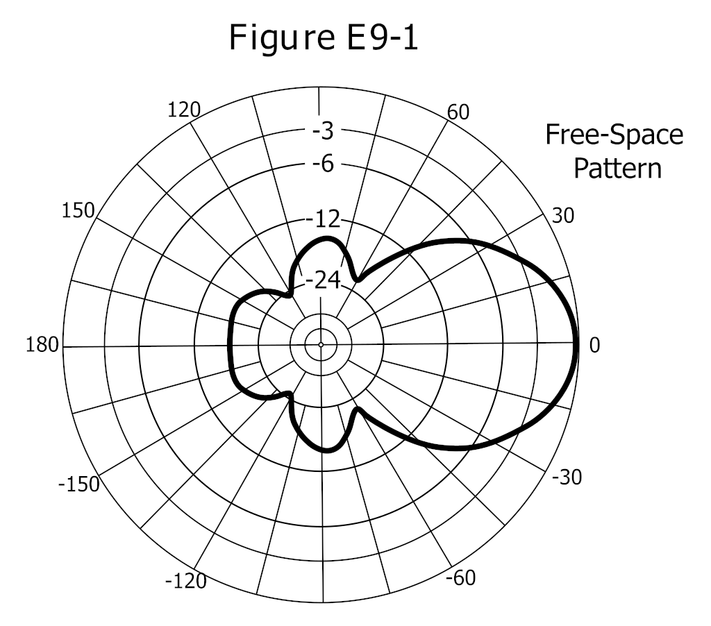
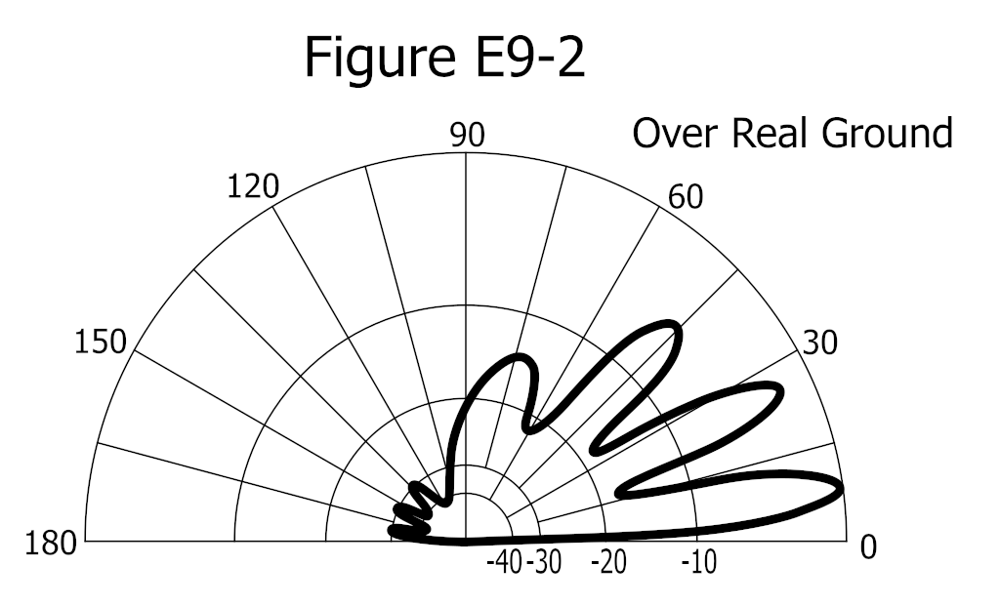

天线系统不仅指天线本身，还包括连接收发信机的馈线、阻抗匹配装置以及根据传播条件选择合适天线形式。一个良好的天线系统应保证发射机输出的射频能量尽可能多地转化为有效辐射，同时接收时能从空间背景噪声中提取出足够强的信号。

## 偶极天线与馈线系统

由半波长偶极天线和传输线构成的天线系统，其理想工作状态是 **天线上形成驻波、馈线上只有行波** 。半波偶极天线是谐振天线，振子上的电流和电压呈驻波分布，这正是它能在特定频率上高效辐射的原因；而连接收发信机的馈线则希望处于匹配状态，使电磁波以行波方式无反射地传输。如果馈线上也出现了驻波，说明天线与馈线之间存在阻抗失配，能量被反射回发信机，既浪费功率又可能损坏设备。

实际制作半波偶极天线时，振子的物理长度比理论上的 $\dfrac{\lambda}{2}$ 要短一些，这源于 **端点效应** 、绝缘子以及导线粗细带来的等效电容。工程上常用的 **缩短系数** 约为 $0.95$ 。设工作频率为 $f$（单位 $\mathrm{MHz}$ ），则单边振子的长度约为

$$
l \approx \dfrac{71.3}{f}\,\mathrm{m}
$$

整个振子的总长度约为 $\dfrac{142.6}{f}\,\mathrm{m}$ 。若不做缩短，理论半波长为 $\dfrac{150}{f}\,\mathrm{m}$ ，因此实际制作时要按经验值截短。要提高偶极天线的谐振频率，只需把振子截短一些；反之，加长振子、在振子中串联线圈，或加装电容帽，都会使谐振频率下降。半波偶极在**包含导体振子的平面内，方向图呈"8"字形**（垂直于振子的两侧辐射最强、振子两端为零）。把馈电点从中心向端部移动，**馈点阻抗逐渐增大**（中心约 $73\,\Omega$、两端极高）；而把水平偶极的架设高度降到约 $\dfrac{1}{10}$ 波长时，**馈点阻抗会明显降低**。水平极化 HF 天线相比垂直极化的优点是**地面损耗较小**（无需像垂直天线那样铺大面积地网）。此外，水平偶极若架设高度低于 $\dfrac{1}{2}$ 波长，在较高仰角上其**水平方向图会变得近似全向**。**天线增益** 指天线在 **指定方向上的信号强度相对于某参考天线（如理想点源或半波偶极）的增量** ，并非真正增加了发射功率。车载移动常用的 **约 19 英寸（约 48 厘米）垂直天线** 是 2 米波段的 **$1/4$ 波长谐振天线**；而 **$5/8$ 波长鞭状天线** 相比 $1/4$ 波长天线有 **更高的增益**（把能量更集中地压向低仰角）。

电波在同轴电缆中的传播速度低于真空光速 $c$ ，这个比值称为 **速度因子（velocity factor）** ，等于

$$
VF = \dfrac{1}{\sqrt{\varepsilon_r}}
$$

其中 $\varepsilon_r$ 是绝缘介质的相对介电常数。最常用的聚乙烯介质同轴电缆， $\varepsilon_r \approx 2.25\sim2.3$ ，因此速度因子约为 $0.66$ ，题目给出的经验值 $0.65$ 与之接近。同轴电缆的 $\dfrac{\lambda}{4}$ 物理长度应为自由空间 $\dfrac{\lambda}{4}$ 乘以速度因子：

$$
l_{\mathrm{coax}} = \dfrac{75}{f}\times VF \approx \frac{48.8}{f}\,\mathrm{m}
$$

这就是制作 $\dfrac{1}{4}$ 波长同轴电缆移相器时常用的估算公式。

偶极天线在工作频点获得低输入阻抗的条件是：两臂总的 **电气长度** 为 $\dfrac{1}{2}$ 波长的整数倍。常见的情况是 $n=1$ ，即两臂总长约 $\dfrac{\lambda}{2}$ ，此时中心馈电阻抗约为 $73\,\Omega$。若总长度为 $\dfrac{1}{2}$ 波长的奇数倍，中心馈电处仍是电流腹点，阻抗较低；而偶数倍时中心处于电流节点，阻抗变得很高，不容易与 $50\,\Omega$ 馈线匹配。一般谐振偶极天线的增益在垂直于振子轴的方向达到最大，长度取 $\dfrac{\lambda}{2}$ 时方向图简单、增益适中；若振子很短，辐射电阻很小、效率低；若取 $\dfrac{3\lambda}{2}$ 等多波长长度，方向图会出现多个瓣和零点，反而不便于使用。

半波偶极上的电流与电压分布呈驻波：中心馈电处电流最大、电压最小（故阻抗低，约 $73\,\Omega$），两端电流最小、电压最大。因此偶极总是从中心（电流腹点）馈电；若在两端（电压腹点、电流节点）馈电，阻抗会极高、难以匹配。

实际架设中，如果把水平偶极天线的馈电点从中心向一侧偏移 $\dfrac{\lambda}{8}$ ，由于离开了电流最大点，馈电处的电压分量增大、电流分量减小，输入阻抗会显著变大；但整个振子的总长度没变，谐振频率变化不大。如果通信对象在偶极天线振子轴的垂直方向上，应使两臂各为 $\dfrac{\lambda}{4}$ ，即总长度为 $\dfrac{\lambda}{2}$ ，这样最大辐射方向正好对准对方；单纯追求低 SWR 并不能保证辐射方向正确。

短波水平偶极天线或八木天线发射的仰角主要由 **天线离地面高度与波长之比** $\dfrac{h}{\lambda}$ 决定。大地相当于一面镜子，天线与其地面镜像共同形成等效二元阵，不同仰角上直射波与反射波的相位差不同。远距离通信需要低仰角，以便电波以较小的入射角投射到电离层并返回很远的地方，因此应把天线架设得较高；近距离通信则需要高仰角，使电波以较大仰角射向电离层并就近返回，这时应使用较低架设高度的水平偶极天线或端馈斜拉天线。计算特定对象的最佳仰角时，可依据电离层的大致高度、通信距离和反射跳数，用简单几何关系估算。

大地电导率对短波天线也有影响。导电性越好，地面镜像越接近理想导体，镜像电流越强，天线方向图越接近理论值；高电导率地面有利于提升天线效果。若把水平偶极天线架得很低，例如距地面约 $\dfrac{\lambda}{10}$ ，由于镜像天线靠得很近，互耦很强，馈电点阻抗会明显下降。

当架设空间受限、无法使用全尺寸振子时，可在振子中串入电感线圈构成 **加感天线** （顶部/中部/底部加感对效率的影响，以及三种加感方案示意图，见《天线、馈线与极化》的“垂直接地天线与加载技术”）。

上图展示了一副野外常用的 $14/21/28\,\mathrm{MHz}$ 三频段偶极天线。它的基本原理是利用 **陷波器（trap）** ：一个 LC 并联回路，谐振在某个频率时对该频率呈现高阻抗，阻止该频率电流继续向外流。从馈电点看，当工作在 $28\,\mathrm{MHz}$ 时，内侧的 $28\,\mathrm{MHz}$ 陷波器谐振，电波只到达 A 段；工作在 $21\,\mathrm{MHz}$ 时，$21\,\mathrm{MHz}$ 陷波器谐振，电波到达 A+B 段；工作在 $14\,\mathrm{MHz}$ 时，陷波器都失谐呈低阻抗，电波使用 A+B+C 全段。因此各段的电气长度应满足：A 为 $28\,\mathrm{MHz}$ 的 $\dfrac{1}{4}$ 波长（单臂），A+B 为 $21\,\mathrm{MHz}$ 的 $\dfrac{1}{4}$ 波长，A+B+C 为 $14\,\mathrm{MHz}$ 的 $\dfrac{1}{4}$ 波长。图中 A、D 为 $21\,\mathrm{MHz}$ 陷波器，B、C 为 $28\,\mathrm{MHz}$ 陷波器，它们都是 **并联谐振回路** 。

从构成上看，一个 **陷波器（trap）** 就是 **一只线圈（电感）与一只电容并联** 组成的谐振回路：在其谐振频率上呈高阻抗，把该频率“挡”在振子内侧，使外侧振子不参与该频率的辐射；偏离谐振频率时它呈低阻抗，电流得以继续流向外段。靠在不同位置布置多个不同谐振频率的 trap，一副天线就能工作于多个波段——例如单根八木天线可借 trap 同时覆盖 $20\,\mathrm{m}$ 、 $15\,\mathrm{m}$ 、 $10\,\mathrm{m}$ 波段。这类多频段天线的优点是“一副顶多副”、架设简便，缺点是结构更复杂、带宽往往更窄，且因辐射体包含不连续的谐振点， **有时比简单偶极更容易辐射谐波** ，搭建与调试时要留意。

另一种方法是把不同频段的偶极振子并联在同一馈电点，构成 **多频段天线** ，如上图所示。该天线在 $7\,\mathrm{MHz}$ 、 $14\,\mathrm{MHz}$ 、 $28\,\mathrm{MHz}$ 三个频段都有谐振振子；特别地， $7\,\mathrm{MHz}$ 振子在 $21\,\mathrm{MHz}$ 上以 $\dfrac{3}{2}$ 波长方式工作，也能谐振，因此这副天线可覆盖 $7\,\mathrm{MHz}$ 、 $14\,\mathrm{MHz}$ 、 $21\,\mathrm{MHz}$ 、 $28\,\mathrm{MHz}$。不谐振的振子在该频率上呈现较高阻抗，对并联总阻抗影响很小，所以总输入阻抗仍可维持在 $50\,\Omega$ 左右。

## 八木天线

**八木天线** 又称八木—宇田天线，是在一个被驱动的半波偶极天线（主振子）前后加上一个反射器和若干个引向器构成的 **定向天线** 。引向器比主振子短，反射器比主振子长；引向器所在方向即为最大辐射方向。因此现场判别八木天线发射方向的方法是：看主振子前后的辅助振子，较短的一侧为引向器，较长的一侧为反射器，最大辐射指向引向器一侧。

八木天线的 **前后比** 定义为 **主瓣辐射功率与反向辐射功率之比** ，用来衡量天线抑制后方信号的能力。它既不是前向增益与理想点源增益之比，也不是引向器与反射器的数量之比。八木的**有源振子**（被驱动的振子）长度约为 **$\dfrac{1}{2}$ 波长**；**增大振子直径**可增加带宽。**加长主梁、增加引向器数量**能提高**增益**；而主梁长度、振子数量和各振子间距都可用来优化**前向增益、前后比或驻波带宽**。**主瓣**指天线**最大辐射方向**。八木馈点还常用 **发夹匹配（beta/hairpin match）**——在馈点并联一段短路传输线短截来匹配阻抗。

## 方向图读图与参数

天线的 **方向图** 把辐射强度随方向的变化画成图形，常见的有 **方位图（azimuth，水平面）** 与 **仰角图（elevation，垂直切面）** 两类：仰角图通常画成 $0\degree$ ~ $90\degree$ 的半圆（“Over Real Ground”），用于表示不同仰角上的增益；方位图则表示水平面各方位的增益。

从方向图可读取三个常用参数：

- **半功率波束宽度（3 dB beamwidth）** ：主瓣上较峰值下降 $3\,\mathrm{dB}$ 的两个方向之间的夹角，反映主瓣的宽窄；
- **前后比（front-to-back ratio）** ：主瓣峰值电平与正后方（反方向）瓣电平之差（用 $\mathrm{dB}$ 表示）；
- **前侧比（front-to-side ratio）** ：主瓣峰值电平与侧向瓣电平之差。

图 E9-1 是自由空间极坐标方向图：主瓣峰值在 $0\degree$ 方向，两侧降到峰值下 $3\,\mathrm{dB}$ 点的夹角约为 **$50\degree$** （即半功率波束宽度）；主瓣峰值与正后方（ $180\degree$ 附近）瓣之差约 **$18\,\mathrm{dB}$** （前后比）；与主瓣峰值和侧向（ $\pm 90\degree$ 附近）瓣之差约 **$14\,\mathrm{dB}$** （前侧比）。

图 E9-2 是真实地面上方的仰角方向图（半圆， $0\degree$ ~ $90\degree$ Over Real Ground）：这是一张 **仰角图（elevation pattern）** ，可见多个仰角瓣，峰值响应出现在约 **$7.5\degree$** 的低仰角，主瓣与正后方之差约 **$28\,\mathrm{dB}$** 。

## 二元阵与相控方向图

把两个相同单元按一定间距排成阵列，总方向图等于 **单元方向图 × 阵因子** 。以两个 $\dfrac{1}{4}\lambda$ 垂直天线为例：

- 间距 $\dfrac{1}{2}\lambda$ 、**同相** 馈电：阵因子在主瓣垂直于阵轴方向最强，整体呈沿阵轴拉长的“8”字形；
- 间距 $\dfrac{1}{2}\lambda$ 、**反相（相差 $180\degree$ ）** 馈电：能量被推到阵轴两端，形成沿阵轴的“8”字形；
- 间距 $\dfrac{1}{4}\lambda$ 、相差 $90\degree$ 反相：方向图变为单向的 **心形（cardioid）** ，适合需要抑制某一方向干扰的场合。

把两副相同八木天线在垂直方向 **间距约 $\dfrac{1}{2}\lambda$ 堆叠** ，会使仰角波束变窄、增益约提高 **$3\,\mathrm{dB}$** 。用两副正交放置的八木、并以相差 $90\degree$ 馈电，可合成出 **圆极化** 波。

## 行波天线与环形天线

**行波天线** 依靠射频电流在连续的匹配导线上行进并逐渐辐射，而不是依赖谐振驻波。常见的业余行波天线有 T2FD 和 Beverage 天线。它们没有严格的自然谐振点，长度通常接近或大于一个波长，并在线路终端接有吸收电阻。电阻的作用是把到达末端而尚未辐射的少量能量吸收掉，避免反射形成驻波；大部分能量在沿线行进过程中已经辐射出去，因此并不会有一半功率被浪费。

T2FD 天线若水平部分与垂直接引线的组合呈“T”形，其有效辐射主要来自垂直部分，极化方式为 **垂直极化** 。若把 T2FD 的半边振子直立起来，也同样得到垂直极化。线极化天线的方向决定了辐射电场的方向，因此只要馈电结构使主要辐射体呈垂直状态，天线就是垂直极化的。

**环形天线** 发射的电磁波，其 **磁场分量垂直于环所在的平面** 。小型环形天线的自然谐振尺寸并不对应 $\dfrac{1}{4}$ 波长半径；若在环中串联可变电容，只能调谐抵消感抗以改变谐振点，并不能显著拓展工作带宽。 **磁场耦合可调谐环形天线** 则通过激励环与谐振环之间的磁耦合工作：调节尺寸和耦合度可获得接近 $1:1$ 的输入 SWR；谐振环中的可变电容器必须承受较高电压才能允许更大输入功率；谐振环尺寸越大，效率越高，但可调谐的最高频率越低。它并不是对电场不敏感、损失一半能量的天线。

## 近距离与野外 HF 通信

在 $100\,\mathrm{km}$ ~ $200\,\mathrm{km}$ 范围内的 HF 通信有时反而比 $300\,\mathrm{km}$ ~ $500\,\mathrm{km}$ 更困难，因为普通天波通信存在一个“跳过区”：电离层反射的落地点离发信点较远，中间区域信号较弱。要解决这个问题，可尝试 **较低频段** （白天 $40\,\mathrm{m}$ 、夜晚 $80\,\mathrm{m}$ ），或使用 **架设高度较低的水平偶极天线** 、 **端馈斜拉天线** ，以便获得高仰角的近垂直入射天波（Near Vertical Incidence Skywave，NVIS）。在偶极天线下方加装反射器可以把主瓣压向正上方，也有利于近距通信。小尺寸磁环天线虽然便携，但不是解决近距通信最有效的简单手段。

## 天线调谐器

**天线调谐器** 俗称“天调”，其主要功能是 **把天馈系统的输入阻抗变换为发射机所需的负载阻抗** ，使发射机能在额定功率下工作。它并不能让天线本身在宽频带内都谐振，也不会因为“消耗反射功率”而使通信效果变差。调谐器通常安放在天线端附近效果最佳，这样可以把大部分馈线置于匹配状态，减少因高 SWR 造成的馈线额外损耗。

上图给出了四种天调（Antenna Tuning Unit，ATU）和驻波功率计（SWR MTR）的安装方案。理论上， **天调越靠近天线越好** ，驻波功率计也应尽量靠近天线端监测；若二者都放在机房，馈线很长且呈高 SWR 状态，传输损耗会显著增加。因此把 ATU 和 SWR 功率计都放在塔顶的方案效率最高，二者都放在机房最差；天调在塔底、功率计在机房的方案居中。

常见拓扑有 **L 型（一个电感＋一个电容）** 、 **T 型（两个电容夹一个电感）** 、 **π 型（两个电容夹一个电感，形如 $\pi$ ）** 以及 **π-L 型（π 后再串一段 L）** 。其中 **L 型变换比范围最小** ，只适合失配不大的情形； **π 型变换比最大** ，可处理从很低到很高的阻抗； **π-L 型谐波抑制最好** ，常用于电子管功放与多波段天线之间。

常用 **匹配装置** 还有： **伽马匹配（gamma match）** ——用一根与有源振子平行、靠可调电容相连的“伽马杆”，把同轴外皮接振子中心、芯线经电容接到伽马杆，常用于八木天线的不平衡馈电； **T 型匹配** 把馈线分别接在振子中心两侧、相距约 $\dfrac{\lambda}{4}$ 的两点； **短截线匹配（stub match）** 用一段开路或短路的 $\dfrac{\lambda}{4}$ 传输线并联在馈线靠近天线处，抵消电抗。

## 有效辐射功率与限值

描述天线实际辐射效果时，常用 **等效全向辐射功率（e.i.r.p.）** 和 **有效辐射功率（e.r.p.）** 。e.i.r.p. 把天线增益折算到理想点源天线，定义式为

$$
P_{\mathrm{e.i.r.p.}} = P_{\mathrm{in}} \times G_i
$$

其中 $G_i$ 是以理想点源为参考的绝对功率增益（线性值）。e.r.p. 则以半波偶极为参考，二者相差约 $2.15\,\mathrm{dB}$ ：

$$
P_{\mathrm{e.r.p.}} = P_{\mathrm{in}} \times G_d = \dfrac{P_{\mathrm{e.i.r.p.}}}{1.64}
$$

若某频段规定最大 e.i.r.p. 不得超过 $1\,\mathrm{W}$ ，则允许馈入天线的功率应为 $1\,\mathrm{W}$ 除以天线绝对增益 $G_i$ 。

> 例题：某天线增益为 $3.85\,\mathrm{dBd}$ ，馈入功率 $10\,\mathrm{W}$ ，求其等效全向辐射功率 e.i.r.p.。
> 
> 先把 $\mathrm{dBd}$ 换算为 $\mathrm{dBi}$ ：
> $$
>   G_{\mathrm{dBi}} = 3.85 + 2.15 = 6.00\,\mathrm{dBi}
> $$
> 由 $6\,\mathrm{dB} = 10\log_{10}G_i$ 得
> $$
>   G_i = 10^{\dfrac{6}{10}} \approx 3.98 \approx 4
> $$
> 因此
> $$
>   P_{\mathrm{e.i.r.p.}} = 10\,\mathrm{W} \times 4 = 40\,\mathrm{W}
> $$

> 例题：某天线增益为 $5.15\,\mathrm{dBi}$ ，馈入功率 $10\,\mathrm{W}$ ，求其有效辐射功率 e.r.p.。
> 
> 先把 $\mathrm{dBi}$ 换算为 $\mathrm{dBd} $ ：
> $$
>   G_{\mathrm{dBd}} = 5.15 - 2.15 = 3.00\,\mathrm{dBd}
> $$
> 由 $3\,\mathrm{dB} = 10\log_{10}G_d$ 得
> $$
>   G_d = 10^{\dfrac{3}{10}} \approx 2.00
> $$
> 因此
> $$
>   P_{\mathrm{e.r.p.}} = 10\,\mathrm{W} \times 2 = 20\,\mathrm{W}
> $$

计入馈线与天调损耗时，先把发射机输出功率折算为天线实际得到的功率，再加上天线增益：

$$P_{\mathrm{in}} = P_{\text{TX}} \times 10^{-\dfrac{L_{\mathrm{dB}}}{10}}$$

其中 $L_{\mathrm{dB}}$ 为馈线损耗（分贝）。例如发射机输出 $100\,\mathrm{W}$ 、馈线与接插件总损耗 $3\,\mathrm{dB}$ 、天线增益 $6\,\mathrm{dBd}$ ：

$$P_{\mathrm{in}} = 100\times 10^{-\dfrac{3}{10}} = 100\times 0.5 = 50\,\mathrm{W},\quad \mathrm{ERP} = 50\times 10^{\dfrac{6}{10}}=50\times 4 = 200\,\mathrm{W}$$

若输出 $200\,\mathrm{W}$ 、线损以功率给出为 $5\,\mathrm{W}$ （即 $P_{\mathrm{in}}=195\,\mathrm{W}$ ）、增益 $3\,\mathrm{dBd}$ ，则 $\mathrm{ERP}=195\times 10^{\dfrac{3}{10}}\approx 390\,\mathrm{W}$ 。整体增益提高 $3\,\mathrm{dB}$ ，ERP 约 **翻倍** ；把 $3\,\mathrm{dBd}$ 天线换成 $9\,\mathrm{dBd}$ 天线（提高 $6\,\mathrm{dB}$ ），ERP 约提高到原来的 **$4$ 倍** 。

## 常见实用天线类型

- **折合偶极子（folded dipole）** ：由两根平行、两端相连的金属管构成，等效为加粗的半波偶极，其馈点阻抗约 **$300\,\Omega$** 、带宽比普通偶极更宽，常用作八木天线的有源振子。
- **G5RV 天线** ：一副用中心一段平行馈线（平衡线）馈电的多频段偶极，借助馈线本身的变换覆盖多个短波波段。
- **齐伯（Zepp）天线** ：一种 **端馈半波** 振子，馈电点在一端而非中心。
- **加长双齐伯（extended double Zepp）** ：长度约为 $1.25\lambda$ 的长偶极，方向图主瓣更靠近振子轴。
- **倒 V（Inverted V）天线** ：把偶极的中心架高、两臂向斜下方下垂成“V”，水平面方向图近似全向，对架设空间要求较低。
- **对数周期天线（log-periodic）** ：各单元长度与间距按对数规律递减，能在很宽的频带内保持可用阻抗与方向性。
- **Halo 天线** ：VHF/UHF 用的小水平环，在其所在平面内近似全向。
- **随机长线天线** ：直接把一段长导线接在发射机上，由于没有匹配与平衡措施，**设备机壳可能带上显著的射频电流**。
- **架高的四分之一波长 GP 天线** ：把地网**向下斜**可把馈点阻抗调到约 **$50\,\Omega$**；地面安装的垂直天线，其**地网应平铺在地面或浅埋于地下几英寸**。
- **端馈半波天线** 的**馈点阻抗很高**（馈点在电压腹点），需高变比的匹配。
- **螺丝刀天线（screwdriver）** ：移动 HF 常用的底部加载鞭天线，靠**改变底部加载电感**来调谐馈点阻抗。
- **贝瓦雷吉（Beverage）天线** 主要用于 **中波和低短波频段的定向接收**。
- **电小环天线**（周长小于 $\dfrac{1}{10}$ 波长）在**环的平面方向**有两个**零辐射方向**（垂直于环面方向最强）。
- **多波段天线**（如陷波器多波段）的缺点是**谐波抑制较差**。
- **抛物面天线** ：用旋转抛物面把电磁波会聚到焦点。其增益与孔径面积和频率平方成正比，因此 **工作频率加倍时，增益约提高 $6\,\mathrm{dB}$** 。

一副理想抛物面反射天线，工作频率加倍，增益增加 **$6\,\mathrm{dB}$** （因为增益正比于 $f^2$ ）。**天线效率** 定义为 **辐射电阻与总电阻（辐射电阻加损耗电阻）之比**。地面安装的垂直天线，其 **地面损耗由土壤电导率决定**（土壤越湿润、电导率越高，损耗越小），铺设 **地网** 可减小地面损耗、提高效率。 **地面增益** 指地面反射使信号增强的现象。天线的 **远场** 是 **方向图形状不再随距离变化** 的区域。天线建模常用 **矩量法**：把导线分成许多 **电流均匀的小段** 近似计算，若每半波长划分的段数少于 **10 段**，算出的馈点阻抗可能不准。

**偏馈偶极（OCFD）** 把馈电点从中心移到偏一端，可在多个频段获得相近的馈点阻抗。给菱形或长线天线加 **终端电阻**，可把 **双向方向图变成单向**。垂直天线架在 **海面** 上比架在干燥土壤上 **低仰角辐射更强**；水平天线架在 **向下倾斜的坡地** 上方，主瓣仰角在 **下坡方向更低**。

电短天线的加感线圈应 **尽量放在振子中部** 以获更高效率，并应有 **高的电抗/电阻比**；其作用是 **抵消容抗** 使天线谐振，代价是 **Q 升高、驻波带宽变窄**；**顶部加载** 比底部加载效率更高。两单元八木通常用 **反射器**（而非引向器）以获得更高增益；寄生振子故意 **比谐振长度略长或略短**，是为了 **控制相位**。 **发夹（Beta）匹配** 要求有源振子 **与主梁绝缘** 且馈点呈容性； **伽马匹配** 的串联电容用于 **抵消感抗**； **四分之一波长 Q 段** 可用 **$75\,\Omega$** 电缆把 $100\,\Omega$ 负载匹配到 $50\,\Omega$； **威尔金森功分器** 把功率 **均分到两个 $50\,\Omega$ 负载** 并保持 $50\,\Omega$ 输入；用 **相移线** 连接多个有源振子可 **控制方向图**。

传输线阻抗：远端短路时， **$\dfrac{1}{8}$ 波长** 呈现 **感性**、远端开路时呈现 **容性**（$\dfrac{1}{4}$ 波长短路呈高阻、开路呈低阻，$\dfrac{1}{2}$ 波长不变）。 **史密斯圆图** 用 **电阻圆与电抗弧** 表示阻抗，可求 **传输线上的阻抗与驻波、匹配短截线的长度和位置**。 **接收方向性因子（RDF）** 是天线 **峰值增益与上半空间平均增益之比**。 **感测天线** 与环形测向天线配合，可把双向零点变成 **单向零点（心形）**；给测向小环加 **静电屏蔽** 可消除不平衡的电容耦合、改善零点深度。

> 例题：估算半波偶极天线的物理长度（英尺）常用经验式 **$L\approx \dfrac{468}{f_{\mathrm{MHz}}}$** ：工作 $14.250\,\mathrm{MHz}$ 时 $L\approx \dfrac{468}{14.25}\approx 32.8\,\mathrm{ft}\approx 33\,\mathrm{ft}$ ；工作 $3.550\,\mathrm{MHz}$ 时 $L\approx \dfrac{468}{3.55}\approx 131.8\,\mathrm{ft}\approx 132\,\mathrm{ft}$ 。

> 例题：估算 $\dfrac{1}{4}$ 波长垂直接地天线的物理长度（英尺）常用经验式 **$L\approx \dfrac{234}{f_{\mathrm{MHz}}}$** ：工作 $28.5\,\mathrm{MHz}$ 时 $L\approx \dfrac{234}{28.5}\approx 8.2\,\mathrm{ft}\approx 8\,\mathrm{ft}$ 。
