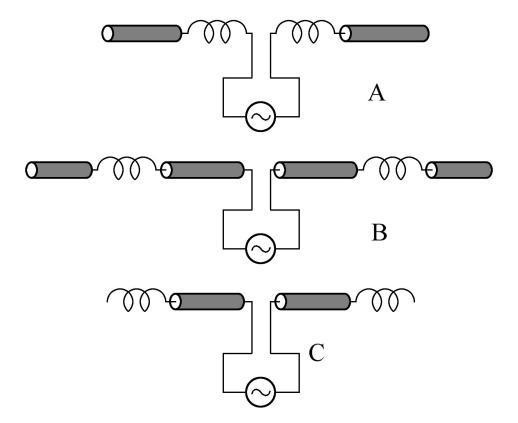
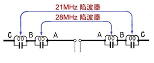
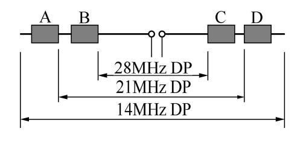
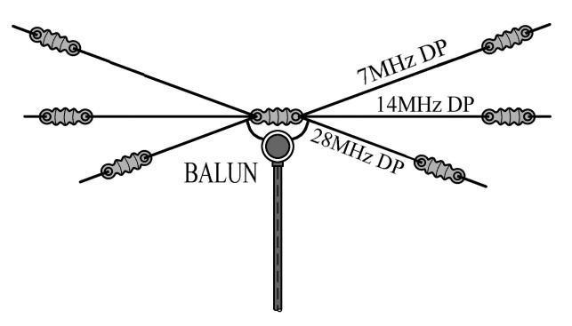
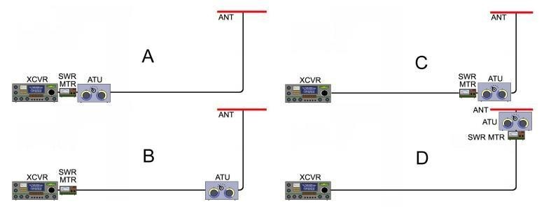

天线系统不仅指天线本身，还包括连接收发信机的馈线、阻抗匹配装置以及根据传播条件选择合适天线形式。一个良好的天线系统应保证发射机输出的射频能量尽可能多地转化为有效辐射，同时接收时能从空间背景噪声中提取出足够强的信号。

## 偶极天线与馈线系统

由半波长偶极天线和传输线构成的天线系统，其理想工作状态是 **天线上形成驻波、馈线上只有行波** 。半波偶极天线是谐振天线，振子上的电流和电压呈驻波分布，这正是它能在特定频率上高效辐射的原因；而连接收发信机的馈线则希望处于匹配状态，使电磁波以行波方式无反射地传输。如果馈线上也出现了驻波，说明天线与馈线之间存在阻抗失配，能量被反射回发信机，既浪费功率又可能损坏设备。

实际制作半波偶极天线时，振子的物理长度比理论上的 $\dfrac{\lambda}{2}$ 要短一些，这源于 **端点效应** 、绝缘子以及导线粗细带来的等效电容。工程上常用的 **缩短系数** 约为 $0.95$ 。设工作频率为 $f$（单位 $\mathrm{MHz}$ ），则单边振子的长度约为

$$
    l \approx \dfrac{71.3}{f}\,\mathrm{m}
$$

整个振子的总长度约为 $\dfrac{142.6}{f}\,\mathrm{m}$ 。若不做缩短，理论半波长为 $\dfrac{150}{f}\,\mathrm{m}$ ，因此实际制作时要按经验值截短。要提高偶极天线的谐振频率，只需把振子截短一些；反之，加长振子、在振子中串联线圈，或加装电容帽，都会使谐振频率下降。

电波在同轴电缆中的传播速度低于真空光速 $c$ ，这个比值称为 **速度因子（velocity factor）** ，等于

$$
    VF = \dfrac{1}{\sqrt{\varepsilon_r}}
$$

其中 $\varepsilon_r$ 是绝缘介质的相对介电常数。最常用的聚乙烯介质同轴电缆， $\varepsilon_r \approx 2.25\sim2.3$ ，因此速度因子约为 $0.66$ ，题目给出的经验值 $0.65$ 与之接近。同轴电缆的 $\dfrac{\lambda}{4}$ 物理长度应为自由空间 $\dfrac{\lambda}{4}$ 乘以速度因子：

$$
    l_{\mathrm{coax}} = \dfrac{75}{f}\times VF \approx \frac{48.8}{f}\,\mathrm{m}
$$

这就是制作 $\dfrac{1}{4}$ 波长同轴电缆移相器时常用的估算公式。

偶极天线在工作频点获得低输入阻抗的条件是：两臂总的 **电气长度** 为 $\dfrac{1}{2}$ 波长的整数倍。常见的情况是 $n=1$ ，即两臂总长约 $\dfrac{\lambda}{2}$ ，此时中心馈电阻抗约为 $73\,\Omega$。若总长度为 $\dfrac{1}{2}$ 波长的奇数倍，中心馈电处仍是电流腹点，阻抗较低；而偶数倍时中心处于电流节点，阻抗变得很高，不容易与 $50\,\Omega$ 馈线匹配。一般谐振偶极天线的增益在垂直于振子轴的方向达到最大，长度取 $\dfrac{\lambda}{2}$ 时方向图简单、增益适中；若振子很短，辐射电阻很小、效率低；若取 $\dfrac{3\lambda}{2}$ 等多波长长度，方向图会出现多个瓣和零点，反而不便于使用。

实际架设中，如果把水平偶极天线的馈电点从中心向一侧偏移 $\dfrac{\lambda}{8}$ ，由于离开了电流最大点，馈电处的电压分量增大、电流分量减小，输入阻抗会显著变大；但整个振子的总长度没变，谐振频率变化不大。如果通信对象在偶极天线振子轴的垂直方向上，应使两臂各为 $\dfrac{\lambda}{4}$ ，即总长度为 $\dfrac{\lambda}{2}$ ，这样最大辐射方向正好对准对方；单纯追求低 SWR 并不能保证辐射方向正确。

短波水平偶极天线或八木天线发射的仰角主要由 **天线离地面高度与波长之比** $\dfrac{h}{\lambda}$ 决定。大地相当于一面镜子，天线与其地面镜像共同形成等效二元阵，不同仰角上直射波与反射波的相位差不同。远距离通信需要低仰角，以便电波以较小的入射角投射到电离层并返回很远的地方，因此应把天线架设得较高；近距离通信则需要高仰角，使电波以较大仰角射向电离层并就近返回，这时应使用较低架设高度的水平偶极天线或端馈斜拉天线。计算特定对象的最佳仰角时，可依据电离层的大致高度、通信距离和反射跳数，用简单几何关系估算。

大地电导率对短波天线也有影响。导电性越好，地面镜像越接近理想导体，镜像电流越强，天线方向图越接近理论值；高电导率地面有利于提升天线效果。若把水平偶极天线架得很低，例如距地面约 $\dfrac{\lambda}{10}$ ，由于镜像天线靠得很近，互耦很强，馈电点阻抗会明显下降。

当架设空间受限、无法使用全尺寸振子时，可以在振子中串入 **电感线圈** 构成 **加感天线** 。通过调整线圈的电感量和位置，仍能使天线在所需频率上谐振并达到合适的馈电点阻抗；但由于线圈本身存在电阻损耗，且改变了电流分布，其辐射效率通常低于同频段的全尺寸天线。下图给出三种加感方案。

图中 A 方案的加感线圈靠近馈电点，称为 **底部加感** ；B 方案线圈位于振子中部，称为 **中部加感** ；C 方案线圈位于振子末端，称为 **顶部加感** 。沿线电流分布是馈电点最大、末端最小。线圈所在位置的电流越小，线圈电阻消耗的 $I^2R$ 功率就越少，效率越高；因此效率从高到低为 **C、B、A** 。

上图展示了一副野外常用的 $14/21/28\,\mathrm{MHz}$ 三频段偶极天线。它的基本原理是利用 **陷波器（trap）** ：一个 LC 并联回路，谐振在某个频率时对该频率呈现高阻抗，阻止该频率电流继续向外流。从馈电点看，当工作在 $28\,\mathrm{MHz}$ 时，内侧的 $28\,\mathrm{MHz}$ 陷波器谐振，电波只到达 A 段；工作在 $21\,\mathrm{MHz}$ 时，$21\,\mathrm{MHz}$ 陷波器谐振，电波到达 A+B 段；工作在 $14\,\mathrm{MHz}$ 时，陷波器都失谐呈低阻抗，电波使用 A+B+C 全段。因此各段的电气长度应满足：A 为 $28\,\mathrm{MHz}$ 的 $\dfrac{1}{4}$ 波长（单臂），A+B 为 $21\,\mathrm{MHz}$ 的 $\dfrac{1}{4}$ 波长，A+B+C 为 $14\,\mathrm{MHz}$ 的 $\dfrac{1}{4}$ 波长。图中 A、D 为 $21\,\mathrm{MHz}$ 陷波器，B、C 为 $28\,\mathrm{MHz}$ 陷波器，它们都是 **并联谐振回路** 。

另一种方法是把不同频段的偶极振子并联在同一馈电点，构成 **多频段天线** ，如上图所示。该天线在 $7\,\mathrm{MHz}$ 、 $14\,\mathrm{MHz}$ 、 $28\,\mathrm{MHz}$ 三个频段都有谐振振子；特别地， $7\,\mathrm{MHz}$ 振子在 $21\,\mathrm{MHz}$ 上以 $\dfrac{3}{2}$ 波长方式工作，也能谐振，因此这副天线可覆盖 $7\,\mathrm{MHz}$ 、 $14\,\mathrm{MHz}$ 、 $21\,\mathrm{MHz}$ 、 $28\,\mathrm{MHz}$。不谐振的振子在该频率上呈现较高阻抗，对并联总阻抗影响很小，所以总输入阻抗仍可维持在 $50\,\Omega$ 左右。

## 八木天线

**八木天线** 又称八木—宇田天线，是在一个被驱动的半波偶极天线（主振子）前后加上一个反射器和若干个引向器构成的 **定向天线** 。引向器比主振子短，反射器比主振子长；引向器所在方向即为最大辐射方向。因此现场判别八木天线发射方向的方法是：看主振子前后的辅助振子，较短的一侧为引向器，较长的一侧为反射器，最大辐射指向引向器一侧。

八木天线的 **前后比** 定义为 **主瓣辐射功率与反向辐射功率之比** ，用来衡量天线抑制后方信号的能力。它既不是前向增益与理想点源增益之比，也不是引向器与反射器的数量之比。

## 行波天线与环形天线

**行波天线** 依靠射频电流在连续的匹配导线上行进并逐渐辐射，而不是依赖谐振驻波。常见的业余行波天线有 T2FD 和 Beverage 天线。它们没有严格的自然谐振点，长度通常接近或大于一个波长，并在线路终端接有吸收电阻。电阻的作用是把到达末端而尚未辐射的少量能量吸收掉，避免反射形成驻波；大部分能量在沿线行进过程中已经辐射出去，因此并不会有一半功率被浪费。

T2FD 天线若水平部分与垂直接引线的组合呈“T”形，其有效辐射主要来自垂直部分，极化方式为 **垂直极化** 。若把 T2FD 的半边振子直立起来，也同样得到垂直极化。线极化天线的方向决定了辐射电场的方向，因此只要馈电结构使主要辐射体呈垂直状态，天线就是垂直极化的。

**环形天线** 发射的电磁波，其 **磁场分量垂直于环所在的平面** 。小型环形天线的自然谐振尺寸并不对应 $\dfrac{1}{4}$ 波长半径；若在环中串联可变电容，只能调谐抵消感抗以改变谐振点，并不能显著拓展工作带宽。 **磁场耦合可调谐环形天线** 则通过激励环与谐振环之间的磁耦合工作：调节尺寸和耦合度可获得接近 $1:1$ 的输入 SWR；谐振环中的可变电容器必须承受较高电压才能允许更大输入功率；谐振环尺寸越大，效率越高，但可调谐的最高频率越低。它并不是对电场不敏感、损失一半能量的天线。

## 近距离与野外 HF 通信

在 $100\,\mathrm{km}$ ~ $200\,\mathrm{km}$ 范围内的 HF 通信有时反而比 $300\,\mathrm{km}$ ~ $500\,\mathrm{km}$ 更困难，因为普通天波通信存在一个“跳过区”：电离层反射的落地点离发信点较远，中间区域信号较弱。要解决这个问题，可尝试 **较低频段** （白天 $40\,\mathrm{m}$ 、夜晚 $80\,\mathrm{m}$ ），或使用 **架设高度较低的水平偶极天线** 、 **端馈斜拉天线** ，以便获得高仰角的近垂直入射天波（NVIS）。在偶极天线下方加装反射器可以把主瓣压向正上方，也有利于近距通信。小尺寸磁环天线虽然便携，但不是解决近距通信最有效的简单手段。

## 天线调谐器

**天线调谐器** 俗称“天调”，其主要功能是 **把天馈系统的输入阻抗变换为发射机所需的负载阻抗** ，使发射机能在额定功率下工作。它并不能让天线本身在宽频带内都谐振，也不会因为“消耗反射功率”而使通信效果变差。调谐器通常安放在天线端附近效果最佳，这样可以把大部分馈线置于匹配状态，减少因高 SWR 造成的馈线额外损耗。

上图给出了四种天调（ATU）和驻波功率计（SWR MTR）的安装方案。理论上， **天调越靠近天线越好** ，驻波功率计也应尽量靠近天线端监测；若二者都放在机房，馈线很长且呈高 SWR 状态，传输损耗会显著增加。因此把 ATU 和 SWR 功率计都放在塔顶的方案效率最高，二者都放在机房最差；天调在塔底、功率计在机房的方案居中。

## 有效辐射功率与限值

描述天线实际辐射效果时，常用 **等效全向辐射功率（e.i.r.p.）** 和 **有效辐射功率（e.r.p.）** 。e.i.r.p. 把天线增益折算到理想点源天线，定义式为

$$
    P_{\mathrm{e.i.r.p.}} = P_{馈入} \times G_i
$$

其中 $G_i$ 是以理想点源为参考的绝对功率增益（线性值）。e.r.p. 则以半波偶极为参考，二者相差约 $2.15\,\mathrm{dB}$ ：

$$
    P_{\mathrm{e.r.p.}} = P_{馈入} \times G_d = \dfrac{P_{\mathrm{e.i.r.p.}}}{1.64}
$$

若某频段规定最大 e.i.r.p. 不得超过 $1\,\mathrm{W}$ ，则允许馈入天线的功率应为 $1\,\mathrm{W}$ 除以天线绝对增益 $G_i$ 。

> 例题：某天线增益为 $3.85\,\mathrm{dBd}$ ，馈入功率 $10\,\mathrm{W}$ ，求其等效全向辐射功率 e.i.r.p.。
>
> 先把 $\mathrm{dBd}$ 换算为 $\mathrm{dBi}$ ：
> $$
>   G_{\mathrm{dBi}} = 3.85 + 2.15 = 6.00\,\mathrm{dBi}
> $$
> 由 $6\,\mathrm{dB} = 10\log_{10}G_i$ 得
> $$
>   G_i = 10^{\dfrac{6}{10}} \approx 3.98 \approx 4
> $$
> 因此
> $$
>   P_{\mathrm{e.i.r.p.}} = 10\,\mathrm{W} \times 4 = 40\,\mathrm{W}
> $$

> 某天线增益为 $5.15\,\mathrm{dBi}$ ，馈入功率 $10\,\mathrm{W}$ ，求其有效辐射功率 e.r.p.。
>
> 先把 $\mathrm{dBi}$ 换算为 $\mathrm{dBd} $ ：
> $$
>   G_{\mathrm{dBd}} = 5.15 - 2.15 = 3.00\,\mathrm{dBd}
> $$
> 由 $3\,\mathrm{dB} = 10\log_{10}G_d$ 得
> $$
>   G_d = 10^{\dfrac{3}{10}} \approx 2.00
> $$
> 因此
> $$
>   P_{\mathrm{e.r.p.}} = 10\,\mathrm{W} \times 2 = 20\,\mathrm{W}
> $$
