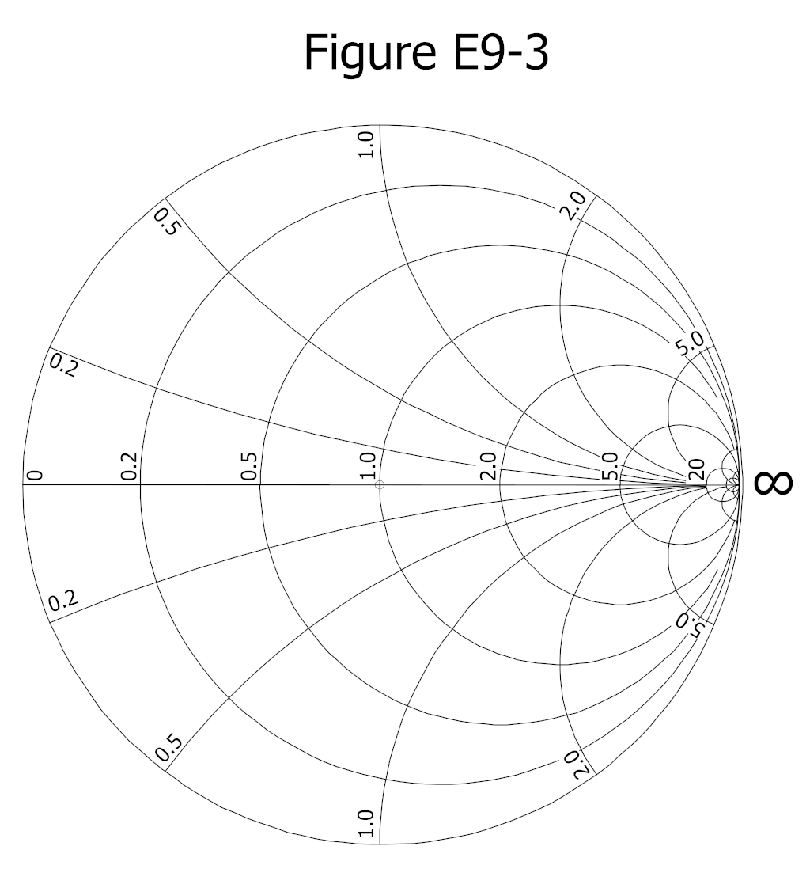
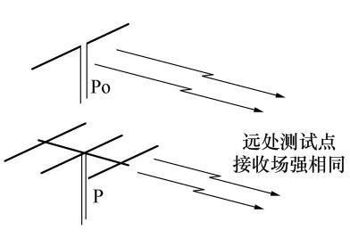

## 传输线与阻抗变换

连接电台与天线最常见的 **传输线** 有三种： **同轴电缆** 、 **平行馈线（开放式扁馈线）** 和 **波导** 。波纹软管只是保护外皮，并不是一种传输线。

同轴电缆的 **特性阻抗** $Z_0$ 由内导体外径 $d$ 、外导体内径 $D$ 和绝缘介质的相对介电常数 $\varepsilon_r$ 决定，近似公式为

$$
    Z_0 \approx \dfrac{60}{\sqrt{\varepsilon_r}}\ln\dfrac{D}{d}
$$

可见外导体内径与内导体外径之比 $\dfrac{D}{d}$ 越大，特性阻抗越高；绝缘介质的介电常数 $\varepsilon_r$ 越小，特性阻抗越高。屏蔽层的致密程度和电缆外径的粗细并不直接决定特性阻抗。

当电缆末端接上等于其特性阻抗的负载（例如 $50\,\mathrm{\Omega}$ 电缆接 $50\,\mathrm{\Omega}$ 负载）时，电缆处于 **匹配** 状态，从始端看进去的阻抗就是 $Z_0$ ，与电缆长度和频率 **无关** 。若末端 **开路** ，输入阻抗随电气长度变化：在 $\dfrac{1}{4}$ 波长的 **偶数倍** 时接近 **无穷大（开路）** ，在 $\dfrac{1}{4}$ 波长的 **奇数倍** 时接近 **零（短路）** 。若末端 **短路** ，情况正好相反：在 $\dfrac{1}{4}$ 波长的 **奇数倍** 时接近 **无穷大** ，在 **偶数倍** 时接近 **零** 。原因是传输线可等效为阻抗变换器，长度为 $\dfrac{\lambda}{4}$ 时把开路变成短路、把短路变成开路，每再增加 $\dfrac{\lambda}{4}$ 状态翻转一次。

用天线阻抗分析仪测量失配天线的阻抗时，读数会随天线与仪表之间电缆跳线的长度而变，因为跳线本身也在做阻抗变换。为了读出发射机实际“看到”的阻抗，应当使用电气长度正好等于一个波长（或整数倍）的连接电缆——这样经过整周期后输入阻抗等于负载阻抗，不受变换影响。单纯换高档接头或银线并不能消除这种由电气长度引起的读数漂移。

## 传输线进阶

**四分之一波长匹配段（Q-section）** 是一段长度恰为 $\dfrac{\lambda}{4}$ 、特性阻抗为 $Z_Q$ 的传输线，可把负载阻抗 $Z_{\mathrm{load}}$ 变换为输入阻抗 $Z_{\mathrm{in}}$ ，满足

$$
    Z_Q = \sqrt{Z_{\mathrm{load}}\, Z_{\mathrm{in}}}
$$

例如把 $100\,\Omega$ 的馈点阻抗匹配到 $50\,\Omega$ 同轴电缆，需要
$$
    Z_Q = \sqrt{100\times 50} = \sqrt{5000}\approx 70.7\,\Omega
$$
工程上取 **$75\,\Omega$** 段即可。

**空气绝缘平行馈线** 的速度因子约为 $0.95$ （高于聚乙烯同轴）。其电气长度若为 $\dfrac{1}{2}\lambda$ 、工作于 $14.10\,\mathrm{MHz}$ ，物理长度约为
$$
    l = \dfrac{300}{14.10}\times 0.95\times \dfrac{1}{2}\approx 10.1\,\mathrm{m}
$$
（工程估算取约 $10.6\,\mathrm{m}$ ）。

**微带线（microstrip）** 是在介质基板上覆铜走线形成的平面传输线，广泛用于射频电路板。同轴电缆方面， **泡沫介质同轴** 比 **实心介质同轴** 损耗更低、速度因子更高，但耐电压较低。

> 例题：把 $100\,\Omega$ 馈点阻抗用四分之一波长段匹配到 $50\,\Omega$ 电缆，该匹配段特性阻抗应取 **$75\,\Omega$** 左右（ $Z_Q=\sqrt{100\times 50}\approx 70.7\,\Omega$ ）。

一段空气绝缘平行馈线，电气长度 $\dfrac{1}{2}\lambda$ 、工作 $14.10\,\mathrm{MHz}$ ，其物理长度约 **$10.6\,\mathrm{m}$** 。

## 史密斯圆图

**史密斯圆图（Smith Chart）** 是把传输线阻抗（先 **归一化** 到系统特性阻抗 $Z_0$ ）画在复平面上的专用图，便于做阻抗、驻波比与匹配计算：

- 圆图最外圈的大圆是 **电抗轴（reactance axis）** ，代表纯电抗边界；
- 图中 **唯一的一条直线** 是水平直径，即 **电阻轴（resistance axis）** ；
- 以圆心为中心的一族同心圆是 **恒定 SWR 圆** ，圆图上还标有 **波长刻度** ；
- “归一化”指把圆心处的阻抗值重新定义（赋为系统特性阻抗），从而可直接读取相对值；
- 借助圆图可求得使负载与馈线匹配的 **短截线（stub）长度与位置** 。

图 E9-3 史密斯圆图最外圈是 **电抗轴（reactance axis）** 。

同一张图里，唯一的直线（水平直径）是 **电阻轴（resistance axis）** 。

史密斯圆图的“归一化”是指把 **圆心处的阻抗值重新设定为系统的特性阻抗** ，以便用相对值读图。

## 电磁波与自由空间传播

变化的电场产生位移电流，在周围激发变化的磁场；这个磁场又在稍远处激发变化的电场，如此循环往复，便形成向远方传播的 **电磁波** 。电磁波由 **电场** 和 **磁场** 两个分量构成，而电压、电流、阻抗、功率都不是它的组成成分。要发生辐射，场源必须是某种 **开放系统** （如天线），封闭在导体内或封闭腔体里的电磁场不会向自由空间辐射。

在真空中，电磁波的传播速度等于光速，约为 $3\times10^8\,\mathrm{m/s}$ 。电磁波每经过一个周期向前推进的距离称为 **波长（wavelength）** $\lambda$ ；单位时间内电磁场重复改变的次数称为 **频率（frequency）** $f$ ；相邻两次重复之间的时间间隔称为 **周期（period）** $T$ 。三者关系为

$$
    f = \dfrac{n}{\tau},\qquad T = \dfrac{1}{f},\qquad \lambda = \dfrac{c}{f}
$$

已知频率（单位 $\mathrm{MHz}$ ）求波长（单位 $\mathrm{m}$ ）的常用估算是

$$
    \lambda\,\mathrm{(m)} \approx \dfrac{300}{f\,\mathrm{(MHz)}}
$$

频率越高，在相同场强下位移电流越强，场源辐射的能量越多，因此高频天线一般更容易获得增益，但高频电波在自由空间中的路径损耗也更大。

电波在自由空间传播时会随距离增加而发散，接收功率的减弱遵循 **距离平方** 和 **频率平方** 规律：路径损耗（功率比形式）与 $d^2$ 成正比、与 $f^2$ 成正比。用分贝表示，自由空间路径损耗为

$$
    L = 32.4 + 20\log_{10}(d) + 20\log_{10}(f)
$$

其中 $d$ 单位为 $\mathrm{km}$ ，$f$ 单位为 $\mathrm{MHz}$。由分贝式可以看出：在频率一定时，距离增大到 $N$ 倍，损耗（功率比）增大约为 $N^2$ 倍（折算成分贝为增加 $20\log_{10}N$ ）；在距离一定时，频率增大到 $N$ 倍，损耗同样增大约为 $N^2$ 倍。

> 例题：甲乙两台相距 $100\,\mathrm{km}$ ，均用 $0\,\mathrm{dBi}$ 天线、工作于 $145\,\mathrm{MHz}$ ，发射功率 $1\,\mathrm{W}$ 时接收信号约 $-115.6\,\mathrm{dBm}$ 。现将距离增加到 $500\,\mathrm{km}$ ，求接收功率。
>
> 距离变为 $5$ 倍，损耗增量为
> $$
>   \Delta L = 20\log_{10}5 \approx 14\,\mathrm{dB}
> $$
> 因此接收功率变为
> $$
>   -115.6 - 14 = -129.6\,\mathrm{dBm}
> $$

> 例题：仍取上述条件，距离增加到 $1000\,\mathrm{km}$ （ $10$ 倍），接收功率变为？
>
> $$
>   \Delta L = 20\log_{10}10 = 20\,\mathrm{dB}
> $$
> $$
>   -115.6 - 20 = -135.6\,\mathrm{dBm}
> $$

> 例题：仍取上述条件，保持 $100\,\mathrm{km}$ 不变，频率改为 $435\,\mathrm{MHz}$ （ $3$ 倍），接收功率变为？
>
> $$
>   \Delta L = 20\log_{10}3 \approx 9.5\,\mathrm{dB}
> $$
> $$
>   -115.6 - 9.5 \approx -125.1\,\mathrm{dBm}
> $$

> 例题：仍取上述条件，保持 $100\,\mathrm{km}$ 、 $145\,\mathrm{MHz}$ 不变，发射功率降为 $0.25\,\mathrm{W}$ （即原来的 $\dfrac{1}{4}$ ），接收功率变为？
>
> 功率降低 $\dfrac{1}{4}$ 对应
> $$
>   \Delta = 10\log_{10}0.25 \approx -6\,\mathrm{dB}
> $$
> $$
>   -115.6 - 6 = -121.6\,\mathrm{dBm}
> $$

收信机的信号强度指示（S 表）从 $S_1$ 到 $S_9$ 每升高一档对应约 $6\,\mathrm{dB}$ 的功率变化，因此上述分贝差可以直接折算成 S 档变化。

> 例题：仍取上述条件，$S_8$ 信号，距离从 $100\,\mathrm{km}$ 增至 $500\,\mathrm{km}$（ $5$ 倍，损耗增大约 $14\,\mathrm{dB} \approx 2.3$ 档）。接收信号报告变为？
>
> $$
>   S_8 - 2.3 \approx S_{5.7}
> $$
> 即略低于 $S_6$ 。

> 例题：上述条件，$S_8$ 信号，距离增至 $1000\,\mathrm{km}$ （ $10$ 倍，损耗增大 $20\,\mathrm{dB} \approx 3.3$ 档），信号报告变为？
>
> $$
>   S_8 - 3.3 \approx S_{4.7}
> $$
> 即略低于 $S_5$ 。

> 例题：上述条件，$S_8$ 信号，频率改为 $435\,\mathrm{MHz}$ （ $3$ 倍，损耗增大约 $9.5\,\mathrm{dB} \approx 1.6$ 档），信号报告变为？
>
> $$
>   S_8 - 1.6 \approx S_{6.4}
> $$
> 即略高于 $S_6$ 。

> 例题：上述条件， $S_8$ 信号，发射功率降为原来的 $\dfrac{1}{4}$ （$-6\,\mathrm{dB} = 1$ 档），信号报告变为？
>
> $$
>   S_8 - 1 = S_7
> $$

> 例题：发射功率 $100\,\mathrm{W}$ 收到 $S_8$ ，现降到 $25\,\mathrm{W}$ （ $\dfrac{1}{4}$ ， $-6\,\mathrm{dB} = 1$ 档），信号报告变为 $S_7$ 。

> 例题：发射功率 $80\,\mathrm{W}$ 收到 $S_8$ ，现降到 $5\,\mathrm{W}$ ，功率比 $\dfrac{5}{80} = 0.0625$ ，对应
> $$
>   \Delta = 10\log_{10}0.0625 \approx -12\,\mathrm{dB} \approx 2\mathrm{档}
> $$
> 信号报告变为 $S_6$ 。

## 波阻抗、远场与天线增益测量

在自由空间传播的平面电磁波中，电场 $E$ 与磁场 $H$ 之比称为 **波阻抗** $Z = \dfrac{E}{H}$ ；传播过程中 $Z$ 近似为常数，已知其中一个分量即可推算另一个。波从馈线进入发射天线馈电点时的阻抗，是天线自身的输入阻抗，并不是“波阻抗”，二者不可混淆。

“场强与到辐射源距离的平方成反比”这条规律只适用于 **远区场（far field）** ，即距离辐射源约 $10\lambda$ 及以上的区域；在更近的近场区并不成立。实地用 **场强计** 比较不同全向垂直天线的辐射效果时，测试地点必须选在远场区，离天线至少约 $10\lambda$ 以上，否则测到的主要是近场，不能代表真实辐射能力。

测量一副天线的增益可以采用 **比较替代法** ：在开阔场地的同一接收点，分别用待测天线和作为标准的半波偶极天线接收同一信源，调整送往两副天线的功率 $P_o$ （标准天线）与 $P$ （待测天线），使收到的场强相等。因为场强相同意味着有效辐射功率相同，待测天线相对于半波偶极的增益（ $\mathrm{dBd}$ ）为

$$
    G_{\mathrm{dBd}} = 10\log_{10}\left(\dfrac{P_o}{P}\right)
$$

若以理想点源为参考求 $\mathrm{dBi}$ 值，则再加上半波偶极的 $2.15\,\mathrm{dBi}$ 基准，即 $10\log_{10}\left(\dfrac{P_o}{P}\right) + 2.15$ 。待测天线所需功率 $P$ 越小，说明它增益越高。（ $\mathrm{dBd}$ 与 $\mathrm{dBi}$ 的定义及二者 $2.15\,\mathrm{dB}$ 换算基准，详见《天线、馈线与极化》的“天线增益、dBd 与 dBi”。）

> 例题：业余条件下测试天线增益的典型方法如下图所示。用场强表或接收机接收设置在远处同一地点、最大辐射方向朝向自己的半波偶极天线（上）和待测天线（下）的信号。调整送至两副天线的射频功率 $P_o$ 和 $P$ ，使收到的场强相同。求待测天线相对半波偶极的增益（ $\mathrm{dBd}$ ）以及相对理想点源的增益（ $\mathrm{dBi}$ ）。
>
> 
>
> 由上文“比较替代法”的结论，同一接收点场强相等即两副天线的有效辐射功率相等，因此待测天线相对半波偶极的增益（ $\mathrm{dBd}$ ）为
> $$
>   G_{\mathrm{dBd}}=10\log_{10}\left(\dfrac{P_o}{P}\right)
> $$
> 即增益（ $\mathrm{dBd}$ ）值为 $10\log\left(\dfrac{P_o}{P}\right)$ 。
>
> 换算为相对理想点源（ $\mathrm{dBi}$ ）只需在上式的 $\mathrm{dBd}$ 基础上再加 $2.15$ ：
> $$
>   G_{\mathrm{dBi}}=10\log_{10}\left(\dfrac{P_o}{P}\right)+2.15
> $$
> 即增益（ $\mathrm{dBi}$ ）值为 $10\log\left(\dfrac{P_o}{P}\right)+2.15$ 。

## 地波、天波与电离层传播

按传播形式，无线电波可分为 **地面波（地波）** 、 **天波（经电离层反射）** 、 **空间波（直射/视距）** 和 **散射波** 。地面波沿地面传播，其特性取决于 **电波频率、大地电导率以及传播距离** ：频率越低、大地电导率越高（如海面），地波衰减越小、传得越远；频率很高时空间波与天波占主导，地波作用范围有限。

短波（High Frequency，HF）能够远距离通信，主要依靠 **电离层** 对电波的反射。电离层是大气高层被太阳紫外线和 X 射线电离出自由电子的区域，从低到高主要有 **D、E、F1、F2** 各层。其中 **F2 层离子密度最高** ，是日间和夜间都最重要的反射层； **F1** 层在白天出现； **E** 层高度约 $100\,\mathrm{km}$ ，夏季白天会出现局部的 **突发 E 层（sporadic E）** ； **D 层** 一般不反射短波，但会 **吸收** 电波能量，且这种吸收对低频段更明显。

在短波天波通信中，天波从电离层反射的落地点离发射台有一定距离，而地波又只能覆盖很近的范围，于是中间会出现一段 **静寂区（skip zone，也称越距区）** ——天波、地波和空间波都未能覆盖的区域，信号很弱甚至收不到。静寂区内虽然收不到正常天波，但仍有少量电波经电离层的 **散射（scatter）** 被"抛"回来，称为 **HF 散射**——散射信号通常 **很弱**，且因经多条路径到达而 **带有颤动声、听感失真**；这正是发信台自己的跳区内偶尔还能听到微弱信号的原因。

**衰减（attenuation）** 指信号通过信道或电路后功率的减少，是一个相对静态的量； **衰落（fading）** 指信号经过信道后幅度随时间发生起伏，是动态变化。短波天波经电离层多次反射后，信号的 **极化特性会随时间随机改变** ，不同的 **频率成分也会随时间随机衰落** （即选择性衰落）。用 SDR 观察 2FSK 这类数据信号时，两个本应幅度相等的谱峰高度在随机变化，正是因为 **电离层的选择性衰落** 。因此依靠天波反射进行远距离通联时，收发天线的最佳极化方式是不确定的——信号的极化在传播中已被随机改变，不必强求水平或垂直；把一方从水平偶极改成垂直偶极，通信效果的变化同样不确定。

影响电离层短波传播特性的主要因素有： **太阳黑子活动、太阳耀斑和地磁活动** ； **季节与昼夜变化** ；以及 **工作频率和通信距离** 。太阳黑子平均数（Sunspot Number，SSN）越大，电离层越活跃，越有利于短波 DX 通信。

**最高可用频率（MUF）** 指地球上两点间通过天波能建立联络的最高频率；通常夜间 MUF 降低、白天显著升高。若已知某路径 MUF 为 $20\,\mathrm{MHz}$ ，则最有可能成功的业余频段是略低于该值的 $18\,\mathrm{MHz}$ 波段，而 $21\,\mathrm{MHz}$ 已超出 MUF、反射困难。按高度从高到低排列电离层为 **F2、F1、E、D** ；若按离子密度从高到低，同样是 **F2、F1、E、D** （F2 密度最高）。电离层对短波传播的主要作用体现为：F2、F1、E 层反射电波，D 层不反射但吸收电波。与 MUF 相对的是 **最低可用频率（LUF）**——两点间能建立天波联络的**最低**频率；频率若低于 LUF，信号会在到达目的地前被 D 层等**过度吸收而衰减掉**，无法建立联络。若某路径 LUF 高于 MUF，则该路径上**普通天波传播无法进行**；实际通联应选在 **MUF 与 LUF 之间、略低于 MUF** 的频率，衰减最小。电离层反射还有两个阈值概念：**临界频率** 指垂直向上发射时**能被电离层折射回地面的最高频率**（高于它则穿透电离层进入太空）；**临界角** 指在特定电离层条件下**能返回地面的最高仰角**（仰角再高便穿透）。就单跳距离而言，F2 区最高，其**单跳反射最大距离约 4000 千米**；E 区单跳最大约 **2000 千米**。

**灰线（gray line）** 指地球上白昼与黑夜交汇的晨昏线区域。当通信双方同时位于灰线附近时，最有可能利用天波的多跳反射路径建立联络，因此业余无线电爱好者常借助灰线进行 $1.9\,\mathrm{MHz}$ 、 $3.5\,\mathrm{MHz}$ 等低频段 DX 通信。若尝试用 **长路径（long path）** 联络某台，应把定向天线指向短路径方向的反方向。

## 传播预测参数

做短波电离层传播预测需要的基本参数有： **太阳黑子平均数（SSN）** 、 **地磁活动指数** 、 **通信双方的位置** 以及 **通信时间** 。反映太阳活动常用的 **F107 参数** 是太阳 $10.7\,\mathrm{cm}$ 波长射电辐射通量指数，其数值大体在 $50$ ~ $300$ 之间波动；数值越大，安静太阳辐射越强、电离层密度越大，越有利于 F 层反射 DX 信号。太阳通量的最低值可取约 $50$ ，最高值可取约 $300$ 。

反映地磁活动程度的常见指标是 **A 指数** 和 **K 指数** ，其中 **K 指数的取值范围为 $0$ ~ $9$** 。太阳黑子活动的平均周期约为 $11.2\,\mathrm{年}$ ，每个周期活跃程度有所差异而非完全相同。太阳耀斑会引发电离层扰动（Sudden Ionospheric Disturbance，SID），对短波通信的影响是 **低频段比高频段更严重** 。太阳耀斑发出的 **紫外线和 X 射线** 以光速传播，约 **8 分钟** 即可到达地球并影响电离层；而 **日冕物质抛射** 抛出的带电粒子流速度较慢，需约 **15 小时到数天** 才到达并引发地磁扰动。太阳表面各层**绕轴自转**，使面向地球的活跃区周期性变化，故 HF 传播条件呈现约 **26～28 天** 的周期起伏；太阳 **冕洞** 喷出的高速带电粒子到达地球后会**扰乱 HF 通信**。地磁暴除产生极光外，还会使 **高纬度地区的 HF 传播变差**。当同一信号经 **短路径与长路径** 同时到达时，长路径因走更远的弧而**略有延迟**，会在信号后听到一个 **稍延迟的回声**。

## 大气与环境因素

在毫米波与亚毫米波等极高频率，大气中存在若干 **吸收频带** （如约 $60\,\mathrm{GHz}$ 、 $120\,\mathrm{GHz}$ 、 $183\,\mathrm{GHz}$ 附近），电波衰减很大，因此某些高频段（例如 $122.25\,\mathrm{GHz}$ ~ $123\,\mathrm{GHz}$ ）虽然划分给业余业务，却剔除卫星业余业务，因为不适合地面至空间的卫星链路。就降雨而言，受影响最严重的是 **极高频 EHF（毫米波）** ，而 HF、LF、UHF 受影响依次更小。关于植被对电波的吸收，大体规律是 **频率越高，吸收越多** 。

## 特殊传播与空间天气

除常规地波、天波、视距传播外，业余无线电还会遇到一些特殊机制：

- **EME（月面反射）** ：信号经月球表面反射实现超远距离联络；地面站间最大距离约 $12000$ 英里（约 $2\times10^4\,\mathrm{km}$ ），在月球近地点时路径损耗最小；月球的天平动会造成 **天平动衰落（libration fading）** 。
- **极光传播（aurora）** ：强烈地磁暴使极区电离层出现不规则结构，可反射 VHF 信号；这种通路失真大， **CW（等幅报）** 效果最好。
- **跨赤道传播（Trans-Equatorial Propagation，TEP）** ：某些夜间赤道上空 F 层异常，可实现跨赤道的超远距离通信。
- **弦跳（chordal hop）** ：电波在电离层间连续折射、中途不经地面反射，损耗小于多次“电离层—地面”多跳。
- **寻常波 / 异常波（ordinary / extraordinary waves）** ：电离层中的地磁场使线极化电波分裂成两个旋向相反的圆极化分量，传播特性不同。
- **长路径（long path）** ：与通常的短路径方向相反的另一半圆弧路径，在 $40\,\mathrm{m}$ 、 $20\,\mathrm{m}$ 等波段较常见。

反映空间天气、帮助判断传播条件的常用参数：

- **Bz** ：行星际磁场的南北分量； **南向（负 Bz）** 时更易引发地磁扰动；
- **地磁暴分级** ：如 **G5** 表示极端地磁暴；
- **$304\mathop{\mathrm{\AA}}$ 参数** ：太阳紫外辐射强度的一种度量，与太阳射电流量指数相关；
- **VOACAP** ：常用的 HF 传播预测软件，可估算两点间各频率的可通联概率。
- **微波大气波导** 常在大片 **水体** 上空形成，典型传播距离约 **100～300 英里**（约 160～480 千米）。
- **流星余迹** 是流星撞击大气时在 **E 层** 留下的电离痕迹，最适合 **28～148 兆赫** 频段的短暂散射通信。
- 电磁波在介质中的传播速度由该介质的 **折射率** 决定（折射率越大、速度越慢）。
- **地波** 传播适合 **垂直极化**；把发射仰角 **降低**，每跳覆盖的距离会 **增大**； **160 米波段** 的长距离传播通常发生在 **整条路径都处于黑夜** 时。
- 空间天气补充： **A/K 指数升高** 时，**极光椭圆带** 上的路径吸收最强；太阳耀斑强度等级中 **X 级** 最强；业余传播报告网络上报的是 **数字模式与 CW 信号** 的接收情况；若 HF 全频段背景噪声突然整体升高，往往意味着发生了 **太阳耀斑或日冕物质抛射**。

比较若干频段， **$5.8\,\mathrm{GHz}$** 的第一菲涅尔区最小（频率越高，菲涅尔区半径越小，见前文“第一菲涅尔区”）。

## 传输线与波导

一段长度为 **$\dfrac{\lambda}{4}$ 的传输线** 具有 **阻抗变换** 作用： **短路线（远端短路）的 $\dfrac{\lambda}{4}$ 段对源呈现很高阻抗** ， **开路线（远端开路）的 $\dfrac{\lambda}{4}$ 段则呈现很低阻抗** ；而长度为 **$\dfrac{\lambda}{2}$ 的线段不改变阻抗性质** ——开路的 $\dfrac{\lambda}{2}$ 段仍呈高阻抗、短路的 $\dfrac{\lambda}{2}$ 段仍呈低阻抗。利用这一特性可做阻抗变换或制作谐振陷波。

**波导（waveguide）** 是空心金属管，常用于 **$3\,\mathrm{GHz}$ 以上** 的微波频段。它像一个 **高通滤波器** ：只有高于截止频率（对应截面尺寸约 $\dfrac{\lambda}{2}$ 以上）的模式才能传播，低于截止频率则迅速衰减；正因如此，波导在微波下 **损耗很低** ，优于同轴线。矩形波导的截面至少约 **$\dfrac{\lambda}{2}$** 才能传输。与之相比，印刷电路上的 **微带线（microstripline / stripline）** 虽然轻便，但 **屏蔽不如同轴电缆好** ，更易向外辐射或受干扰。

