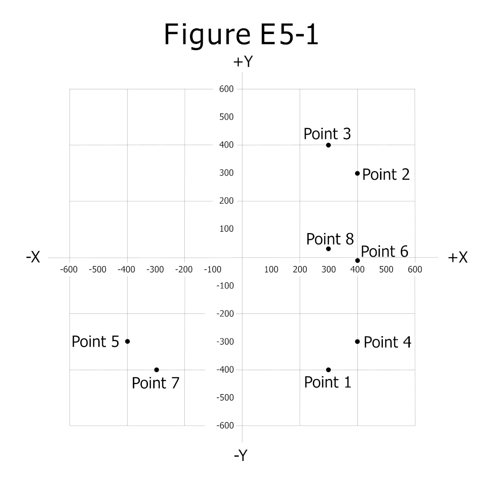

已知电阻负载上的电压 $U$ 、电流 $I$ 、电阻 $R$ 、功率 $P$ ，它们之间的基本关系可相互导出：

$$
    I = \dfrac{U}{R},\qquad U = IR,\qquad R = \dfrac{U}{I},\qquad P = UI = I^2R = \dfrac{U^2}{R}
$$

由此还能推出：已知 $U$ 与 $P$ 时，$R = \dfrac{U^2}{P}$ 、 $I = \dfrac{P}{U}$ 。

**并联** 电路中各支路电压相同。若 $R_1 = N\cdot R_2$ ，则 $I_1 = \dfrac{I_2}{N}$ 、 $P_1 = \dfrac{P_2}{N}$ ，而两端电压相等。 **串联** 电路中电流处处相同。若 $R_1 = N\cdot R_2$ ，则 $U_1 = N\cdot U_2$ 、 $P_1 = N\cdot P_2 $。

两个设备工作电压相同，若 A 消耗功率是 B 的 $N$ 倍，由 $P=UI$ 知 $I_A = N\,I_B$；反过来若 A 的电流是 B 的 $N$ 倍，则 $P_A = N\,P_B$ 。

把 $N$ 个相同电阻 **串联** 到原电源上（与每个单独接电源相比）：总阻值变为 $N$ 倍，每个电阻上的电流减到 $\dfrac{1}{N}$ ，电压减到 $\dfrac{1}{N}$ ，功率减到 $\dfrac{1}{N^2}$ 。把 $N$ 个相同电阻 **并联** ：每个电阻仍承受原电压、电流不变，每个功率不变，而总功率为单个的 $N$ 倍。

若把电阻负载两端电压提高 $n\%$ ，则功率按平方关系变化：新功率为原来的 $\left[\dfrac{100+n}{100}\right]^2$ 倍；降低 $n\%$ 则为 $\left[\dfrac{100-n}{100}\right]^2$ 倍。

## 交流信号的有效值、平均值与发热

衡量交流信号大小有两个常用指标： **有效值（Root Mean Square，RMS）** 是“能在同一电阻上产生相同热量的等效直流值”，即瞬时值平方的平均值再开方； **平均值** 通常指一个完整周期内波形的代数值平均，对于以零为中心对称的交变波形，其完整周期平均值为 **0** 。

对正弦波，峰值 $V_p$ 、峰峰值 $V_{\mathrm{pp}}=2V_p$ 、有效值三者关系为

$$
    V_{\mathrm{rms}} = \dfrac{V_p}{\sqrt{2}} = \dfrac{V_{\mathrm{pp}}}{2\sqrt{2}}
$$

> 例题：峰峰值为 $100\,\mathrm{V}$ 的正弦波，其有效值 $V_{\mathrm{rms}} = \dfrac{100}{2\sqrt{2}} \approx 35.4\,\mathrm{V}$ ；峰值为 $100\,\mathrm{V}$ 的正弦波，其有效值 $V_{\mathrm{rms}} = \dfrac{100}{\sqrt{2}} \approx 70.7\,\mathrm{V}$ 。

> 例题：峰峰值为 $340\,\mathrm{V}$ 的正弦波，其有效值 $V_{\mathrm{rms}} = \dfrac{340}{2\sqrt{2}} \approx 120\,\mathrm{V}$ ；峰值 $20\,\mathrm{V}$ （ $100\,\mathrm{Hz}$ ）的正弦波，其有效值 $V_{\mathrm{rms}} = \dfrac{20}{\sqrt{2}} \approx 14.14\,\mathrm{V}$ 。

对于方波与三角波，要注意 **有效值不等于平均值** ：一个在 $\pm A$ 之间摆动的对称方波，有效值就等于幅度 $A$ （平均值仍为 $0$ ）；一个从 $0$ 到 $2A$ 的单极性方波（ $50\%$ 占空比），其平均值是 $A$ 、有效值是 $A\sqrt{2}$ 。三角波的有效值更小，对称三角波（峰幅 $A$ ）有效值为 $\dfrac{A}{\sqrt{3}}$ 。

电阻发热只取决于加在其上的电压 **有效值** 的平方（ $P=\dfrac{U^2}{R}$ ），与波形形状无关，因此可以比较不同电源驱动同一电阻时的发热：

> 例题：用 $120\,\mathrm{V}$ 蓄电池（直流）与 **峰值** $120\,\mathrm{V}$ 的交流变压器分别驱动相同电阻：交流的有效值只有 $\dfrac{120}{\sqrt{2}}\approx 84.9\,\mathrm{V}$ ，功率为蓄电池的 $\left(\dfrac{84.9}{120}\right)^2 = \dfrac{1}{2}$ ，故蓄电池驱动的电阻发热约为交流侧的 **$2$ 倍** 。

> 例题：改用 **有效值** $120\,\mathrm{V}$ 的交流变压器时，双方有效值相同，发热 **相同** 。

> 例题：若有效值 $120\,\mathrm{V}$ 的交流再串联一只二极管做半波整流，只有半个周期通过，平均功率减半，于是蓄电池侧发热又约为整流侧的 **$2$ 倍** 。

> 例题：若有效值 $120\,\mathrm{V}$ 交流经带电容滤波的全波整流，滤波后的直流近似等于交流峰值 $120\sqrt{2}\approx 170\,\mathrm{V}$ ——但当题目中交流本就以“峰值 $120\,\mathrm{V}$ ”给出时，滤波后得到约 $120\,\mathrm{V}$ 直流，与 $120\,\mathrm{V}$ 蓄电池发热 **大致相同** 。

> 例题：用有效值同为 $120\,\mathrm{V}$ 的 $50\,\mathrm{Hz}$ 正弦与 $10\,\mathrm{kHz}$ 方波分别驱动同一电阻，因有效值相同，发热 **大致相同** （纯电阻对频率与波形不敏感）。

## 电容、电感与电抗

**电容** 是以 **电场** 形式储存能量的元件， **电感（线圈）** 是以 **磁场** 形式储存能量的元件；电阻只消耗能量、不储存。给导线通入电流，其周围就会伴随 **电磁场** ：磁场呈同心圆环绕导线（方向可由左手定则判断，即让磁感线穿入手心、四指指向电流方向，拇指即指出磁场环绕方向）；而电容两极板之间则存在 **静电场** 。储存在这些场中的能量属于 **势能** 。通电导线的磁场强度 **随距离增大而减弱**；两根导线 **平行且相互紧贴** 时耦合最强；线圈中感应电压最大发生在 **电流（磁通）变化最快** 的时刻；永久磁铁通常用 **硬磁材料** 制作。在正弦交流下，流过电容的电流大小与电压和电容量都成正比（ $I = U\cdot 2\pi f C$ ），其阻碍作用用电容 **容抗** 表示：

$$
    X_C = \dfrac{1}{2\pi f C}
$$

频率提高 $N$ 倍，容抗减小到原来的 $\dfrac{1}{N}$ 。流过电感的电流与电压成正比、与电感量成反比（ $I = \dfrac{U}{2\pi f L}$ ），其阻碍作用用 **感抗** 表示：

$$
    X_L = 2\pi f L
$$

频率提高 $N$ 倍，感抗增大到原来的 $N$ 倍。实际电感还带有分布电容，存在一个 **自谐振频率**：低于它时呈感性，**高于自谐振频率后整体呈容性**，不再是电感。

## 相位关系与 RC / RL 瞬态过程

**相位差** 描述频率相同的两个周期信号在时间上的超前或滞后：相差 $180\degree$ 的偶数倍为 **同相** 、奇数倍为 **反相** ，相差 $90\degree$ 互为 **正交** 。信号通过含电感或电容的电路时，电压与电流不再同相；无线电波相互叠加时会同相相长、反相相消。

两个幅度相等的正弦电压源串联：相差 $360\degree$ （即同相）时叠加为幅度 $2$ 倍、相位不变；相差 $180\degree$ 时完全抵消为 $0$；相差 $90\degree$ 时合成为幅度 $\sqrt{2}\approx 1.41$ 倍、相位各偏转 $45\degree$ 的正弦波。

具体相位关系： **电容** 中电流 **超前** 电压 $90\degree$ （电压落后电流 $90\degree$ ）； **电感** 中电流 **落后** 电压 $90\degree$ （电压超前电流 $90\degree$ ）。

把电阻与电容（或电感）构成回路突然接入直流时，会出现指数规律的瞬态过程，其特征时间由 **时间常数 $\tau$** 决定：RC 电路 $\tau = RC$ ，RL 电路 $\tau = \dfrac{L}{R}$ 。经过一个 $\tau$ ，按指数变化的过程大约完成 $63\%$（剩余量约为 $37\%$）；经过 **两个时间常数（ $2\tau$ ）** 约完成 **$86.5\%$**（剩余约 $13.5\%$）。

RC 串联突然接到直流电压 $U$ ：电容电压从 $0$ 按指数逐渐升到 $U$ （ $\tau$ 后约 $63\%$ ）；电阻电压则从 $U$ 突跳到 $0$ 后再按指数降到 $0$ （ $\tau$ 后约 $37\%$ ）；电流从 $\dfrac{U}{R}$ 突跳后按指数降到 $0$ 。断开已充电回路时，电容与电阻电压、电流都从原有值按指数衰减到 $0$ 。

RL 串联突然接到直流电压 $U$ ：电感电压从 $U$ 突跳到 $0$ 后再按指数降到 $0$ （ $\tau$ 后约 $37\%$ ）；电阻电压与回路电流从 $0$ 按指数升到 $U$ 与 $\dfrac{U}{R}$ （ $\tau$ 后约 $63\%$ ）。

电感之所以“抗拒”电流变化，根源是 **反电动势（back EMF）** ：线圈中电流变化时，变化的磁场会感应出一个方向 **与原电动势相反** 的电压来阻碍这种变化，这正是电感电流不能突变、只能按 $\tau=L/R$ 的指数规律逐渐建立的原因。

经过 $n$ 个时间常数后，充放电完成的程度由指数函数给出：电容电压充到 $V(1-e^{-n})$ 、放掉到 $V e^{-n}$ 。所以经过 **$2\tau$** ，电容约充到 **$86.5\%$** （ $1-e^{-2}\approx0.865$ ）、放电剩约 **$13.5\%$** （ $e^{-2}\approx0.135$ ）；经过 **$5\tau$** 已充到约 **$99.3\%$** ，可视为基本完成。

> 例题：一个 $100\,\mu\mathrm{F}$ 电容与 $470\,\mathrm{k}\Omega$ 电阻串联，时间常数
> $$
> \tau = RC = 470\times10^3 \times 100\times10^{-6} = 47\,\mathrm{s}
> $$
> 约 $47\,\mathrm{s}$ 后电容电压升到约 $63\%$ ，约 $94\,\mathrm{s}$ （ $2\tau$ ）后升到约 $86.5\%$ 。

## 时间常数的并联组合

多个相同性质的元件并联时，总电容（或总电导）相加、总电阻减半。RC 并联电路的时间常数仍用 $\tau = R_{\mathrm{tot}}C_{\mathrm{tot}}$ 计算。

> 例题：电路含 **两只 $220\,\mu\mathrm{F}$ 电容** 与 **两只 $1\,\mathrm{M}\Omega$ 电阻** ，全部并联：总电容 $C=440\,\mu\mathrm{F}$ ，总电阻 $R=0.5\,\mathrm{M}\Omega$ ，
> $$
> \tau = RC = 0.5\times10^6 \times 440\times10^{-6} = 220\,\mathrm{s}
> $$

## 复阻抗、导纳与相量图

交流电路里同时含有电阻、电容、电感时，对电流的整体阻碍作用称为 **阻抗** $Z$ （单位 $\Omega$ ）。它可分解为实部与虚部：

$$
    Z = R + jX
$$

其中 **电阻 $R$** 是实部（与电流同相）， **电抗 $X$** 是虚部。约定 **感抗取正** （ $+jX_L$ ）、 **容抗取负** （ $-jX_C$ ）。一个串联 RLC 电路的阻抗因此写作

$$
    Z = R + j(X_L - X_C)
$$

其幅值与相角为

$$
    |Z| = \sqrt{R^2 + (X_L-X_C)^2},\qquad \varphi = \arctan\!\left(\dfrac{X_L-X_C}{R}\right)
$$

把阻抗画成“电阻为横轴、电抗为纵轴”的向量，就得到 **相量图** 。阻抗的倒数称为 **导纳** $Y=\dfrac{1}{Z}$ （单位西门子 $\mathrm{S}$ ），电抗的倒数称为 **电纳** $B=\dfrac{1}{X}$ ；对串联电路先求 $Z$ 再取倒数即得 $Y$ ，对并联支路则常先求各支路导纳再相加。

> 例题：一个由 **$400\,\Omega$ 电阻** 与 **$38\,\mathrm{pF}$ 电容** 串联、工作于 **$14\,\mathrm{MHz}$** 的电路：
> $$
> X_C=\dfrac{1}{2\pi f C}=\dfrac{1}{2\pi\times 14\times10^6\times 38\times10^{-12}}\approx 299\,\Omega
> $$
> 故 $Z=400-j299$ ，落在复平面第四象限（电阻正、容抗负），对应阻抗坐标图（图 E5-1）中的 **第 4 点** 。
> 

> 例题：一个由 **$300\,\Omega$ 电阻** 与 **$18\,\mu\mathrm{H}$ 电感** 串联、工作于 **$3.505\,\mathrm{MHz}$** 的电路：
> $$
> X_L=2\pi f L=2\pi\times 3.505\times10^6\times 18\times10^{-6}\approx 396\,\Omega
> $$
> 故 $Z=300+j396$ ，落在第一象限，对应图 E5-1 中的 **第 3 点** 。
> 

> 例题：一个由 **$300\,\Omega$ 电阻** 与 **$19\,\mathrm{pF}$ 电容** 串联、工作于 **$21.200\,\mathrm{MHz}$** 的电路：
> $$
> X_C=\dfrac{1}{2\pi\times 21.2\times10^6\times 19\times10^{-12}}\approx 395\,\Omega
> $$
> 故 $Z=300-j395$ ，落在第四象限，对应图 E5-1 中的 **第 1 点** 。
> 

## RLC 串联电路的合成相位角

串联 RLC 中，电压与电流的相位差由净电抗决定：

$$
    \varphi = \arctan\!\left(\dfrac{X_L-X_C}{R}\right)
$$

当 $X_L>X_C$ （净电抗为感抗）时， **电压超前电流** ；当 $X_L<X_C$ （净电抗为容抗）时， **电压滞后电流** 。

> 例题：串联电路中 $X_C=500\,\Omega$ 、 $R=1000\,\Omega$ 、 $X_L=250\,\Omega$ ，净电抗 $X_L-X_C=-250\,\Omega$ ，
> $$
> \varphi=\arctan\!\left(\dfrac{-250}{1000}\right)\approx -14.0\degree
> $$
> 负号表示 **电压滞后电流约 $14.0\degree$** 。

> 例题：串联电路中 $X_C=300\,\Omega$ 、 $R=100\,\Omega$ 、 $X_L=100\,\Omega$ ，净电抗 $-200\,\Omega$ ，
> $$
> \varphi=\arctan\!\left(\dfrac{-200}{100}\right)\approx -63\degree
> $$
> 即 **电压滞后电流约 $63\degree$** 。

> 例题：串联电路中 $X_C=25\,\Omega$ 、 $R=100\,\Omega$ 、 $X_L=75\,\Omega$ ，净电抗 $+50\,\Omega$ ，
> $$
> \varphi=\arctan\!\left(\dfrac{50}{100}\right)\approx 27\degree
> $$
> 即 **电压超前电流约 $27\degree$** 。

## 谐振电路

由电感 $L$ 与电容 $C$ 组成的电路，在某一特定频率下容抗与感抗相互抵消、总电抗消失，这种状态称为 **谐振** ，谐振频率为

$$
    f = \dfrac{1}{2\pi\sqrt{LC}}
$$

**串联** LC 电路的总阻抗在谐振时呈现 **最小值** ，频率高于谐振时呈 **感性** 、低于谐振时呈 **容性** ，而在直流（ $f=0$ ）下电容开路、整体呈断路。 **并联** LC 电路则相反：谐振时阻抗呈现 **最大值** ，高于谐振时呈容性、低于谐振时呈感性，直流下电感短路、整体呈短路。

衡量谐振回路质量的是 **Q 值** （品质因数）： **空载 Q 值** 是回路自身储能与自身损耗之比，值越高代表制作质量越好，且主要取决于回路中电感的 Q 值（电容损耗通常更低）。 **有载 Q 值** 是接入规定负载后的 Q 值。Q 值越高，谐振曲线越尖锐、 **选择性越好、通带宽度越窄** 。通带宽度（Bandwidth，BW）通常定义为谐振频率两侧信号衰减达到 **$3\,\mathrm{dB}$** 时两个频率之间的间隔。

## 谐振电路的深化

**串联谐振** 时总电抗抵消，总阻抗最小、约等于电路电阻 $R$ ，电压与电流同相。由于回路 Q 值很高，电感或电容两端的电压会 **远高于电源电压** ：

$$
    V_L = V_C = Q\cdot V_{\mathrm{src}}
$$

Q 越大，这一电压放大效应越明显。**并联谐振** 时总阻抗最大、输入电流最小，而回路内部的 **环流（circulating current）** 在谐振时达到最大。并联 RLC 回路的 Q 值可用“电抗除以并联电阻”表示：

$$
    Q = \dfrac{X_L}{R} = \dfrac{X_C}{R}
$$

谐振曲线的 **半功率带宽** （即下降 $3\,\mathrm{dB}$ 的两个频率之差）为

$$
    \mathrm{BW} = \dfrac{f_0}{Q}
$$

> 例题：串联 RLC 电路 $R=22\,\Omega$ 、 $L=50\,\mu\mathrm{H}$ 、 $C=40\,\mathrm{pF}$ ，谐振频率
> $$
> f_0=\dfrac{1}{2\pi\sqrt{LC}}=\dfrac{1}{2\pi\sqrt{50\times10^{-6}\times 40\times10^{-12}}}
> =\dfrac{1}{2\pi\sqrt{2\times10^{-15}}}\approx 3.56\,\mathrm{MHz}
> $$

> 例题：串联 RLC 电路 $R=33\,\Omega$ 、 $L=50\,\mu\mathrm{H}$ 、 $C=10\,\mathrm{pF}$ ，
> $$
> f_0=\dfrac{1}{2\pi\sqrt{50\times10^{-6}\times 10\times10^{-12}}}
> \approx 7.12\,\mathrm{MHz}
> $$

> 例题：谐振频率为 $7.1\,\mathrm{MHz}$ 、Q 值为 $150$ 的回路，半功率带宽
> $$
> \mathrm{BW}=\dfrac{7.1\times10^6}{150}\approx 47.3\,\mathrm{kHz}
> $$

> 例题：谐振频率为 $3.7\,\mathrm{MHz}$ 、Q 值为 $118$ 的回路，半功率带宽
> $$
> \mathrm{BW}=\dfrac{3.7\times10^6}{118}\approx 31.4\,\mathrm{kHz}
> $$

## 有功功率、无功功率与 PEP

在串联 RL 电路中，**只有电阻消耗有功功率**，电感只储存和释放能量、不消耗平均功率：

$$
    P_{\mathrm{act}} = I^2 R
$$

电感上的 **无功功率** $Q=I^2 X_L$ 描述能量在电源与磁场之间往返，并不被消耗。

> 例题：电路由 **$100\,\Omega$ 电阻** 与 **$100\,\Omega$ 感抗** 串联、电流 $1\,\mathrm{A}$ ，消耗的有功功率
> $$
> P = I^2 R = 1^2\times 100 = 100\,\mathrm{W}
> $$
> （感抗不消耗功率，尽管它也要承受 $100\,\mathrm{V}$ 电压。）

**峰包功率（PEP, Peak Envelope Power）** 是调幅、单边带等幅值变化信号在包络峰值处的功率。对正弦电压加在纯电阻负载 $R$ 上，几种等价写法是：

$$
    \mathrm{PEP}=\dfrac{V_{\mathrm{rms}}^2}{R}=\dfrac{V_p^2}{2R}=\dfrac{V_{\mathrm{pp}}^2}{8R}
$$

对 **未调制的等幅载波** ，其 PEP 就等于平均功率。

> 例题：在 $50\,\Omega$ 假负载上测得 **峰峰值 $200\,\mathrm{V}$** ，则
> $$
> \mathrm{PEP}=\dfrac{V_{\mathrm{pp}}^2}{8R}=\dfrac{200^2}{8\times 50}=\dfrac{40000}{400}=100\,\mathrm{W}
> $$

> 例题：在 $50\,\Omega$ 负载上峰峰值 $500\,\mathrm{V}$ ，则 $\mathrm{PEP}=\dfrac{500^2}{8\times50}=625\,\mathrm{W}$ 。

> 例题：正弦波有效值 $120\,\mathrm{V}$ ，峰峰值 $V_{\mathrm{pp}}=2\sqrt{2}\,V_{\mathrm{rms}}=2\sqrt{2}\times120\approx 339.4\,\mathrm{V}$ 。

> 例题：正弦波峰值 $17\,\mathrm{V}$ ，有效值 $V_{\mathrm{rms}}=\dfrac{17}{\sqrt{2}}\approx 12.0\,\mathrm{V}$ 。

未调制载波的 PEP 与平均功率之比等于 **$1.00$** （二者相同）。

> 例题：$50\,\Omega$ 假负载耗散平均功率 $1200\,\mathrm{W}$ ，其两端有效值电压 $V_{\mathrm{rms}}=\sqrt{PR}=\sqrt{1200\times 50}\approx 245\,\mathrm{V}$ 。

## 串并联元件与变压器计算

电阻并联： $\displaystyle \dfrac{1}{R_{\mathrm{tot}}}=\sum_{i=1}^{n} \dfrac{1}{R_i}$ ；电容并联直接相加，串联取倒数和；电感串联直接相加，并联取倒数和。理想变压器电压比等于匝数比、阻抗比等于匝数比的平方（见前文“电感与变压器”）。

> 例题：$10\,\Omega$ 、 $20\,\Omega$ 、 $50\,\Omega$ 并联： $\dfrac{1}{R_{\mathrm{tot}}}=0.1+0.05+0.02=0.17$ ，得 $R_{\mathrm{tot}}\approx 5.9\,\Omega$ 。

> 例题：$100\,\Omega$ 与 $200\,\Omega$ 并联： $\dfrac{1}{R_{\mathrm{tot}}}=0.01+0.005=0.015$ ，得 $R_{\mathrm{tot}}\approx 67\,\Omega$ 。

> 例题：变压器初级 $500$ 匝、次级 $1500$ 匝，初级加 $120\,\mathrm{VAC}$ ，次级电压 $U_2=120\times\dfrac{1500}{500}=360\,\mathrm{V}$ 。

> 例题：把天线 $600\,\Omega$ 馈点阻抗匹配到 $50\,\Omega$ 同轴电缆，所需匝数比
> $$
> \dfrac{N_1}{N_2}=\sqrt{\dfrac{600}{50}}=\sqrt{12}\approx 3.5:1
> $$

> 例题：两只 $5.0\,\mathrm{nF}$ 电容与一只 $750\,\mathrm{pF}$ 电容并联：总电容 $=10\,\mathrm{nF}+0.75\,\mathrm{nF}=10.75\,\mathrm{nF}$ 。

> 例题：三只 $100\,\mu\mathrm{F}$ 电容串联： $C_{\mathrm{tot}}=\dfrac{100}{3}\approx 33.3\,\mu\mathrm{F}$ 。

> 例题：三只 $10\,\mathrm{mH}$ 电感并联： $L_{\mathrm{tot}}=\dfrac{10}{3}\approx 3.3\,\mathrm{mH}$ 。

> 例题：$20\,\mathrm{mH}$ 与 $50\,\mathrm{mH}$ 电感串联： $L_{\mathrm{tot}}=70\,\mathrm{mH}$ 。

> 例题：$20\,\mu\mathrm{F}$ 与 $50\,\mu\mathrm{F}$ 电容串联： $\dfrac{1}{C_{\mathrm{tot}}}=\dfrac{1}{20}+\dfrac{1}{50}=0.07$ ，得 $C_{\mathrm{tot}}\approx 14.3\,\mu\mathrm{F}$ 。

> 例题：直流 $400\,\mathrm{V}$ 加在 $800\,\Omega$ 负载上，功率 $P=\dfrac{U^2}{R}=\dfrac{400^2}{800}=200\,\mathrm{W}$ 。

> 例题：$12\,\mathrm{VDC}$ 灯泡流过 $0.2\,\mathrm{A}$ ，功率 $P=UI=12\times 0.2=2.4\,\mathrm{W}$ 。

> 例题：电流 $7.0\,\mathrm{mA}$ 流过 $1250\,\Omega$ 电阻，功率 $P=I^2R=(0.007)^2\times1250\approx 61\,\mathrm{mW}$ 。

## 单位换算与欧姆定律速算例题

下面的例题练习单位改写与欧姆定律速算（计量词头的含义见《电学基础》）；欧姆定律 $U=IR$ 、 $I=U/R$ 、 $P=UI$ 是速算基础。

> 例题：$1.5\,\mathrm{A}=1500\,\mathrm{mA}$ ； $1\,500\,000\,\mathrm{Hz}=1500\,\mathrm{kHz}$ ； $1\,\mathrm{kV}=1000\,\mathrm{V}$ ； $1\,\mu\mathrm{V}=10^{-6}\,\mathrm{V}$ ； $500\,\mathrm{mW}=0.5\,\mathrm{W}$ ； $3000\,\mathrm{mA}=3\,\mathrm{A}$ ； $3.525\,\mathrm{MHz}=3525\,\mathrm{kHz}$ ； $1\,000\,000\,\mathrm{pF}=1\,\mu\mathrm{F}$ ； $28\,400\,\mathrm{kHz}=28.400\,\mathrm{MHz}$ ； $2425\,\mathrm{MHz}=2.425\,\mathrm{GHz}$ 。

> 例题：$13.8\,\mathrm{V}$ 直流、电流 $10\,\mathrm{A}$ ，功率 $P=UI=13.8\times10=138\,\mathrm{W}$ ； $12\,\mathrm{V}$ 、 $2.5\,\mathrm{A}$ 为 $30\,\mathrm{W}$ ；要输出 $120\,\mathrm{W}$ 于 $12\,\mathrm{V}$ ，需电流 $I=P/U=\dfrac{120}{12}=10\,\mathrm{A}$ 。

> 例题：电流 $3\,\mathrm{A}$ 接 $90\,\mathrm{V}$ ，电阻 $R=\dfrac{U}{I}=\dfrac{90}{3}=30\,\Omega$ ； $\dfrac{12\,\mathrm{V}}{1.5\,\mathrm{A}}=8\,\Omega$ ； $\dfrac{12\,\mathrm{V}}{4\,\mathrm{A}}=3\,\Omega$ ； $120\,\mathrm{V}$ 加 $80\,\Omega$ 得电流 $1.5\,\mathrm{A}$ ； $200\,\mathrm{V}$ 加 $100\,\Omega$ 得 $2\,\mathrm{A}$ ； $240\,\mathrm{V}$ 加 $24\,\Omega$ 得 $10\,\mathrm{A}$ ； $2\,\Omega$ 上流过 $0.5\,\mathrm{A}$ 电压为 $1\,\mathrm{V}$ ； $10\,\Omega$ 上 $1\,\mathrm{A}$ 为 $10\,\mathrm{V}$ 、 $2\,\mathrm{A}$ 为 $20\,\mathrm{V}$ 。

## 电长度

**电长度** 指一段导体（如天线振子、传输线）上所容纳的波长数。频率越高、波长越短，同样物理尺寸容纳的波长数越多，电长度越大；在同等物理长度下， **导体直径越大，电长度也越大** （因为电磁场分布使有效电长度略增）。这一性质在天线调谐与传输线相位计算中会用到。
