## 电路图中的常见元器件符号

阅读电路原理图时，首先要熟悉各类元器件的图形符号。下表给出业余无线电作品中常见的基础符号及其含义。

**接地符号**：用一根竖线搭在一根水平粗线上表示，表示电路的**公共参考零电位**。
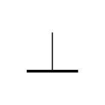

**天线符号**：用一根竖线向上分叉成几根斜线，表示**向空间辐射或接收电磁波**的装置。
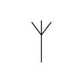

**熔断器（保险丝）符号**：矩形框内有一条横线，表示**过流时熔断以保护电路**。
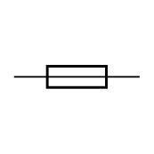

**电容器符号**：两根平行短线不连接，表示**储存电场能量**的元件。
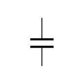

**电阻器符号**：一个矩形框，表示**阻碍电流、消耗电能**的元件。
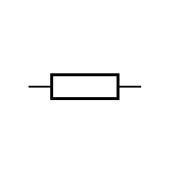

**二极管符号**：三角形指向一条竖线，表示**只允许电流单向通过**的 PN 结器件。
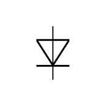

**线圈（电感）符号**：由若干个半圆弧首尾相连组成，表示**储存磁场能量**的电感。
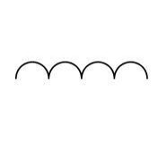

**电池符号**：一长一短两条竖线，**长线为正极、短线为负极**，表示**直流电源**。
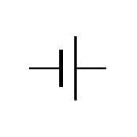

**压电晶体（晶振）符号**：矩形框上下各有一条短线，表示**利用压电效应产生稳定频率**的晶体。
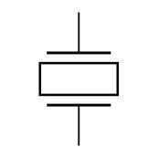

**稳压二极管符号**：在二极管基础上，阴极一侧的竖线折成“L”形，表示**反向击穿后电压稳定**的齐纳二极管。
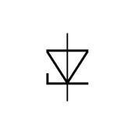

**发光二极管（Light-Emitting Diode，LED）符号**：在二极管基础上向外画有两条箭头，表示**通电后发光**的二极管。
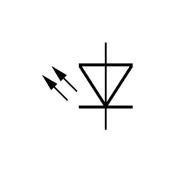

**PNP 双极型晶体管符号**：**发射极箭头指向基极方向**，表示**空穴导电为主**的晶体管。
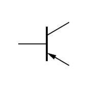

**NPN 双极型晶体管符号**：**发射极箭头由基极向外指出**，表示**电子导电为主**的晶体管。
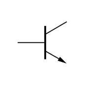

**结型场效应晶体管（JFET）符号**：**栅极与沟道之间用箭头表示 PN 结**，表示**电压控制型**器件。
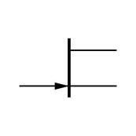

**绝缘栅场效应晶体管（MOSFET/IGFET）符号**：**栅极与沟道之间用一段绝缘间隙**表示，表示**通过电场控制导电沟道**的器件。
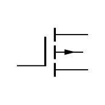

## 电阻与电位器

按制造材料细分，常见的电阻有 **碳膜电阻** 、 **金属膜电阻** 和 **线绕电阻** 。其中 **线绕电阻** 常标有 **额定耗散功率** ；电阻的额定功率是指该电阻正常工作时所能承受的最大功率，超过此值可能过热损坏。表面贴装电阻的封装代号如 0402、0603、0805、1206 等，通常表示元器件的 **长和宽** （单位可为 $\mathrm{mm}$ 或 $0.1\mathrm{in}$ ）。

直插电阻常用 **色环** 表示阻值：四道色环中，前两道为有效数字，第三道为倍率（ $10$ 的幂），第四道为误差；五道色环中，前三道为有效数字，第四道为倍率，第五道为误差。色环对应数字为：黑 0、棕 1、红 2、橙 3、黄 4、绿 5、蓝 6、紫 7、灰 8、白 9。

> 例题：色环为棕、橙、橙、黑的电阻，前三位读作 $1$ 、 $3$ ，倍率为 $10^3$ ，阻值为 $13\times10^3 = 13\,\mathrm{k}\Omega$ 。

色环为黄、白、红、银的电阻，读作 $4$ 、 $9$ ，倍率 $10^2$ ，阻值为 $4.9\,\mathrm{k}\Omega$ 。

贴片电阻常用丝印直接标注阻值： **三位数字** 表示“前两位为基数，第三位为后跟 0 的个数”，单位为欧姆；若带有字母 R/K/M，则字母既作小数点又表示单位（R= $\mathrm{\Omega}$ ，K= $\mathrm{k\Omega}$ ，M= $\mathrm{M\Omega}$ ）。

> 例题：贴片电阻印字 **2R7** 表示 $2.7\,\Omega$ ；印字 **3802** 表示 $380\times10^2 = 38.0\,\mathrm{k}\Omega$ ；印字 **2K7** 表示 $2.7\,\mathrm{k}\Omega$ ；**1M5** 表示 $1.5\,\mathrm{M}\Omega$ 。

电阻的 **误差（tolerance）** 由四环电阻的 **第四道色环** （或五环电阻的第五道）表示：它给出阻值允许浮动的百分比，常见档位有 $5\%$ 、 $10\%$ 、 $20\%$ ，精密电阻可达 $1\%$ 、 $0.5\%$ 乃至 $0.1\%$ 。精度数值越小代表误差越小（其中 $0.1\%$ 最高、 $20\%$ 最低）。同一标称值、不同误差档的电阻，实际阻值范围不同：

> 例题：一只标称 $100\,\Omega$ 、误差 $10\%$ 的电阻，实际阻值允许在 $100\times(1\pm0.1)$，即 **$90\,\Omega$ 到 $110\,\Omega$** 之间。

区分两只末位不同的电阻（如 $33\,\Omega$ 与 $39\,\Omega$ 、或 $120\,\Omega$ 与 $1200\,\Omega$ ）时，要对照各自的有效数字色环而非误差环。除了误差，电阻还标注 **温度系数（temperature coefficient）** ：它表示阻值随温度变化的相对比例，通常标作“每摄氏度若干 ppm（百万分之一）”或“每摄氏度一个分数”（单位温度下的相对变化量）。温度升高时阻值可能增大也可能减小，取决于温度系数的正负；温差较大的电路里，同一标称值、不同温度系数的电阻实际阻值会明显不同，高稳定场合应选用温度系数小的品种。

在高电压电路中，要特别关注电阻的 **耐压** 。提高耐压的方法包括：咨询厂商选用额定耐压更高的产品、选用封装尺寸较大的产品，或把多只电阻 **串联** 使用以分担电压。 **并联** 电阻不能提高耐压，反而可能因分流失衡带来问题。

**电位器** 是一种三端可变电阻，滑动端可在电阻体上移动。它在电路中常用作 **可调分压器** 或 **可变电阻** ，例如用来调节音量，而不是用作变压器或可变电纳。

## 电容

电容器由彼此绝缘的两个电极构成，按制造材料可分为 **陶瓷电容** 、 **电解电容** 、 **有机薄膜电容** 等。 **独石电容** 本质上是一种 **多层陶瓷电容** 。电解电容、钽电容等通常标有 **额定耐压** ；贴片陶瓷电容相比同容量的电解电容，具有 **体积更小、频率特性更好、没有极性、故障率更低** 的优点。电解电容的特点是 **单位体积的电容量大**（适合需要大电容的滤波、旁路等场合），但使用时须注意极性和耐压。

电容量的国际单位是 **法拉（ $\mathrm{F}$ ）** 。在电路图中：电解电容器若未标单位，通常默认单位为 **微法（ $\mathrm{\mu F}$ ）** ；非电解电容用大于 $1$ 的整数或小数标注时，单位常默认为 **皮法（ $\mathrm{pF}$ ）** ；用小于 $1$ 的小数标注时，单位常默认为 **微法（ $\mathrm{\mu F}$ ）** 。

> 例题：非电解电容上三位数字“104”表示 $10\times10^4\,\mathrm{pF}=100\,\mathrm{nF}=0.1\,\mu\mathrm{F}$ 。

电容具有 **隔直通交** 特性，因此常用来阻断直流或给交流信号提供旁路。在实际电路中，常把大容量电容与若干小容量电容并联作为电源旁路或滤波电容：低频时大电容起主要作用，高频时大电容的等效串联电感与损耗变得明显，小电容开始起作用，两者配合可以 **拓展有效工作带宽** 。

把 $1000\,\mu\mathrm{F}$ 电容跨接在 $13.8\,\mathrm{V}$ 直流电源输出端是常见做法，可起到滤波储能作用；但把它跨接在 HF 天线插座、扬声器或 $220\,\mathrm{V}$ 交流插座两端，会破坏射频匹配、改变扬声器负载或带来安全风险，均不合适。

## 电感与变压器

由线圈制成的元件称为 **电感器** 或 **电抗器（扼流圈）** 。射频电路中常见的有 **空芯电感** 和 **磁芯电感** 。电感的 **品质因数 Q** 定义为电感量与其等效损耗电阻之比；Q 值过低会带来功率损失，并影响谐振、滤波等相关特性。用磁性材料做磁芯时，可用较短的导线达到同样电感量，从而减少导线电阻引起的发热损耗，因此磁芯电感通常比同电感量的空心电感损耗更小。

一个 $100\,\mu\mathrm{H}$ 的线圈跨接在 HF 收发信机天线插座两端通常是可接受的（例如作射频扼流），但跨接在 $220\,\mathrm{V}$ 交流电源、 $13.8\,\mathrm{V}$ 直流电源或扬声器两端，则会造成短路或严重改变负载。

变压器和继电器的线圈都属于电感。当开关器件控制继电器线圈时，关断瞬间线圈会产生很高的 **反向电动势** ，使三极管集电极承受远高于电源电压的冲击。因此线圈两端常并联一个小电容或反向偏置的二极管，以吸收这个反向电动势、保护开关器件；而在继电器 **触点** 两端并联小容量电容，则是为了消除触点通断时拉弧产生的电磁干扰。

**电磁感应** 现象是变化磁场在导体中产生感应电动势，是变压器、发电机、交流异步电动机乃至无线电通信的基础。 **互感现象** 特指两个回路通过磁场耦合，当一个回路电流变化时，在另一个回路中产生感应电动势。

变压器铁芯用多片彼此绝缘的矽钢片堆叠而成，主要是为了降低交变磁场在铁芯中感应出的 **涡流损耗** ；继电器的整体衔铁通常工作于直流或低频，涡流问题不突出，所以可用整体铁芯。

理想变压器的电压与匝数成正比，电流与匝数成反比，阻抗变换比等于匝数比的平方。即

$$
    \dfrac{U_1}{U_2} = \dfrac{N_1}{N_2},\qquad \dfrac{I_1}{I_2} = \dfrac{N_2}{N_1},\qquad Z_1 = \left(\dfrac{N_1}{N_2}\right)^2 Z_L
$$

> 例题：一理想变压器初级、次级匝数分别为 $1100$ 匝和 $110$ 匝，初级接 $220\,\mathrm{V}$ ，次级接 $22\,\Omega$ 。匝数比 $10:1$ ，次级电压 $22\,\mathrm{V}$ ，次级电流 $1\,\mathrm{A}$ ，反射到初级的阻抗为 $10^2\times22 = 2200\,\Omega = 2.2\,\mathrm{k}\Omega$ 。

> 例题：一理想变压器初级、次级匝数分别为 $120$ 匝和 $1800$ 匝，初级接 $220\,\mathrm{V}$ ，次级接 $4.5\,\mathrm{k}\Omega$ 。匝数比 $1:15$ ，次级电压 $3300\,\mathrm{V}$ ，次级电流 $0.733\,\mathrm{A}$ ，反射阻抗 $\left(\dfrac{1}{15}\right)^2\times4500 = 20\,\Omega$，初级电流 $11\,\mathrm{A}$ 。

> 例题：要把 $450\,\Omega$ 天线阻抗变换到 $50\,\Omega$，阻抗比为 $9:1$ ，所需匝数比为 $\sqrt{9}:1 = 3:1$ 。

射频变压器（如用双绞线在磁环上绕制的传输线变压器）可在很宽频带内实现阻抗匹配，也能做成平衡-不平衡转换器、功率合成与分配网络，但并不能用来实现倍频或分频。

## 电感磁芯与铁氧体

电感量不仅由匝数决定，还与磁芯的 **磁导率（permeability）** 有关——磁导率越高，同样匝数下电感量越大。**环形磁芯** 把磁场约束在磁芯内部，漏磁小、效率高。

两种常用射频磁芯材料各有特点：

- **铁氧体（ferrite）磁芯** ：磁导率较高，达到同样电感所需匝数少，但温度稳定性相对一般；
- **铁粉芯（powdered iron）磁芯** ：温度稳定性更好，适合需要长期稳定的谐振回路。

**铁氧体磁珠（ferrite bead）** 串在导线上相当于对高频呈现一小电感/电阻，可吸收 VHF/UHF 频段的 **寄生振荡** 与沿同轴电缆外皮流动的 **共模电流** 。往线圈中插入非磁性金属芯（如黄铜、铝）会 **降低** 电感量，插入铁氧体则会 **增加** 电感量。

## 开关、继电器与保护器件

常用的开关类器件包括 **按钮开关** 、 **继电器** 和利用开关状态的 **晶体管** 。 **单刀双掷（SPDT）** 开关可以把一个电路选择接入另外两个电路中的某一个； **熔断器** 用于在过流时熔断以保护其他元件。

选用熔断器时应关注 **额定工作电压、额定工作电流和熔断速度** ；大电流保险丝管应装于管座内，防止熔断时爆裂损伤周边元件。继电器是一种具有电气隔离能力的开关，选型时应关注触点的 **额定耐压** 和 **额定工作电流** ；用继电器控制收发转换时，应在发射机待机后再切换，以保护触点和设备。

在 $4.2\mathrm{V}$ 低压电池实验中，突然断开继电器线圈或变压器绕组时，电感储能释放会产生 **高电压反冲** ，因此这些线圈元件可能让人感受到电击；而大容量电容在低压下储存的电压只有约 $4.2\mathrm{V}$ ，高压二极管本身也不会产生高电压。

## 高频电路中的非理想效应

在数十兆赫以上的射频频段，导线的行为和直流、工频时明显不同。**趋肤效应** 指高频电流不再均匀填满整个导线截面，而是集中在导线表层流动，导线内部几乎没有电流；频率越高，电流集中的表层越薄。正因如此，用实心铜线和同直径空心铜管做交流连线时，低频下实心线因截面大、损耗较小，而高频下两者都只有表层导电，损耗趋于相当。

实际元件在高频下还会表现出“非理想”行为。一个标称电容在 $50\,\mathrm{Hz}$ 时容抗为 $100\,\mathrm{\Omega}$ ，若按 $X_C=\dfrac{1}{2\pi f C}$ 推算到 $5\,\mathrm{MHz}$ 应仅约 $0.001\,\mathrm{\Omega}$ ，但实测会显著偏大：一方面电容器 **引线的寄生电感** 随频率升高不可忽略，另一方面高频下 **介质损耗** 随频率增加而变大。类似地，一个标称电感在 $50\,\mathrm{Hz}$ 时感抗为 $10\,\mathrm{\Omega}$ ，推算到 $5\,\mathrm{MHz}$ 应达约 $1\,\mathrm{M\Omega}$ ，但实测显著偏小，主要原因是线圈的 **匝间分布电容** 随频率升高变得不可忽略，使等效感抗下降。为防止走线间相互串扰，还常使用 **屏蔽线** ：它用金属编织层或金属箔把内部导体包起来，可 **阻止不需要的信号耦合进或耦合出该导线** ，与增大载流能力、减小直流电阻无关。 **电解电容** 因内部卷绕结构寄生电感较大，**不适合射频** 场合；**薄膜电容** 在射频下的主要损耗来自 **介质损耗**。 **导体直径越大，其电气长度越长**。在 VHF 及以上频段应尽量 **缩短元器件引线** 以减小寄生感抗；微波电路中更要用 **短连接** 来减小沿途的相移。

## 二极管、晶体管与集成电路

自身能进行放大或可控整流的元件称为 **有源器件** ，例如硅整流二极管、肖特基二极管、场效应三极管、双极型三极管等。 **二极管** 只允许单方向电流流动，其两个电极分别称为 **正极和负极** （也常称阳极和阴极）；封装上靠近负极的位置通常印有环或线标记以便识别。

**LED** 是 **发光二极管** 的缩写，可当作指示灯使用。把发光二极管接入直流电源时必须 **正向连接并串联限流电阻** ，否则会因电流过大而烧毁。 **二极管整流器** 能把交变电压变成单向的脉动直流电；普通硅整流二极管的正向导通压降约为 **$0.7\,\mathrm{V}$** 。

晶体管主要有两类。 **双极型三极管（BJT）** 的三个基本电极是 **发射极、基极、集电极** ，其放大能力用 **电流放大倍数$\beta$** 表示（无量纲）。 **场效应晶体管（FET）** 的三个基本电极是 **源极、栅极、漏极** ，其放大能力用 **互导（跨导）$g_m$** 表示，单位为毫安/伏（ $\mathrm{mA/V}$ ）。 **电子三极管（真空管）** 的三个基本电极是 **阴极、栅极、屏极（板极）** ，因还带灯丝加热引脚，所以单个管子至少应有 **$4$ 个引脚** ；其放大能力同样用 **跨导 $g_m$** 描述。四极管、五极管在控制栅极与屏极之间另加 **屏栅极（帘栅极）**，其作用是**减小控制栅极与屏极之间的极间电容**，从而抑制自激振荡、提高高频放大能力。按控制电极的输入阻抗由低到高排列，大致为：双极型晶体管的基极、结型场效应管的栅极、绝缘栅场效应管的栅极。

晶体管既可用来以较小的电流控制较大的电流，也可作为电子开关或放大器使用；继电器也能以小电流控制大电流，但属于机械开关而非放大器。把大量元器件集成在单个晶片上的器件称为 **集成电路** ，其中运算放大器属于 **模拟集成电路** 。

**理想运算放大器** 具有两个极性相反的差分输入端，开环（不加负反馈）时电压放大倍数为无穷大，输入阻抗也为无穷大。实际产品型号后常带 SIP、DIP、SOT、SOP、SSOP、QFP 等尾缀，它们说明的是器件的 **封装形式** 而非温度、电平或频率范围。

## 二极管家族与三极管细节

除了前文提到的普通硅整流二极管（正向压降约 $0.7\,\mathrm{V}$ ）与发光二极管，**锗二极管** 的正向导通压降更小，约 **$0.3\,\mathrm{V}$** ，适合对小信号检波。其它常见二极管各有专门用途：

- **肖特基二极管** ：以金属–半导体接触形成势垒，正向压降也较低、结电容小、开关速度快，常用于 VHF/UHF 的 **混频与检波** ；其中 **点接触二极管** 因结面积极小，常用于射频检波。
- **变容二极管（varactor）** ：其 PN 结电容随反向偏压明显变化，相当于一个“ **电压控制的电容** ”，用于压控振荡器（VCO）等电调谐电路。
- **PIN 二极管** ：在 P 与 N 之间夹一层本征（I）半导体，对 RF 呈现的损耗由正向直流偏流控制，常作 **射频开关** （小信号时近似线性电阻，偏流大时导通、无偏流时截止）。
- **稳压二极管（齐纳二极管）** 除稳压外，也常用于 MOSFET 栅极的防静电击穿保护。选用时要保证实际耗散不超过其额定最大值 $P_{\max}=V_Z I_Z$ ：

> 例题：一只额定稳压值 $10\,\mathrm{V}$ 、最大耗散 $50\,\mathrm{W}$ 的稳压二极管，若工作在最大耗散，流过的电流约为
> $$
> I = \dfrac{P}{V} = \dfrac{50}{10} = 5\,\mathrm{A}
> $$

齐纳二极管的额定功耗通常以 **约 25℃ 室温** 为基准，**温度升高时其允许功耗会下降**。

**双极型三极管（BJT）** 导通时，基极–发射极之间需建立约 **$0.6\sim0.7\,\mathrm{V}$** 的正向压降（ $V_{\mathrm{BE}}$ ）才能有明显的集电极电流。共基极接法的电流放大倍数 $\alpha$ 接近 $1$ ；**$\alpha$ 截止频率** 是指共基极电流增益 $\alpha$ 下降到低频值的 $1/\sqrt{2}$ （约 $0.707$ 倍）时对应的频率，标志该管在更高频率下电流增益已明显下降。

双极型三极管的两个电流放大系数分别定义如下：

- **$\beta$（共发射极电流增益）** ：集电极电流的变化量相对于基极电流变化量，即 $\beta = \dfrac{\Delta I_C}{\Delta I_B}$ ；
- **$\alpha$（共基极电流增益）** ：集电极电流的变化量相对于发射极电流变化量，即 $\alpha = \dfrac{\Delta I_C}{\Delta I_E}$ 。

由于 $I_E = I_B + I_C$ ，二者满足
$$
\alpha = \dfrac{\beta}{1+\beta},\qquad \beta = \dfrac{\alpha}{1-\alpha}
$$
$\alpha$ 恒小于 $1$ （典型值约 $0.95\sim0.995$ ），而共射极/共集电极接法的电流增益（ $\beta$ ）远高于共基极接法。

> 例题：若某管的 $\beta = 100$ ，则 $\alpha = \dfrac{100}{101}\approx 0.99$ ；若已知 $\alpha = 0.98$ ，则 $\beta = \dfrac{0.98}{1-0.98} = 49$ 。

**场效应管** 按栅极工作方式分 **增强型** 与 **耗尽型** ：增强型在零栅压时沟道尚未形成（关断），需加栅压才导通；**耗尽型** 在零栅压时沟道已经存在、正常导通，加反向栅压才会夹断。绝缘栅场效应管（Metal-Oxide-Semiconductor Field-Effect Transistor，MOSFET）即属此类可控器件，其中用 **砷化镓（Gallium Arsenide，GaAs）** 做的器件因电子迁移率高，适合微波电路；**氮化镓（Gallium Nitride，GaN）** 则用于频率最高的微波单片集成电路（Monolithic Microwave Integrated Circuit，MMIC）。由于绝缘栅的栅氧化层极薄，MOSFET 与 CMOS（Complementary Metal-Oxide-Semiconductor，互补金属氧化物半导体）器件对 **静电非常敏感** ，人体或工具上的静电荷就可能在栅极感应出足以击穿氧化层的电压，因此焊接、拿取时必须采取防静电措施（戴接地腕带、使用防静电包装）。

图 E6-1 中：符号 1 为 **P 沟道结型场效应管（JFET）** （栅极箭头指向沟道，即朝内）；符号 4 为 **双栅 N 沟道 MOSFET** （有两个栅极 G1、G2）。它们是考试中用于辨认 FET 类型的两类代表。
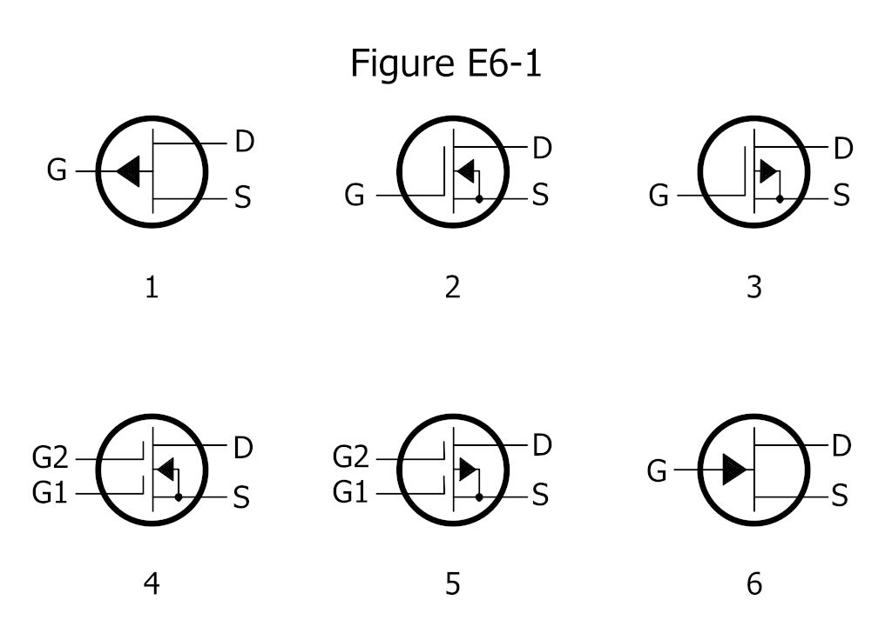

图 E6-2 中：符号 6 为 **肖特基二极管** （阴极一侧画成折线状，区别于普通二极管的直线阴极）；其它如符号 1 变容管、符号 5 发光管、符号 7 光电二极管、符号 8 双向可控硅等，也需能一一辨认。
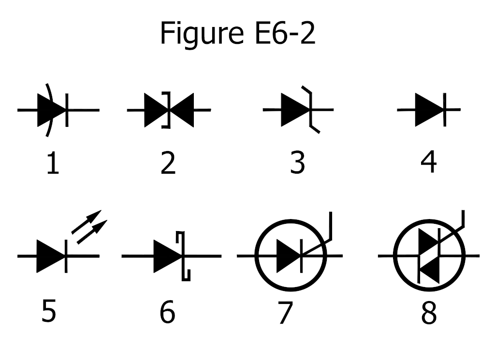

## 晶闸管（可控硅 SCR）与过压保护

**晶闸管（thyristor）** 是一类具有“闩锁”特性的半导体开关。最常见的 **可控硅整流器（SCR，Silicon Controlled Rectifier）** 内部是 **PNPN** 四层结构，对外有三个电极： **阳极（anode）、阴极（cathode）和门极（gate）** 。它有两个稳定状态： **阻断（不导通）** 与 **导通** 。在阳极对阴极施加正向电压时，只有门极收到一个触发脉冲才会“导通”；一旦导通，门极就失去控制作用，必须等阳极电流降到接近零（如交流过零或断开负载）才能重新关断。导通后的 SCR 在阳极–阴极之间表现得很像一只 **正向偏置的整流二极管** 。

SCR 在业余无线电里常用于电源 **过压“撬棍（crowbar）”保护** ：一旦输出电压超过阈值，触发 SCR 瞬间短路，使保险丝熔断或电源进入限流，从而保护后级设备。

## 数字集成电路基础

数字电路处理分立的“0/1”逻辑电平，这里先讲解常用器件与符号。

**逻辑门符号** （图 E6-3）是读数字电路图的基础：

- **与门（AND）** ：所有输入为 1 时输出才为 1；
- **与非门（NAND）** ：与门输出再取反（输出端带小圆圈）；
- **或门（OR）** ：任一输入为 1 输出即为 1；
- **或非门（NOR）** ：或门输出再取反；
- **非门（NOT）** ：单输入反相器（三角形加输出小圆圈）。

图 E6-3 中：符号 2 为 **与非门（NAND）** ，符号 4 为 **或非门（NOR）** ，符号 5 为 **非门（NOT）** 。
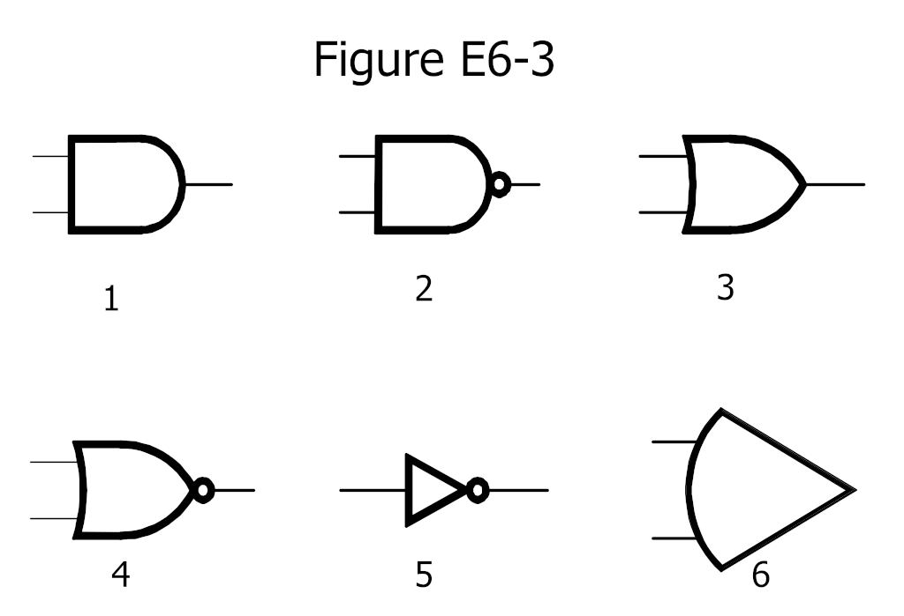

其它数字电路要点：

- **比较器迟滞（hysteresis）** ：在比较器（一种输出高/低两态的运放）中加入正反馈，使翻转阈值随当前输出不同而上、下错开，可避免输入在阈值附近抖动时输出频繁跳变。
- **三态逻辑** ：输出除 0、1 外还有高阻态（断开），便于多器件分时共用一条总线。
- **BiCMOS** 工艺把双极型与 CMOS 结合，兼具 **高输入阻抗与低输出阻抗** 。
- **上拉/下拉电阻** ：接到正电源（上拉）或地（下拉）的电阻，在输入或输出开路（悬空）时给它一个确定电平，避免逻辑状态不定。
- **CMOS** 电路静态功耗极低，且其翻转阈值约为电源一半（ $V_{\mathrm{CC}}/2$ ），因此噪声容限大、抗干扰强。
- **FPGA（现场可编程门阵列）** 用 **硬件描述语言（HDL）** 来设计其内部逻辑，而非固定功能。

## 压电效应与石英晶体等效电路

某些晶体受机械应力会产生电压、施加电压又会形变，称为 **压电效应** 。**石英晶体** 利用这一效应做成高稳定频率源，其等效电路为一个 **串联的 RLC** （代表晶体本身的机械谐振）再并联一个 **静电容 $C_0$** ：在串联谐振频率附近阻抗最低，利用这一尖锐特性可获得极其稳定的振荡频率。晶振两端常需外接标称 **负载电容** 才能工作在标称频率上。

晶振还有一些衍生用法与配套结构值得了解：

- **泛音振荡（overtone oscillation）** ：晶体除基频外，也能在 **奇次泛音** （ $3$ 次、 $5$ 次、 $7$ 次…）上稳定振荡。当需要的频率较高、基频晶体难以直接制成时，可用泛音晶体配合选频电路，让它工作在 $3$ 次或 $5$ 次泛音上获得高频信号。
- **晶体滤波器（lattice filter）** ：用多片频率略有差异的石英晶体组成，可做成 **带宽极窄、过渡带极陡** 的带通滤波器，单边带（Single Sideband，SSB）话音常用的晶体滤波器带宽约 **$2.4\,\mathrm{kHz}$** ，正好容纳话音又抑制邻道。它能做到这么窄、这么陡，靠的就是石英晶体极高的 **品质因数 Q** 。
- **谐振腔（resonant cavity）与螺旋谐振器（helical resonator）** ：在 VHF 及更高频率，一段约四分之一波长的金属腔体本身就是高 Q 谐振结构，可当作 **窄带滤波器** 使用。例如约 $50\,\mathrm{MHz}$ 时，四分之一波长约为 $\dfrac{\lambda}{4} = \dfrac{1}{4}\cdot\dfrac{300}{50} = \dfrac{75}{50} = 1.5\,\mathrm{m}$ 。

螺旋谐振器则是一种小型化的高 Q 谐振结构，常装在接收机前端，用来抑制强信号引起的过载与杂散响应。

## 光电与光耦

- **光伏效应** ：光照射半导体 PN 结产生电压；硅光伏电池开路电压约 **$0.5\,\mathrm{V}$** ，效率定义为输出电功率与入射光功率之比。
- **光敏电阻** ：受光照后阻值下降。
- **光耦合器（光耦）** ：把 **发光二极管与光敏三极管** 封装在一起，用光而非电线传递信号，实现输入、输出之间的电气隔离。
- 由光耦可构成 **固态继电器（SSR）** ；类似原理也用于光电轴编码器等。

## 射频连接器与 MMIC

不同射频连接器有不同的最高可用频率：

- **BNC** 接头多用于低于约 **$4\,\mathrm{GHz}$** 的小功率信号与测试仪器；
- **N 型** 接头有良好防潮性能，可用到约 **$10\,\mathrm{GHz}$** ，常用于室外或高可靠场合；
- **SMA** 接头是小型螺纹结构，常用于更高的微波频率，也常见于手持台的天线端（小体积、螺纹锁紧）；
- **RCA（莲花）插头** 用于低频/直流音视频，不适合射频；
- **PL-259 / SO-239（俗称 M 型、UHF 连接器）** 是螺纹锁紧结构，广泛用于 HF/VHF 电台与 RG-213、RG-58 等电缆的连接，并非卡式快拔，也不只用于微波系统；
- **F 型连接器** 多用于有线电视/卫星接收的低成本同轴连接，业余射频中一般不是首选。

无论哪种射频连接器，都应定期清洁并拧紧，以尽量减小接触电阻；连接器外壳的屏蔽层质量（如实心屏蔽、双层编织屏蔽）也直接影响高频下的泄漏与抗干扰。

**MMIC（Monolithic Microwave Integrated Circuit，单片微波集成电路）** 把放大器、混频器等做在单一芯片上，典型输入/输出阻抗为 **$50\,\Omega$** ，低噪声型号的噪声系数可小到约 **$0.5\,\mathrm{dB}$** ，提供受控增益，常以 **微带线** 连接，供电一般经电阻或射频扼流圈接到输出端。

## 电路图元件识别实例

下面用几张典型电路图巩固元件识别（这些元件在前文“电路图中的常见元器件符号”中已分别介绍）。

图 T-1 中：编号为 1 的是 **电阻** ，编号 2 的是 **NPN 晶体管** ，编号 3 的是 **灯泡** ，编号 4 的是 **电池** ，编号 5 的是 **接地符号** 。
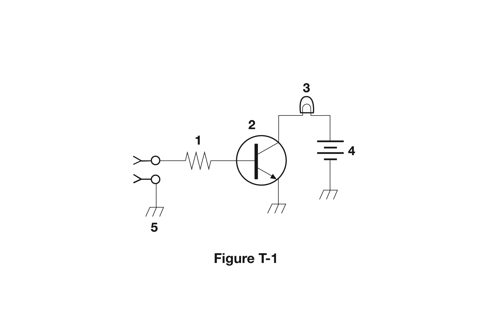

图 T-2 中：左半部分含电池、电阻、开关、变压器；右半部分编号 5 为 **二极管** ，6 为 **电解电容** ，7 为 **电阻** ，8 为 **发光二极管（Light-Emitting Diode，LED）** ，9 为 **电位器** ，10 为 **稳压二极管** 。其中编号 3 是一个 **单刀单掷（Single Pole Single Throw，SPST）开关** 。
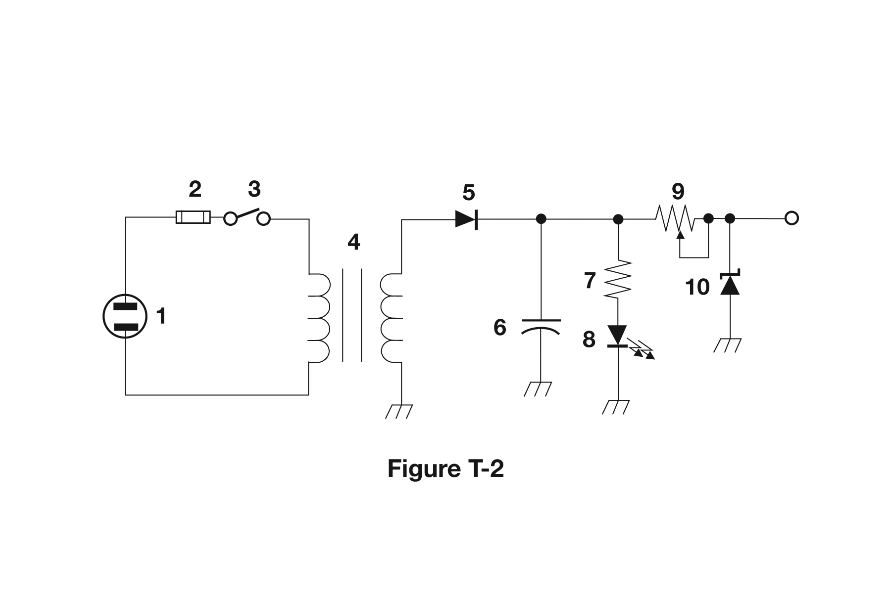

图 T-3 为一个天线调谐回路：编号 1、2 为 **可变电容** ，编号 3 为带抽头的 **可变电感** ，编号 4 为 **天线** 。
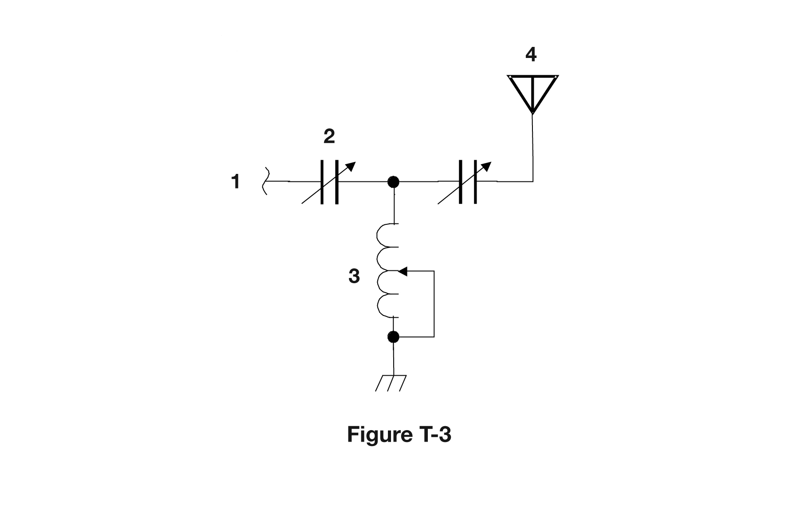
