## 晶体管放大器的三种基本组态

以双极型三极管为例，放大电路按“公共端”（交流接地端）的不同分为三种组态。无论哪种组态，晶体管本身都由基极电流控制集电极电流，只是输入、输出端口的取法不同。

**共基极放大器** 的输入信号从发射极送入，输出从集电极取出，基极为公共端（交流接地）。它高频特性好、输入阻抗低，常用于射频宽带放大电路。

**共基极放大器** ：输入经耦合电容送至发射极，基极经偏置电阻交流接地，输出从集电极取出。
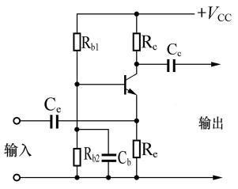

**共发射极放大器** ：输入信号从基极送入，输出从集电极取出，发射极为公共端。这是最常用、电压增益最高的一组态。
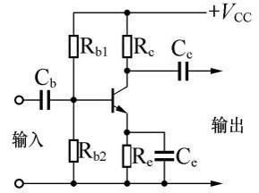

**共集电极放大器** ：输入从基极送入，输出从发射极取出，集电极（接电源）为公共端，又称 **射极跟随器** ，电压增益约等于 $1$ 、输入阻抗高、输出阻抗低。
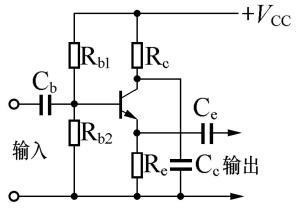

## 晶体管放大电路识图

图 E7-1 是一个典型的 **共发射极放大器** ： **R1、R2 构成分压偏置** ，给基极提供合适的静态工作点； **R3 是发射极电阻** ，提供电流负反馈（自给偏压），稳定工作点；信号从基极入、集电极出，发射极为公共端。
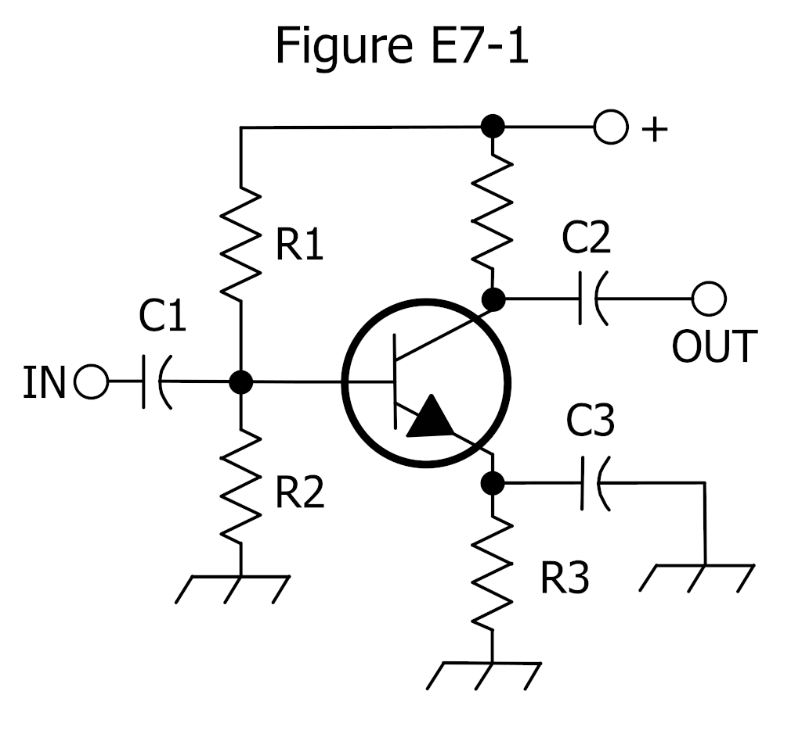

## 放大器中的偏置与耦合元件

一个典型的三极管放大电路除了晶体管本身，还要有提供直流工作点、稳定工作点以及隔离直流/耦合信号的元件。下列元件在电路图中常以字母标注，其功能如下：

**Rc（负载电阻）** ：接在集电极支路，把集电极电流的变化转换为输出的信号电压。
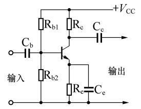

**Re（发射极负反馈电阻）** ：接在发射极到地之间，提供 **电流负反馈** ，用于稳定直流工作点，使电路对温度、管参数差异不那么敏感。
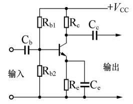

**Rb1（偏流电阻 / 上偏置电阻）** ：为晶体管基极提供偏置电流，使电路获得合适的静态工作点。
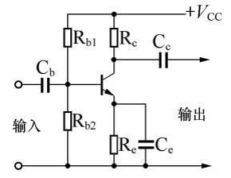

**Cb（输入耦合电容 / 隔直流电容）** ：串在输入回路，使交流信号顺利进入放大器，同时 **隔断** 信号源与放大器之间的直流分量。
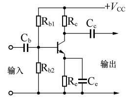

**Ce（发射极旁路电容）** ：并联在 Re 两端，对交流近似短路，使交流信号不经过 Re 形成负反馈（从而保持增益），只在直流时起稳定作用。
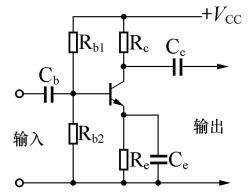

**Cc（输出耦合电容 / 隔直流电容）** ：串在输出回路，使输出交流信号顺利通过，同时隔断放大器与后级之间的直流分量。
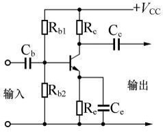

## 运算放大器基础

**运算放大器（运放）** 是一种高增益、高输入阻抗、低输出阻抗的模拟集成电路，有两个差分输入端（反相端“−”、同相端“+”）和一个输出端。在接入负反馈后有两个重要近似：

- **虚短** ：两输入端之间的电压差近似为 $0$ （因为开环增益极大，维持线性时只需极小差值即可）；
- **虚断** ：两输入端的输入电流近似为 $0$ （输入阻抗极大）。

**反相比例放大器** 把输入接到反相端、反馈电阻 $R_F$ 接在输出与反相端之间，同相端接地，其电压增益为

$$
    A_v = -\dfrac{R_F}{R_1}
$$

即输出电压 $V_{\mathrm{out}}=-V_{\mathrm{in}}\cdot\dfrac{R_F}{R_1}$ 。“−”表示反相。**同相比例放大器** 增益为 $1+R_F/R_1$ ，输出与输入同相。

**增益带宽积（GBW）** 指闭环增益与可用带宽的乘积近似为常数：增益调得越高，带宽越窄。**输入失调电压** 是即便两输入端等电位、输出端仍存在的微小直流误差电压，需在精密电路中加以补偿。若反馈支路并联电容，则构成 **低通** 特性，抑制高频。

> 例题：图 E7-3 电路中 $R_1=10\,\Omega$ 、 $R_F=470\,\Omega$ ，反相增益的绝对值
> $$
> |A_v|=\dfrac{R_F}{R_1}=\dfrac{470}{10}=47
> $$

> 例题：同图 $R_1=1000\,\Omega$ 、 $R_F=10000\,\Omega$ ，输入直流 $0.23\,\mathrm{V}$ ，则
> $$
> V_{\mathrm{out}}=-0.23\times\dfrac{10000}{1000}=-2.3\,\mathrm{V}
> $$

> 例题：同图 $R_1=1800\,\Omega$ 、 $R_F=68000\,\Omega$ ， $|A_v|=\dfrac{68000}{1800}\approx 37.8\approx 38$ 。

> 例题：同图 $R_1=3300\,\Omega$ 、 $R_F=47000\,\Omega$ ， $|A_v|=\dfrac{47000}{3300}\approx 14.2\approx 14$ 。
> 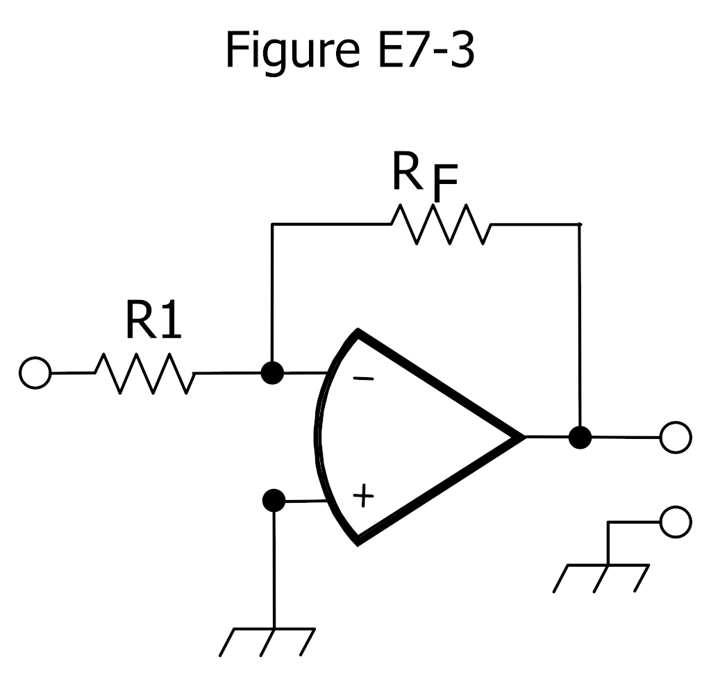

## 滤波器

滤波器按通带可分为 **低通、高通、带通** 等。判断依据是电抗元件的接法： **低通** 让低频通过、抑制高频，典型结构为“串联 **电感** （或电阻）+并联到地的 **电容** ”； **高通** 让高频通过、抑制低频，典型结构为“串联 **电容** +并联到地的 **电感** （或电阻）”； **带通** 则只让某一频段通过。

下列电路为**低通滤波器** ，只让低频成分通过。
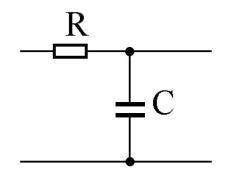

下列电路为**低通滤波器** 。
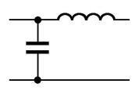

下列电路为**低通滤波器** 。
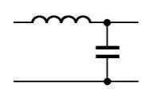

下列电路为**低通滤波器** 。
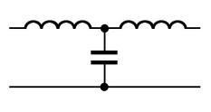

下列电路为**低通滤波器** 。
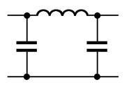

下列电路为**高通滤波器** ，只让高频成分通过。
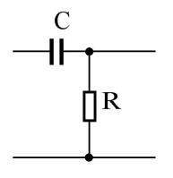

下列电路为**高通滤波器** 。
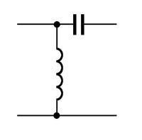

下列电路为**高通滤波器** 。
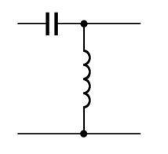

下列电路为**高通滤波器** 。
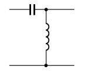

下列电路为**高通滤波器** 。
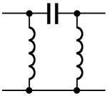

下列电路为**带通滤波器** ，只让某一频段通过。
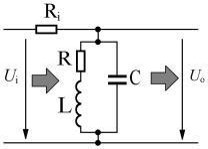

## 振荡器

振荡器是在没有外部输入信号的情况下，靠正反馈自行产生交流信号的电路。常见的三极管振荡器有：

**电感耦合式振荡器** ：集电极接 LC 谐振回路，并通过变压器（电感）把一部分信号耦合反馈回基极。
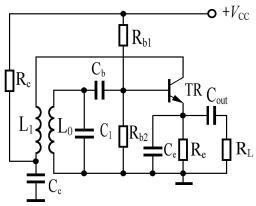

**电感三点式振荡器（哈特莱振荡器）** ：谐振电感线圈带有中间抽头，线圈的三个端点分别接到晶体管的三个极，反馈取自电感抽头。
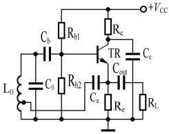

**电容三点式振荡器（科耳皮兹振荡器）** ：用两个串联电容构成“三点”分压，反馈取自电容分压点。
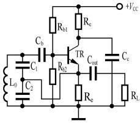

**RC 反馈式振荡器** ：用电阻–电容网络完成选频与相移（例如文氏电桥或相移网络），常用于较低频率。
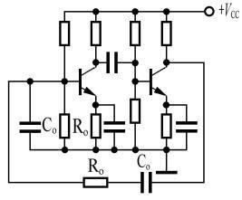

**电容三点式振荡器（科耳皮兹振荡器）** 。
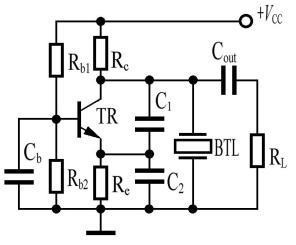

## 振荡器与频率源扩展

前文已介绍 LC、RC、石英晶体振荡器。补充几种实用形式：

- **皮尔斯振荡器（Pierce）** ：用反相器（门电路）加石英晶体作为反馈元件，晶体工作于串联谐振点附近，常见于微处理器时钟。
- **微音效应（microphonics）** ：晶振或陶瓷谐振器受机械振动/冲击时，其等效参数瞬时改变、频率随之跳动；高频晶振安装应避免直接受力，必要时做机械隔离。
- **温度系数** ：用 **NP0/C0G** 等温度系数极小的电容做晶振负载，可减小温漂；普通电容温漂大。
- **直接数字频率合成（DDS）** ：以 **相位累加器** 不断累加频率控制字，把累加得到的相位值送 **查找表** 得出正弦幅度，再经 **DAC** 变成模拟信号，最后用低通滤波器滤除镜像。查找表位数有限会产生离散 **杂散** 。
- **晶振负载电容** ：晶体需在规定的负载电容下才振荡在标称频率，外接电容即为此目的。
- **高稳参考源** ：除 TCXO、OCXO 外，还有 **GPS 驯服** 、 **铷钟** 、 **介质谐振器** 等更高稳定度的频率基准。

## 整流器

把交流电变成直流电要用到二极管整流电路。常见形式有：

**二极管半波整流器** ：只用一只二极管，仅让交流的一个半周通过，输出为单向脉动直流。
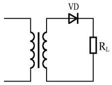

**二极管桥式整流器** ：由四只二极管组成电桥，无论交流正半周还是负半周都有一路导通，无需带中心抽头的变压器即可全波整流。
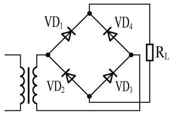

**二极管全波整流器** ：采用带中心抽头的变压器配合两只二极管，两个半周分别经不同二极管导通，输出全波脉动直流。
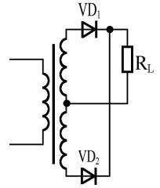

**二极管环形调制器** ：由四只二极管环形连接构成，用于对信号进行平衡调制/解调，是通信电路中而非单纯电源整流的典型应用。
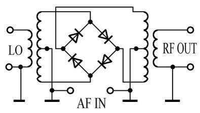

## 放大器的工作类别与特性

**绝缘栅场效应管（MOSFET）** 用作开关时有两个状态： **截止** 指所加偏压不足以使管子导通； **饱和** 指偏压使管子充分导通、继续加大偏压其导通电阻几乎不再减小（饱和导通区）。

场效应管放大器有 **共源极、共栅极、共漏极（源极跟随器）** 三种形式：共源极是栅极输入、漏极输出，栅极电压微小变化即可引起漏极电压与电流的较大变化，电压增益高；共栅极是源极输入、漏极输出；共漏极（源极跟随器）是栅极输入、源极输出。双极型晶体管放大器对应为 **共发射极、共基极、共集电极（射极跟随器）**：共发射极是基极输入、集电极输出；共基极是发射极输入、集电极输出；共集电极是基极输入、发射极输出。电子三极管（真空管）则称为 **共阴极、共栅极、共屏极（阴随器）** 。

按性能由低到高排序：
- **输入阻抗** ：共基极 < 共发射极 < 共集电极
- **电流增益** ：共基极 < 共发射极 < 共集电极（共基极电流增益 $\alpha\approx 1$ ，共发射极 $\beta$ 大，共集电极约 $\beta+1$ ）
- **电压增益** ：共集电极 < 共基极 < 共发射极（共集电极增益约 $1$ ，共发射极最高）
- **输出阻抗** ：共集电极 < 共发射极 < 共基极（共集电极最低，共基极最高）

**小信号放大器** 指工作点始终处于线性工作区； **大信号放大器** 则工作点可超出线性区。

放大器按器件在一个信号周期内的导通角分为 **甲（A）、乙（B）、丙（C）、丁（D）** 四类：甲类在整个周期导通，既不截止也不饱和；乙类恰好在半个周期导通且永不饱和；丙类导通角小于半个周期并在峰值饱和；丁类是开关工作方式，器件在饱和与截止之间切换，并非线性放大。

由此带来效率与失真的规律：电源效率 **甲类最低、丙类最高** ，射频功率放大按效率由高到低为 **D > C > B > A** ；波形失真 **甲类最小、丙类最大** ，失真程度由小到大为 **A < B < C < D** 。

各类放大器的典型用途：音频功率放大宜用 **甲乙类** ；音频小信号放大宜用 **甲类** ；CW、SSB 射频功率放大宜用 **接近乙类或接近甲类的甲乙类** ；FM 射频功率放大可用 **甲乙类、丙类** ；宽带（ $10\,\mathrm{kHz}$ ~ $60\,\mathrm{MHz}$ ）射频单管线性功率放大只能用 **甲类** ；对讲机 FM 射频功放因 FM 为恒包络信号，A、B、C、D 各类均可；而 CW 射频功放因需线性、限定用 A、B 两类。 **甲乙类** 稍有静态偏置、导通角略大于半个周期，失真低于乙类、效率优于甲类。射频末级即便存在失真与谐波，也须经 **选频网络** 滤除以满足法规，高阶互调杂散则需用 **负反馈** 抑制。

两个串联功率管分别负责音频正、负半周的电路叫 **推挽放大** ，可在极小静态偏置下实现高电源效率的线性功率放大；两支 **并联** 功率管则是为了获得双倍的输出电流与功率。

**负反馈** 是把放大器输出的一部分回输到输入端以抵消输入信号，其结果是失真小、工作稳定、增益略有减小、输入与输出阻抗更易控制、工作带宽得以扩展。 **阻抗匹配** 指电路与负载的电抗相互抵消、电阻与电路所需最优负载值一致；在最大功率传输条件下，信号源内阻消耗的功率与负载得到的输出功率 **相等** 。

## 非线性变换、频谱与调制

**非线性失真** 指电路输出相对输入产生了新的频率分量。凡单频信号经电路后波形偏离正弦而生成谐波等全新频率成分，即为非线性变换，例如二极管检波（输出大小正比于输入射频幅度）、二极管环形调制器（用音频信号线性改变本振振幅）、二极管整流（交流变脉动直流）；而发光二极管正向电流与限流电阻成反比仅是线性欧姆关系，不属于非线性变换。

从频谱看： **正弦或余弦（简谐）信号** 是频率为 $f$ 的单一频率分量； **复杂周期信号** 则含频率为 $f$ 整数倍的多个分量； **单个无限窄脉冲** 拥有均匀分布的连续频率分量（平坦谱）。只包含一个频率分量的信号必然是简谐信号。

在收信机旁根据耳机中听到的现象可判断电路功能：耳机传出模糊不清的 SSB 语音，说明电路在 **检波** ；听等幅电报的“嘟嘟”电码声，是 **差拍** （差频振荡器 BFO 与本振拍频）；通电后收信机收到类似鸟鸣、断电即消失，说明电路存在 **振荡** （自激或本振泄漏）。 **差拍** 是两种不同频率信号经非线性电路后得到两者之差频新信号的现象，它与 **混频、二阶互调** 本质相同，只是称谓因应用场景不同。

两个频率 $f_1$、$f_2$ 的信号流经同一非线性元件会产生三阶互调产物，其频率为 $2f_1\pm f_2$ 、 $2f_2\pm f_1$ ，可成为接收假信号或发射杂散。 **倍频器** 正是利用有源器件的非线性产生输入信号的谐波，再用谐振回路选出所需倍频分量；能产生高次谐波的电路包括二极管整流器、检波器、环形调制器（调谐在整倍频率上的选频网络本身并不产生谐波）。

调制方式中， **已调信号振幅（包络）保持恒定** 的有 FSK、FM、PM、PSK；其中 **AM 振幅随调制信号变化** ，其载波相位恒定不变，而 FM/PM 改变的是频率或相位、幅度不变。 **FM、PM** 在特定的调制指数下可使载波分量消失（贝塞尔函数 $J_0=0$ ），也可使某一对边带消失。只含一组与信息对应边带的是 **抑制载波单边带（SSB）** 。

**二极管环形调制器** 有多种用途：作为 **乘积检波器** 给 CW 或 SSB 检波；作为 **接收机混频器** 把射频变成中频；作为 **发射机混频器** 把已调中频变成射频；利用乘法性质将载波与音频基带相乘产生 **DSB** ；若给基带适当叠加直流分量使极性不反转，便得到载波不被抑制的普通 **AM** 。

构成 **振荡器** 的必备元素是放大倍数大于 $1$ 的放大器加 **正反馈** 电路。振荡器频率漂移常因元器件通电发热使 LC 参数变化所致。文献中 **$\mathrm{ppm}$** 表示“百万分之几”，用来描述设备的频率容限。常见缩写： **VFO** 可变频率振荡器（主载波可自由调谐）、 **VXO** 可变频率石英晶体振荡器、 **VCO** 压控振荡器、 **XTAL** 石英晶体谐振器。

按频率稳定度由低到高排列为： **RC 振荡器 < LC 振荡器 < 陶瓷振子振荡器 < 石英声表面波振荡器 < 石英晶体振荡器** 。 **TCXO** 是温度补偿式晶体振荡器， **OCXO** 是恒温控制式晶体振荡器，后者稳定度优于前者。

## 滤波器与线性失真

电路中的 **非线性失真** 主要来自有源器件，但无源滤波器里的电感或变压器一旦磁芯趋于 **饱和** 也会产生同样的失真。此外，包含多个频率分量的信号通过滤波器还会发生 **线性失真** ，它只改变各频率分量的比例或相位，不产生新频率，具体表现为 **频率失真** （各频率分量的比例发生变化）和 **相位失真** （不同频率分量的相位延迟发生改变）；与之相对，偶次、奇次谐波属于非线性失真。

**谐振回路** 由 **电容和电感的组合** 构成，用来筛选特定频率。倍频器需要选择性优良的 LC 谐振回路，其中选择性最佳的是 **松耦合的高 Q 单调谐回路或同频双调谐回路** 。

描述滤波器特性的几个参数： **低通滤波器的截止频率** 是频率响应从通带 $0\,\mathrm{dB}$ 下降 $3\,\mathrm{dB}$ 处的频率（并非高于该频率就被完全切除）； **带通滤波器的 $3\,\mathrm{dB}$ 带宽** 是通带中心频率两侧响应各下降 $3\,\mathrm{dB}$ 时两个频率之间的间隔； **通带波动** 指通带范围内衰减特性的变化幅度。

LC 滤波器的 **阶数（极点数）** 可这样确定：先把串、并联的电容和电感合并化简，再将串、并联的 LC 谐振回路视为单一组件，得到的电容、电感或 LC 谐振组件总数就是阶数（例如 $3$ 阶低通可含两个电容与一个电感，$3$ 阶带通可含两个并联谐振回路与一个串联谐振回路）。

实际抗干扰中常用到带阻、低通、高通滤波器：中继台收发共用一副天线时，应在发信机与天线间串接中心频率为收信频率 $F_1$ 的 **带阻滤波器** ，在收信机与天线间串接中心频率为发信频率 $F_2$ 的 **带阻滤波器** ，以防发射阻塞接收；HF 电台的射频窜入附近电话机，可在电话机与电话线间串联截止频率不高于 $1\,\mathrm{MHz}$ 的 **低通滤波器** ；HF 发射干扰附近 VHF 电视机，则在电视机天线输入端安装截止频率不低于 $30\,\mathrm{MHz}$ 的 **高通滤波器** （让电视频段通过、阻挡 HF）。

## Pi / T / Pi-L 匹配网络与滤波器类型

前文已讲低通、高通、带通的基本结构。射频功放与天线调谐器里还常用 **集总参数匹配网络** ：

- **Pi 型网络** ：两个并联到地的电容中间串一只电感，形如字母 $\pi$ ，常用于功放输出端与天线调谐器，可同时变换阻抗并提供谐波滤波；
- **T 型网络** ：一只串联电感（或电容）两端各接一只到地的电容，形如字母 T；
- **Pi-L 型网络** ：在 Pi 型基础上再加一节，滚降更陡、谐波抑制更好。

按幅频特性，滤波器家族有：

- **巴特沃斯（Butterworth）** ：通带内最平坦，但过渡带较缓；
- **切比雪夫（Chebyshev）** ：通带有等波纹起伏，换取更陡的过渡带；
- **椭圆（Elliptical / Cauer）** ：通带与阻带都有波纹，过渡最陡；
- **贝塞尔（Bessel）** ：相移随频率近似线性，脉冲波形失真最小。

衡量选择性的两个指标： **矩形系数（shape factor）** =（阻带某衰减如 $60\,\mathrm{dB}$ 的带宽）/（ $3\,\mathrm{dB}$ 带宽），越小越好； **插入损耗（insertion loss）** 是信号通过滤波器后损失的分贝数； **终极抑制（ultimate rejection）** 是阻带能达到的最大衰减。螺旋滤波器、晶体格型滤波器、腔体滤波器则是这些拓扑在高频的具体实现。

## 频率响应的对数坐标

放大、滤波等电路的幅频特性常用 **对数坐标** 画：横轴（频率）取对数刻度，纵轴（增益/衰减）取分贝刻度，这样的图称为 **波特图（Bode plot）** 。对数坐标能把很宽的频率范围压缩在一张图上，并让每十倍频的滚降表现为直线斜率。

## 电源与频率合成

$50\,\mathrm{Hz}$ 交流电经全波整流加到电阻负载上，得到的是频率为 $100\,\mathrm{Hz}$ 的 **脉动直流** （全波整流使波形频率加倍）。电源中的 **泄放电阻** 用于在关机后泄放滤波电容两端的电压，避免残留高压。

让起控制作用的晶体管工作于 **开关状态** 的优点是导通电阻小、功率损耗低。因此开关电源可以比工频变压器降压的线性电源更轻巧：其隔离变压器工作频率远高于 $50\,\mathrm{Hz}$ ，磁芯截面积与绕组匝数都大幅减小；且半导体器件工作于开关状态、效率高，散热装置也更轻。 **通信开关电源** 的一般过程是：交流输入先整流滤波为高压直流，再经半导体开关电路变成高压脉冲电流，由变压器变为低压脉冲，最后整流滤波为 $13.8\,\mathrm{V}$ 低压直流。

**锁相环（PLL）频率合成器** 的本振可能给混频后信号增添相位噪声，原因包括：从鉴相检测到环路滤波产生校正电压存在时延，使宽带相位噪声得不到充分抑制；压控振荡器（VCO）多为宽带可调谐 LC 振荡器，其相位噪声本质较大；多次混频方案中多个 VCO 的噪声叠加也使信噪比下降。 **直接数字频率合成器（DDS）** 的主要特点是电路结构简洁、无锁相捕捉范围限制、相位噪声低、跳换频率速度快。

## 线性稳压与开关稳压电源

除前文开关电源外，常用稳压方式还有 **线性稳压** ：

- **串联稳压** ：一只 **调整管（pass transistor）** 与负载串联，通过控制其导通程度，使输出电压保持恒定；输出电压由基准与采样分压决定。
- **并联稳压** ：用 **稳压二极管（齐纳管）** 与负载并联，多余电压由稳压管“吸收”，适合小电流基准。
- **三端稳压器** （如 78xx/79xx 系列）把调整管、基准、误差放大集成一体，仅三个引脚。
- **压差电压（dropout）** 是稳压器维持稳压所需的最小 $(V_{\mathrm{in}}-V_{\mathrm{out}})$ ；输入过低即失去稳压。
- 串联稳压器自身功耗 $P=(V_{\mathrm{in}}-V_{\mathrm{out}})\cdot I_{\mathrm{out}}$ ，压差大、电流大时发热显著。

图 E7-2 中： **Q1 是调整管** ，它控制电流使输出电压保持恒定； **C2 跨接在整流输出与稳压器输入之间** ，用来滤除（旁路）整流纹波；整体是一个 **线性稳压器** 电路。
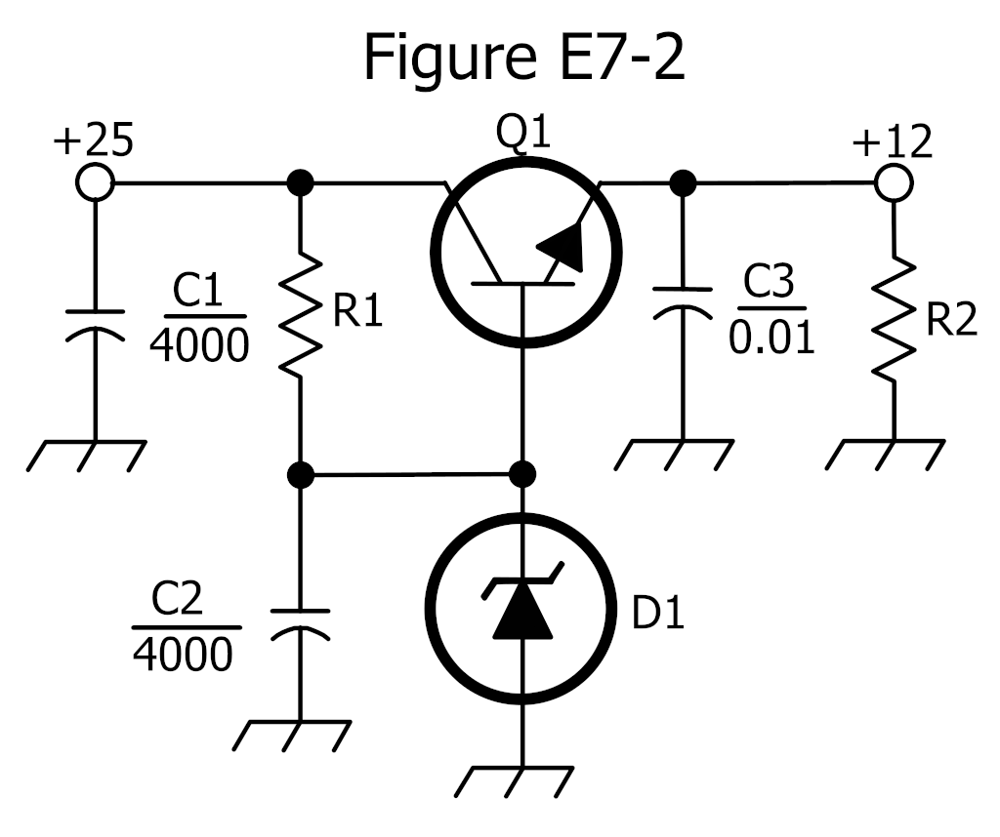

## 电台直流供电、蓄电池与配线

业余电台（尤其 VHF/UHF 手持台、车载台与 HF 便携台）常以 **直流** 工作，典型标称电压为 **$13.8\,\mathrm{V}$** （接近汽车电瓶的 $12\,\mathrm{V}$ ）。理解蓄电池的连接方式与配线，是搭建电台的基础。

**蓄电池的串并联** ：把 **相同规格** 的蓄电池并联，总电压保持不变、容量（安时 $\mathrm{Ah}$）相加；把相同蓄电池 **串联**，总电压相加、容量不变。

> 例题：两只 $12\,\mathrm{V}$ 、 $20\,\mathrm{Ah}$ 的蓄电池 **并联** ，得到 **$12\,\mathrm{V}$ 、 $40\,\mathrm{Ah}$** ；若改为 **串联** ，则得到 **$24\,\mathrm{V}$ 、 $20\,\mathrm{Ah}$** 。

**内阻与端电压** ：蓄电池并非理想电压源，内部存在一定 **内阻** 。向外供电时，电流流经内阻产生压降，于是 **端电压 $= $ 开路电压 $−$ 内阻 $\times$ 放电电流** ；负载越重（电流越大）端电压越低。容量（ $\mathrm{Ah}$ ）表示“以某电流可放电的小时数”所对应的电荷量；若放电电流超过额定值，实际可用容量会下降、电池也更快发热。

常见蓄电池各有取舍： **铅酸电池** 成本低但笨重，充电析出的氢气在通风不良时有爆炸风险； **镍氢（NiMH）** 可反复充电，比一次性碱性电池更经济环保； **锂离子（Li-ion）** 能量密度高（单位重量容量大）、适合便携，但严禁短路或过充，否则有起火危险。

**配线与安全** ：为百瓦级电台供电时，直流电流可达 $20\,\mathrm{A}$ 量级（由 $P=UI$ 估算），必须用 **足够粗的导线** 以减小电压降——导线越细越长，压降越大，可能导致电台端电压不足而工作异常。熔丝应串在 **正极引线靠近电池的一端** ，使整条供电线路都在保护范围内，过流时及时切断、避免起火。相比开关电源，线性电源因半导体多工作在线性区、开关动作少，产生的射频噪声通常更低，在易受干扰的场合更受青睐。

> 例题：某电台要求电压降不超过 $0.5\,\mathrm{V}$ ，电池距电台 $3\,\mathrm{m}$ 。在所需电流 $22\,\mathrm{A}$ 下，若选用每米压降约 $0.07\,\mathrm{V}$ 的 $10$ 号（AWG）导线， $3\,\mathrm{m}$ 总压降约 $0.21\,\mathrm{V}$ ，满足要求；若用每米约 $0.11\,\mathrm{V}$ 的 $12$ 号导线， $3\,\mathrm{m}$ 约 $0.33\,\mathrm{V}$ ，也足够；再细则会超限。

## 电路噪声

**电阻** 等无源元件也会产生噪声，因为所有电路元件都会产生 **热噪声** ，其大小与阻值及温度有关（约翰逊–奈奎斯特噪声，功率正比于电阻、温度与带宽）。有源器件的噪声主要包括 **散粒（散弹）噪声** 和 **热噪声** 。过长的同轴电缆或 VSWR 过高的电缆会为收信机增添热噪声，因为二者都增加了电缆的欧姆损耗；大气放电引起的 **大气噪声** 又称 **天电噪声** ，简称 **QRN** ，其强度一般随频率升高而减弱。劣质开关电源给接收机增添的电磁噪声，源头主要是开关电路的 **谐波辐射** 。

## 常用电路符号识读

读射频/电源电路图时，要能辨认下列抽象符号（与前文“电路图中的常见元器件符号”互为补充）：

图 G7-1 中：符号 1 表示 **场效应管（FET）** ，符号 2 表示 **NPN 双极型三极管** ，符号 5 表示 **稳压二极管（齐纳管）** ，符号 6 表示 **实心磁芯变压器** ，符号 7 表示 **带抽头的电感** 。
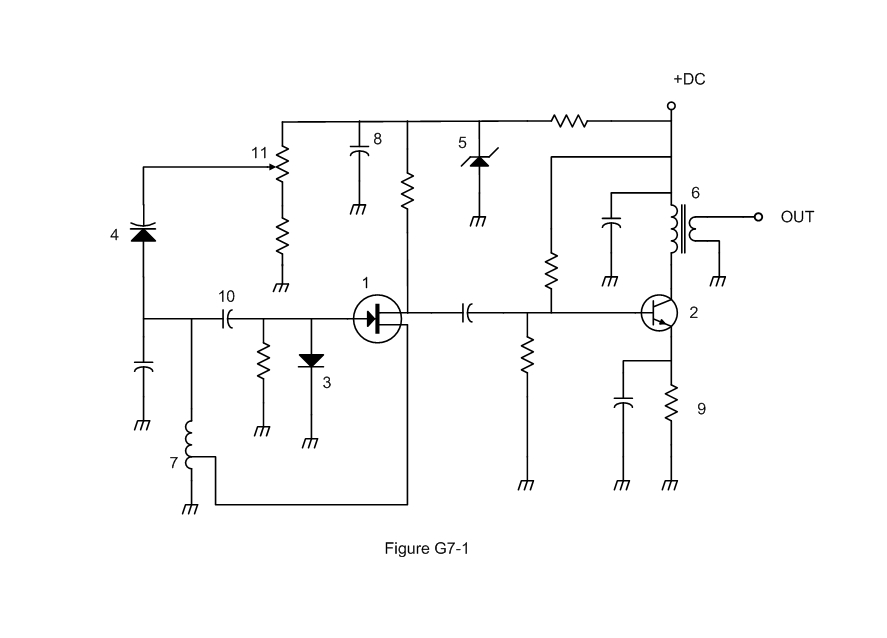

关于二进制计数器的状态数与分频链（$n$ 位计数器有 $2^n$ 个状态、$N$ 级触发器实现 $2^N$ 分频），详见《数字逻辑与软件无线电》。

## 整流、滤波与稳压补充要点

**整流二极管的两个主要额定值** 都不可超过： **峰值反向电压（PIV，Peak Inverse Voltage）** 与 **平均正向电流** 。在电容输入滤波的半波整流中，二极管截止时承受的反向峰值约为 **$2.8$ 倍的交流有效值** （即两倍峰值 $2\sqrt{2}\,V_{\mathrm{RMS}}\approx2.83\,V_{\mathrm{RMS}}$ ）；全波中心抽头整流里每只二极管同样承受约 $2.8$ 倍次级有效值的 PIV 。

> 例题：若变压器次级有效值为 $120\,\mathrm{V}$ ，峰值约 $170\,\mathrm{V}$ ，则半波电容滤波电路中二极管的 PIV 约为 $2\times170\approx340\,\mathrm{V}=2.8\times120\,\mathrm{V}$ 。

**纹波频率** ：半波整流输出脉动频率为 **市电频率** （如 $60\,\mathrm{Hz}$ ），全波（桥式或中心抽头）整流利用两个半周，纹波频率为 **两倍市电频率** （ $120\,\mathrm{Hz}$ ）。

**滤波方式** 主要有两类： **电容输入滤波** 输出电压较高，但负载变化时稳压较差； **电感（扼流圈）输入滤波** 稳压更好，却要求始终有 **最小负载电流** （常由 **泄放电阻（bleeder）** 维持）。电感对直流几乎无阻碍、却阻碍交流成分；泄放电阻除了给电容提供放电通路，还能改善稳压。滤波的“第一只电感＋第一只电容”若凑成串联谐振，可能把纹波放大造成过压，设计时要避开。

**倍压整流** ：全波倍压电路利用交流的两个半周分别给电容充电，得到约两倍的直流输出。

> 例题：桥式整流与全波中心抽头整流相比， **不需要带中心抽头的变压器** ；在同样次级电压下，桥式输出的直流约为中心抽头全波的两倍。

稳压方面，除前文提到的串联/并联线性稳压与三端稳压器外，还有两点值得补充：线性稳压的 **基准电压常由稳压二极管提供** ；需要稳压器“看见”负载端的真实电压时，可用 **远端取样（remote sensing）** ——把误差放大器的采样点直接连到负载端。稳压质量分 **静态稳压** （应对负载长期变化）与 **动态稳压** （应对负载短期突变，加大输出电容可改善）。

## 振荡器类型补充（考毕兹、中和与电子管放大）

**电容三点式振荡器（考毕兹振荡器，Colpitts）** 的反馈取自两个 **串联电容** 对谐振回路的分压，与电感三点式（哈特莱）用抽头线圈提供反馈相对；它常用于要求较高稳定度的 VFO，反馈电容常选用温度系数小的 **云母电容** 以减小频率漂移。皮尔斯（Pierce）振荡器则用一只晶体串联电容构成反馈，晶体工作于串联谐振点附近。

**中和（neutralization）** 用于部分射频放大器（尤其电子管放大器）：放大管的极间电容会把输出的一部分反馈回输入，形成不需要的正反馈，可能引起 **寄生振荡** 。中和电路用电容/电感抵消这部分反馈，正是为了 **消除寄生振荡** ；实际调试时通常以“改变输出回路而栅流变化最小”作为中和良好的判据。

早期大功率射频放大器多用 **电子管** ，例如 **接地栅（grounded-grid）** 放大器：输入信号加在阴极，屏极经 **旁路电容** 接到 π 网络、并通过 **射频扼流圈（RFC）** 接到高压 B+ ，阴极经 RFC 接到偏置 B− 。这类放大器的屏极高压可按“输出功率÷（电流×效率）”估算：

> 例题：一台接地栅放大器输出 $400\,\mathrm{W}$ 、工作电流 $400\,\mathrm{mA}$ 、效率约 $50\%$ ，所需屏极高压约为
> $$
> V_{B+} = \dfrac{P}{I\cdot\eta} = \dfrac{400}{0.4\times0.5} = 2000\,\mathrm{V}
> $$

