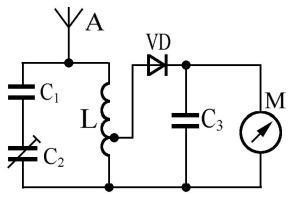

用 **万用表直流电压档** 测量正负对称的方波（占空比 $1:1$ ），读数为 **零值** ——因为波形正负面积相等，平均直流分量为零。若改用磁电式 **交流电压档** 测量同一对称方波，指针读数会 **大于该电压的峰值** ：交流档内部按正弦波的有效值刻度，而方波的有效值（等于其峰值）按正弦换算关系读出时会偏大。若直流档测量的是最小值为 $0$ 、占空比 $1:1$ 的方波（只有正向脉冲），读数则是该电压 **峰值的一半** ，即其平均直流分量。

用 **电阻档** 测量电路时，若开始指示阻值很小、随时间延长阻值越来越大，说明电路两端可能存在一个 **很大的电容** ：表内电池在对电容充电，初始充电电流大、等效电阻小，随着电荷充满电流减小、读数上升。若测一个元件时表笔第一次连接表针挥动一下很快回到零位、断开重连却毫无指示，则该元件很可能是一支 **电解电容器** （充电瞬间有电流冲击，稳态则近似开路）。检查电解电容器好坏可用 **指针式万用表的电阻档** （观察充放电挥动）或 **数字万用表的电容测试档** 。

指针式电压档有一个 **“欧姆/伏”（每伏欧姆）** 指标，数值越大说明测量电压时电表对电路工作状态的影响越小——因为这意味着电表内阻高、从被测电路分流少。 **数字万用表直流电压档** 测量两点间一个等幅音频信号时若读数不为零，且交换两支表笔后读数极性反转，则表明该音频信号上 **叠加有直流成分** （纯交流成分交换表笔读数极性应不变、仅数值相同）。

## 示波器耦合与图表的用途

**示波器** 的输入耦合方式决定它能观察到什么。用 **交流耦合档** 测量一个正负对称的等幅音频信号时，示波器内部电容会隔断直流，只显示交流波形；若切换到 **直流耦合档** ，波形在垂直方向上发生明显偏移，说明原信号上 **叠加有直流成分** ——交流耦合把这部分直流去掉了，直流耦合则把它一并显示出来。

不同测量或调制原理适合用不同图表表达： **相位矢量图（星座图）** 最适合表达 PSK 的相位状态； **频谱图** 最直观展示 FM 的边带结构和 SSB 的载波抑制及单边带特性； **频率-时间曲线** 适合展示 RTTY、SSTV 这类频率随时间变化的调制； **波形图** 最便于比较 A、B、C 类放大器的工作点与导通角差异； **频谱瀑布图** 则把频率、幅度、时间同时显示出来，最适合观察 LC 振荡器因温度漂移引起的频率缓慢变化。

## 场强表与射频仪表使用

简易场强表的典型结构如图所示：天线 **A** 接收电波；并联的可变电容 **C1、C2** 与电感 **L** 组成 **LC 谐振回路** ，用来选择欲测频率；二极管 **VD** 对高频信号进行 **检波** ，得到直流或低频电流；电容 **C3** 起 **旁路滤波** 作用，滤除残余高频；直流微安表 **M** 则指示场强大小。

用这种电路做射频场强表时，检波二极管可选 **锗二极管** 或 **硅二极管** 。锗管起始导通电压约为 **$0.3\,\mathrm{V}$**，硅管约为 **$0.7\,\mathrm{V}$** 。锗管导通所需信号幅度更低，因此场强表更灵敏。

使用 **网络分析仪** 或 **天线分析仪** 测量电缆和天线时，需要用校准件进行校准。校准件通常包括 **$50\,\mathrm{\Omega}$ 匹配负载（假负载）** 、 **开路接头** 和 **短路接头** 。开路、短路、匹配负载三种已知终端分别对应反射系数 $+1$ 、 $-1$ 、 $0$ ，仪器据此修正系统误差。

为 FM 电台选择 **驻波比表** 时，主要注意其 **频率范围** 和 **功率量程** 是否与电台工作频段及输出功率匹配。测量发射机输出功率时，驻波比表应装在 **发射机与馈线之间** ，此时读数反映的是馈线输入端的正向功率。

## 分贝与增益计算

在无线电工程中， **分贝（ $\mathrm{dB}$ ）** 是表示功率比或电压比的常用对数单位。功率增益（或损耗）定义为：

$$
    G = 10\log_{10}\left(\dfrac{P_{\mathrm{out}}}{P_{\mathrm{in}}}\right)\,\mathrm{dB}
$$

电压增益（在输入、输出阻抗相同的情况下）为：

$$
    G = 20\log_{10}\left(\dfrac{V_{\mathrm{out}}}{V_{\mathrm{in}}}\right)\,\mathrm{dB}
$$

记住几组常用数值：功率比 $100$ 倍对应 $20\,\mathrm{dB}$ ， $1{,}000{,}000$ 倍对应 $60\,\mathrm{dB}$ ；电压比 $100$ 倍对应 $40\,\mathrm{dB}$ ， $10{,}000$ 倍对应 $80\,\mathrm{dB}$ ， $10$ 倍对应 $20\,\mathrm{dB}$ 。比值为 $5$ 时功率增益约为 $10\log_{10}5\approx 7\,\mathrm{dB}$ ；功率减半对应 $-3\,\mathrm{dB}$ ；电压减半对应 $-6\,\mathrm{dB}$ 。当输出小于输入时，分贝值为负，表示衰减。

增益也常以绝对功率单位表示：**$\mathrm{dBm}$** 以 $1\,\mathrm{mW}$ 为参考， **$\mathrm{dBW}$** 以 $1\,\mathrm{W}$ 为参考， **$\mathrm{dB\mu}$** 以 $1\,\mu\mathrm{W}$ 为参考。它们的关系是：

$$
    P(\mathrm{dBm}) = P(\mathrm{dB\mu}) - 30 = P(\mathrm{dBW}) + 30
$$

即 $0\,\mathrm{dBm}=30\,\mathrm{dB\mu}=-30\,\mathrm{dBW}$ 。

当信号依次通过增益分别为 $x\,\mathrm{dB}$ 、 $y\,\mathrm{dB}$ 、 $z\,\mathrm{dB}$ 的电路时， **总增益为 $(x+y+z)\,\mathrm{dB}$** ，对应的功率倍数为 $10^{\dfrac{x+y+z}{10}}$ 。若增益为 $x\,\mathrm{dB}$ 的信号经二等分功率分配器分成两路，则每路功率减半，对应衰减 $3\,\mathrm{dB}$，每路增益变为 $(x-3)\,\mathrm{dB}$ ，倍数为 $10^{\dfrac{x-3}{10}}$ 。

下面是几个典型计算示例。

## 示波器、频谱仪与高级测量

- **数字示波器最高可显示频率** 受内部 **ADC 采样率** 限制；当采样率不足时，高频信号会经 **混叠（aliasing）** 表现为虚假的低频波形，因此测量高频须保证采样率足够高并开启抗混叠。
- **示波器探头补偿** ：用方波校准探头，使方波边沿平整（无过冲或下塌）；测量时应 **尽量缩短探头的接地引线** ，否则引线电感会引入振铃与噪声。测量线性电源的输出纹波，通常用与市电同步的 **Line（电源）触发** 使波形稳定。
- **预分频器（prescaler）** ：把过高的频率先除以一个整数，降到频率计或计数器能直接计数的量程内。
- **频谱分析仪** ：横轴是 **频率** 、纵轴是 **幅度（常取 $\mathrm{dBm}$ ）** ，用来观察发射机的杂散、互调产物与相位噪声。
- **真有效值表（true-RMS）** ：对任意波形都能测出真实有效值，不同于早期按正弦平均响应的表（后者对非正弦会读错）。
- **ADC 类型** ：**逐次逼近型（SAR）** 逐位比较、速度中等；**快闪型（flash）** 并行比较、速度极快但位数有限。给 ADC 输入加入极少量 **抖动（dither）** 噪声，可改善微弱信号的量化分辨。**总谐波失真（THD）** 常作为衡量 ADC/放大器质量的指标。
- **频率计数器精度** 主要取决于其内部 **时基精度** （晶振的稳定度）。

数字示波器在采样率不足时，会把真实高频信号显示成一条 **虚假的低频波形** ，这就是混叠现象。

用示波器探头测量时， **接地引线越短越好** ，过长会引入振铃与噪声；测线性电源纹波宜用 **Line 触发** 使波形稳定。

**天线分析仪** 除了测天线驻波比，还能测量馈线的 **速度因子** 、估算 **电缆长度** 、并扫频找出 **谐振频率** （SWR 最小处）。

频率计数器的读数精度主要受 **时基（参考晶振）精度** 影响。

## S 参数与矢量网络分析仪

射频两端口网络常用 **S 参数** 描述，下标表示“测量端口”：

- **$S_{11}$** 是端口 1 的反射，等价于 **输入回波损耗 / 反射系数 / VSWR** ；
- **$S_{21}$** 是端口 1 到端口 2 的传输，等价于 **前向增益（或插入损耗）** 。

**矢量网络分析仪（VNA）** 借助短路、开路、 $50\,\Omega$ 三种校准件（前文已介绍）修正误差后，可测量 **输入/输出阻抗、反射系数** ，也能扫频绘出 **滤波器的频率响应** 。

$S_{21}$ 表示信号从端口 1 传到端口 2 的情况，即 **前向增益（插入损耗）** ； $S_{11}$ 表示端口 1 的反射情况，即 **回波损耗（反射系数/VSWR）** 。

用 VNA 测一个滤波器，可得其 **频率响应** 曲线（通带、阻带与过渡带）；用 VNA 测天线端子，可得其 **输入阻抗与反射系数** 。

## 定向功率计读数分析

定向功率计能同时读出发射机输出的 **正向功率** 与负载反射回来的 **反射功率** ，两者之差即为负载实际吸收的功率。

> 例题：定向功率计接在发射机与负载之间，读得 **正向功率 $100\,\mathrm{W}$** 、 **反射功率 $25\,\mathrm{W}$** ，则负载实际吸收的功率为
> $$
> P_{\mathrm{abs}}=P_{\mathrm{fwd}}-P_{\mathrm{refl}}=100-25=75\,\mathrm{W}
> $$

某放大器增益为 $20\,\mathrm{dB}$ ，意味着输出功率是输入功率的 $100$ 倍。放大器只是把电源能量按输入信号的规律“搬运”到负载，并非凭空产生能量，因此说“把相当于输入信号的 $100$ 倍的能量从电源转移到负载”是正确的物理描述。

> 例题：若电路输出功率是输入功率的 $100$ 万倍，增益为 $10\log_{10}\left(10^6\right)=60\,\mathrm{dB}$ 。输出功率是输入功率的 $5$ 倍时，增益约为 $10\log_{10}5\approx 7\,\mathrm{dB}$ 。输入功率是输出功率的一半，即输出为输入的 $\dfrac{1}{2}$ ，增益为 $-3\,\mathrm{dB}$ 。输出电压是输入电压的 $100$ 倍，电压增益为 $20\log_{10}100=40\,\mathrm{dB}$ ；若是 $1$ 万倍，则为 $80\,\mathrm{dB}$ ；若是 $10$ 倍，则为 $20\,\mathrm{dB}$ 。输入电压是输出的一半，电压增益为 $20\log_{10}\left(\dfrac{1}{2}\right)\approx -6\,\mathrm{dB}$ 。输出电压为输入的 $\dfrac{1}{100}$ 时，电压增益为 $-40\,\mathrm{dB}$ ；为 $\dfrac{1}{10}$ 时，电压增益约为 $-20\,\mathrm{dB}$ 。

> 例题：接收机的 **S 表** 通常按 $1$ ~ $9$ 分度，相邻分度差 $6\,\mathrm{dB}$ 。若某电台以 $15\,\mathrm{W}$ 发射时读数为 $S_9$，功率降为 $S_4$ 时降低了 $5$ 个分度，即 $5\times6=30\,\mathrm{dB}$ 。 $15\,\mathrm{W}=10\log_{10}15\approx 11.8\,\mathrm{dBW}$ ，降低 $30\,\mathrm{dB}$ 后为 $-18.2\,\mathrm{dBW}$ ；换算成功率约为 $10^{-\dfrac{18.2}{10}}\,\mathrm{W}\approx 15\,\mathrm{mW}$ 。

> 例题：若 $100\,\mathrm{W}$ 对应 $S_8$ ，读数降到 $S_5$ 时降低了 $3$ 个分度，即 $18\,\mathrm{dB}$ 。$100\,\mathrm{W}=20\,\mathrm{dBW}$ ，降低 $18\,\mathrm{dB}$ 后为 $2\,\mathrm{dBW}$ ；对应功率约为 $10^{\dfrac{2}{10}}\,\mathrm{W}\approx 1.58\,\mathrm{W}$ 。

> 例题：功率为 $0\,\mathrm{dBm}$ 的信号通过增益 $23\,\mathrm{dB}$ 的电路，输出功率为 $0+23=23\,\mathrm{dBm}$ ，即 $10^{\dfrac{23}{10}}\,\mathrm{mW}\approx 200\,\mathrm{mW}$ ，也等于 $23-30=-7\,\mathrm{dBW}$ 。

> 例题：功率为 $0\,\mathrm{dB\mu}$ 的信号通过增益 $36\,\mathrm{dB}$ 的电路，由于 $0\,\mathrm{dB}\mu=-30\,\mathrm{dBm}$ ，输出为 $6\,\mathrm{dBm}$，即 $10^{\dfrac{6}{10}}\,\mathrm{mW}\approx 4\,\mathrm{mW}$ ，也等于 $6-30=-24\,\mathrm{dBW}$ 。 $447\,\mathrm{mV}$ 是电压值，不是功率单位，不能作为输出功率。

> 例题：功率为 $0\,\mathrm{dBW}$ 的信号通过 $-36\,\mathrm{dB}$ 的衰减器，输出功率为 $0-36=-36\,\mathrm{dBW}$ ，即 $-6\,\mathrm{dBm}$ ，对应 $10^{-\dfrac{6}{10}}\,\mathrm{mW}\approx 0.25\,\mathrm{mW}$；换算成 $\mathrm{dB\mu}$ 为 $-36+60=24\,\mathrm{dB\mu}$ 。

> 例题：功率为 $-133\,\mathrm{dBm}$ 的信号通过 $60\,\mathrm{dB}$ 放大器，输出功率为 $-73\,\mathrm{dBm}$ 。换算： $-73\,\mathrm{dBm}=-73+30=-43\,\mathrm{dB}\mu$，$-73\,\mathrm{dBm}=-73-30=-103\,\mathrm{dBW}$ 。$50\,\mathrm{\mu V}$ 是电压，不是功率单位，因此不作为“输出功率”的表述。

## 其他测量仪器与读数扩展

**吸合式频率计（dip meter / grid-dip meter）** 是一个带指示电流表的 **可变频率振荡器** 。把它 **松散地耦合** 到待测调谐回路附近，当振荡频率扫过回路的谐振点时，回路会从振荡器“吸收”能量，使指示电流出现一个 **下陷（dip）** ，由此读出回路的 **谐振频率** 。它最擅长测并联/串联调谐回路、天线陷波器、滤波器等谐振结构的谐振频率，但不能直接给出电容或电感的具体数值，也不是精确的场强计或功率计。

**信号发生器（signal generator）** 是高稳定度的可调振荡源，能产生 **频率与幅度均可调** 的信号，用来注入被测电路。它的输出衰减器刻度只有在 **正确终接（terminated）标称阻抗** （通常 $50\,\Omega$ ）时才准确；若负载不匹配，实际输出会偏离刻度。

**频率计数器（frequency counter）** 直接测量频率，读数精度取决于内部 **时基（time base）** 的准确度与稳定度，时基通常由 **晶体振荡器** 提供。时基误差以 **ppm（百万分之一）** 计，因此实际频率与读数的最大可能偏差为
$$
\Delta f = f_{\mathrm{read}}\times\delta_{\mathrm{ppm}}\times 10^{-6}
$$
（式中 $f_{\mathrm{read}}$ 为计数器读数，$\delta_{\mathrm{ppm}}$ 为时基误差的 ppm 数值。）

> 例题：一台时基误差 $\pm0.1\,\mathrm{ppm}$ 的计数器读得 $146\,520\,000\,\mathrm{Hz}$ ，实际频率最多偏离
> $$
> 146.52\times10^6 \times 0.1\times10^{-6} = 14.652\,\mathrm{Hz}
> $$
> 若时基误差为 $10\,\mathrm{ppm}$ ，则最多偏离 $146.52\times10^6\times10\times10^{-6}=1465.2\,\mathrm{Hz}$ 。

可用 **标准频率台** （如美国的 WWV、中国的 BPM）做零拍校准：把待测振荡器与标准频率台的信号同时接收，调节至二者 **差拍声尽可能低、周期尽可能长** ，即可判定频率对准。更高等级的频率基准还有 TCXO、OCXO、GPS 驯服钟等（见《放大器、滤波器、振荡器与整流电路》）。

**利萨如图形（Lissajous figure）** 是把两个频率分别加到示波器的水平与垂直偏转上形成的轨迹，用来比较两信号的频率比或相位差：若两频率成简单整数比，图形会出现整数个瓣； **相位差为 $0\degree$ 或 $180\degree$ 时退化为一条对角线直线** ，相位差 $90\degree$ 时趋于椭圆或圆。设水平通道频率为 $f_x$ 、垂直通道为 $f_y$ ，则图形在水平方向与垂直方向的瓣数之比等于 $f_y:f_x$ 。

> 例题：水平通道送入 $100\,\mathrm{kHz}$ 、垂直通道为未知频率，屏上 **水平方向 $2$ 个瓣、垂直方向 $5$ 个瓣** ，则
> $$
> f_x : f_y = 5 : 2 \quad\Rightarrow\quad f_y = 100\,\mathrm{kHz}\times\dfrac{2}{5} = 40\,\mathrm{kHz}
> $$

示波器的 **带宽** 指它能正常显示的最高信号频率；测量时应根据被测信号频率选用足够的带宽，并用 **已补偿的探头** （接地引线尽量短）以免引入振铃。

**电表量程扩展与灵敏度** ：动圈表头由 **满偏电流 $I_g$** 与 **内阻 $R_g$** 决定。要扩成更大量程的 **电流表** ，需 **并联分流电阻（shunt）** ；要改成 **电压表** ，需 **串联倍率电阻（multiplier）** 。

> 例题：一只表头满偏电流 $40\,\mu\mathrm{A}$ 、内阻 $96\,\Omega$ ，想改成 $0\sim1\,\mathrm{mA}$ 电流表。并联分流电阻 $R_s$ 后表头仍走 $40\,\mu\mathrm{A}$ ，其余电流走 $R_s$ ，且两者两端电压相等：
> $$
> I_g R_g = (I - I_g)R_s \;\Rightarrow\; 40\times10^{-6}\times96 = (10^{-3}-40\times10^{-6})R_s
> $$
> $$
> R_s = \dfrac{40\times10^{-6}\times96}{0.00096} \approx 4\,\Omega
> $$

> 例题：一只满偏 $1\,\mathrm{mA}$ 、内阻 $0.5\,\Omega$ 的表头改成 $20\,\mathrm{V}$ 量程电压表，需串联倍率电阻 $R_m$ ：
> $$
> R_m + R_g = \dfrac{U}{I_g} = \dfrac{20}{0.001} = 20000\,\Omega \;\Rightarrow\; R_m = 20000 - 0.5 \approx 19999.5\,\Omega
> $$

> 例题：一只 $150\,\mathrm{V}$ 量程、内阻 $150\,\mathrm{k}\Omega$ 的电压表，扩到 $750\,\mathrm{V}$ ，需串联倍率电阻
> $$
> \dfrac{750}{150}\times150\,\mathrm{k}\Omega - 150\,\mathrm{k}\Omega = 5\times150\,\mathrm{k}\Omega - 150\,\mathrm{k}\Omega = 600\,\mathrm{k}\Omega
> $$

电压表的 **灵敏度** 常以 **$\Omega/\mathrm{V}$** 表示，等于表头满偏电流的倒数 $1/I_g$ ；灵敏度为 $20\,\mathrm{k}\Omega/\mathrm{V}$ 的电压表，其满偏电流为 $1/(20\times10^3)=50\,\mu\mathrm{A}$ 。把电压表切到更高量程，本质上就是在表头 **串联更大的倍率电阻** 。
