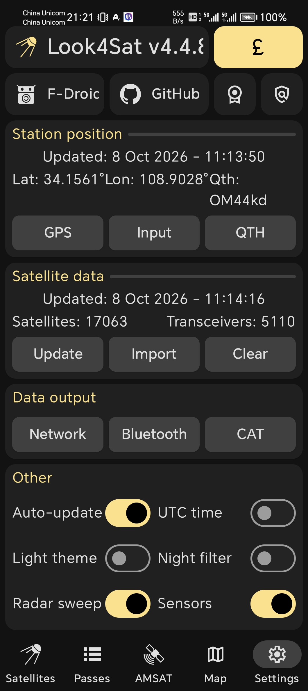
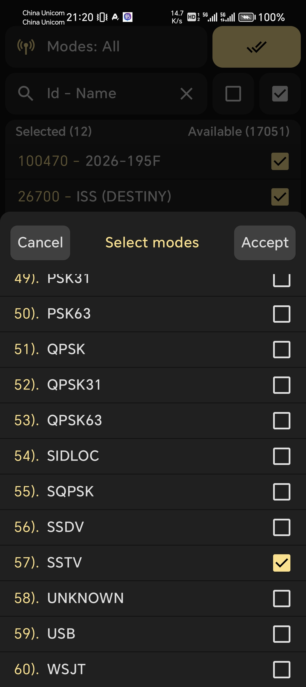
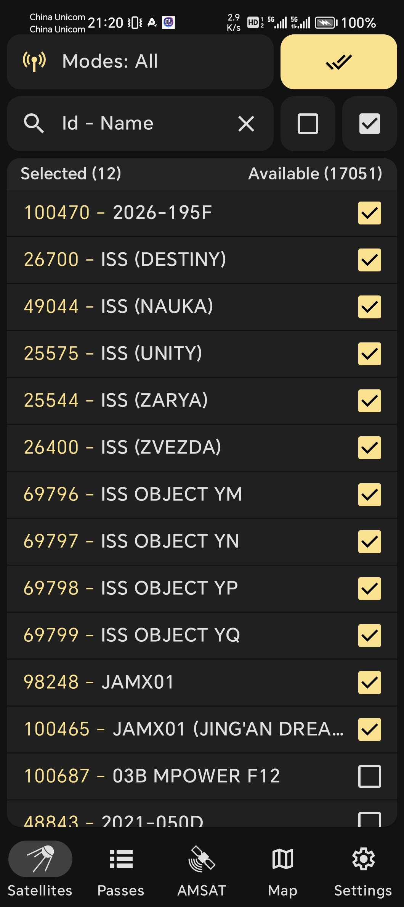
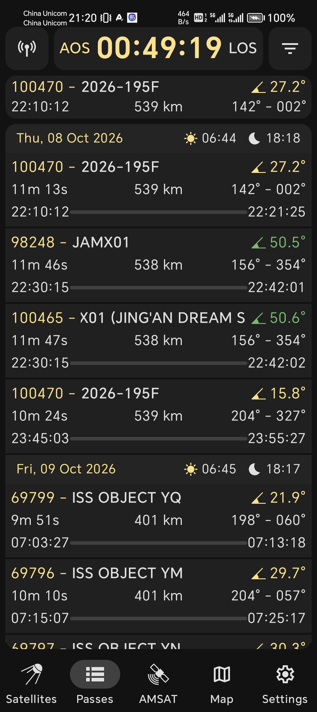
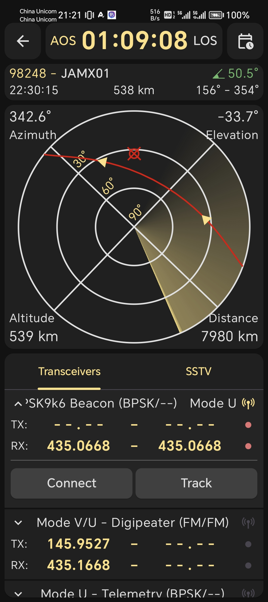
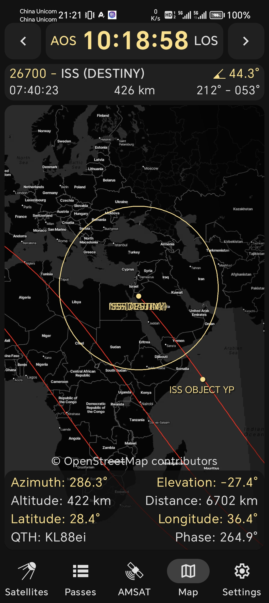

---

title: 追星方法
description: 讲解追踪业余卫星过顶、计算轨道与完成卫星通联的实操方法。

---

## 追星软件介绍

### Look4Sat

Look4Sat是一款Android平台的开源卫星追踪与过境预测软件，官方下载地址为[https://github.com/rt-bishop/Look4Sat](https://github.com/rt-bishop/Look4Sat)。

安装后可以看到下方有5个界面，分别为“Satellites”、“Passes”、“AMSAT”、“Map”和“Settings”。打开软件后，首先推荐在“Settings”界面中的“Station position”中点击“GPS”按钮，更新当前所在位置。然后在“Satellite data”中点击“Update”按钮，更新卫星数据库。

以追一颗有SSTV下行业务的卫星为例，来到“Satellites”页面，点击左上角“Modes\: All”，勾选“SSTV”复选框，点击“Accept”按钮。

然后就可以在“Satellites”页面中勾选需要跟踪的卫星，并点击右上角的对钩按钮。如果数目太多，还可在上方“Id \- Name”搜索框中输入卫星名称或NORAD ID进行筛选。

来到“Passes”界面，就是一个以过境时间从早到晚排序的列表，例如图中第一条“100470 \- 2026\-195F”就是在当前位置上、距离现在最近的、还未到来的卫星过境事件，这颗卫星名叫“2026\-195F”，他的NORAD ID为100470。“11m 13s”表示这颗卫星这次过境时共持续的时间，左右两侧的“22\:10\:12”和“22\:21\:25”分别为AOS和LOS。“$\angle 27.2\degree$”表示本次过境时最高仰角，这个仰角的数字为黄色时表示仰角较小，为绿色时表示仰角较大，在右上角点击按钮可以弹出“Filter passes”筛选框，把“Minimal elevation”拉低后列表中会多出一些红色字体的、最大仰角很低的过境事件。

点开列表中任何一个过境事件，如下图，图中中间为一个大罗盘。将手机水平放置并转动时，可以看到罗盘在转动。拿起手机，手机与水平面的夹角越大，也就是仰角越大，图中的红色叉号与圆圈重叠的光标将接近罗盘圆心，反之平放则贴近罗盘边缘。在追星时，手机将与天线（如八木天线这类指向性特别强的天线）方向平行。罗盘中红线即为该卫星本次过境时，天线需要划过的路径，三角形标注了移动方向。下方为“Transceivers”列表，里面是该卫星可能的上下行业务，TX和RX分别为发射和接收频率，这个频率会实时地自动根据多普勒效应进行修正。

在“Map”界面中，可以选中需要跟随的卫星，显示他目前所在地图上哪个地方的上空，以及某些卫星（或空间站）会给出覆盖范围。红色路径表示还未经过的路径。

