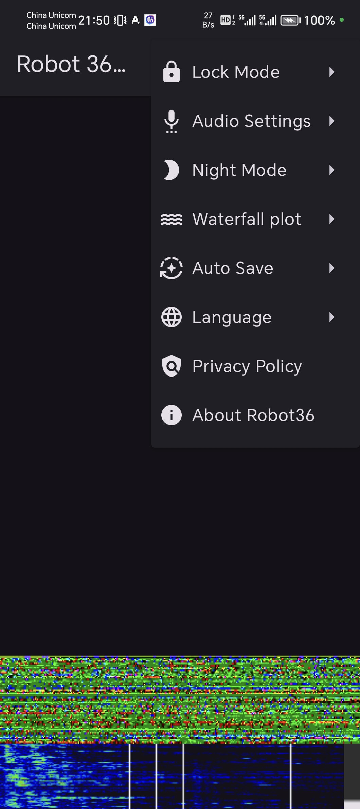

## SSTV解码软件

### Robot36

Robot36是一款Android平台上的开源SSTV解码软件，官方下载地址为[https://github.com/xdsopl/robot36](https://github.com/xdsopl/robot36)。

打开应用后，应用自动从手机麦克风收集音频并实时解码，下图屏幕下方即为解码结果，但因为目前没有SSTV音频，所以是乱码。Robot36在启动时，选择的编码模式为自动，他会自动从SSTV音频开头的协议信号中自动选择相应的协议。在信号接收效果差的时候，可能协议无法自动识别，所以需要点击右上角菜单，弹出如图下拉菜单。在“Lock Mode”中选用所需的协议。

Robot36在启动时也默认开启了自动保存，也就是收到一张SSTV图像结束的信号时，自动保存，用户也可以手动点击右上角保存按钮来保存。注意这个应用比较简陋，如果没能自动保存，也没能手动保存，则这张SSTV图像将会丢失。

### MMSSTV

待补充。

### QSSTV

待补充。
