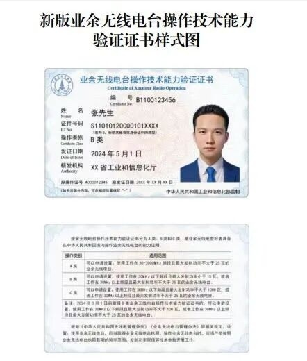
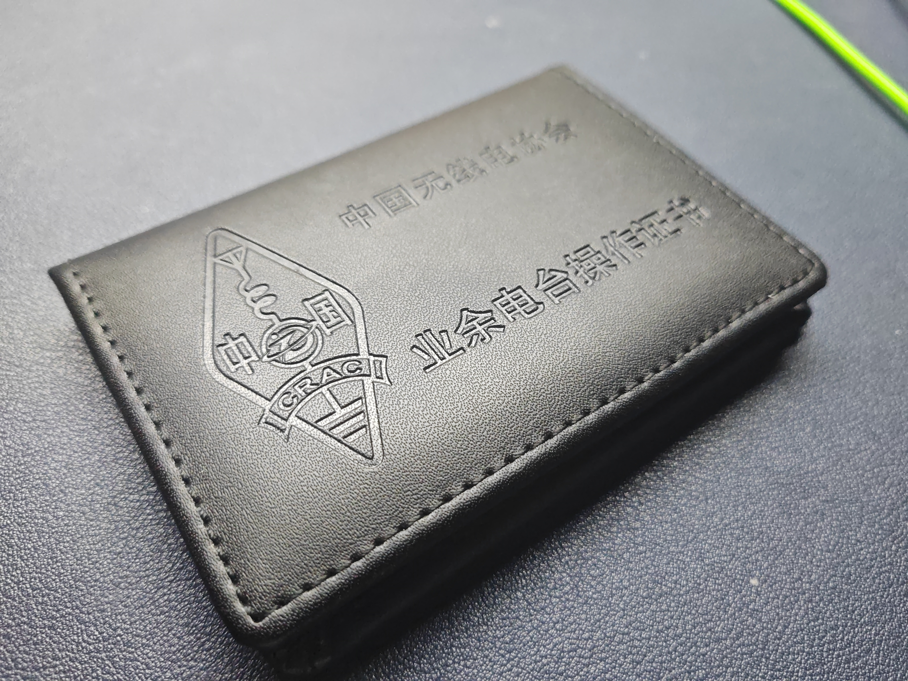
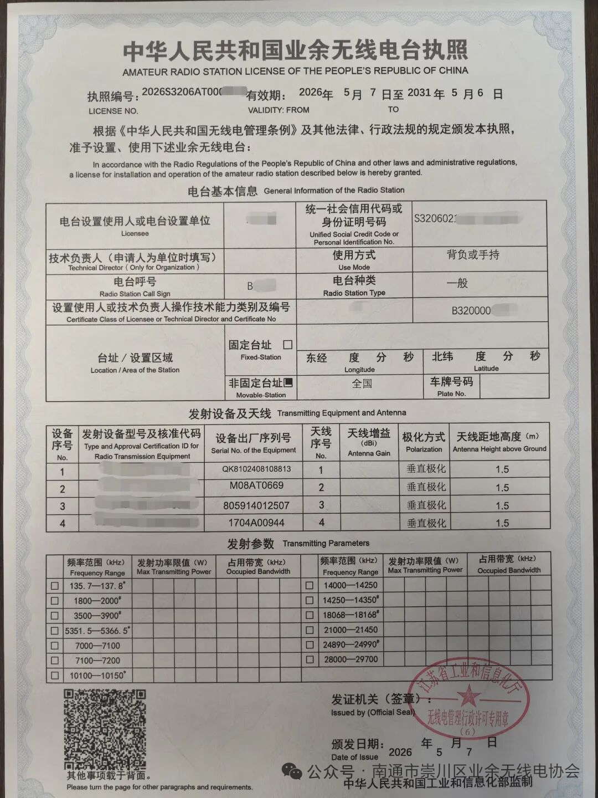
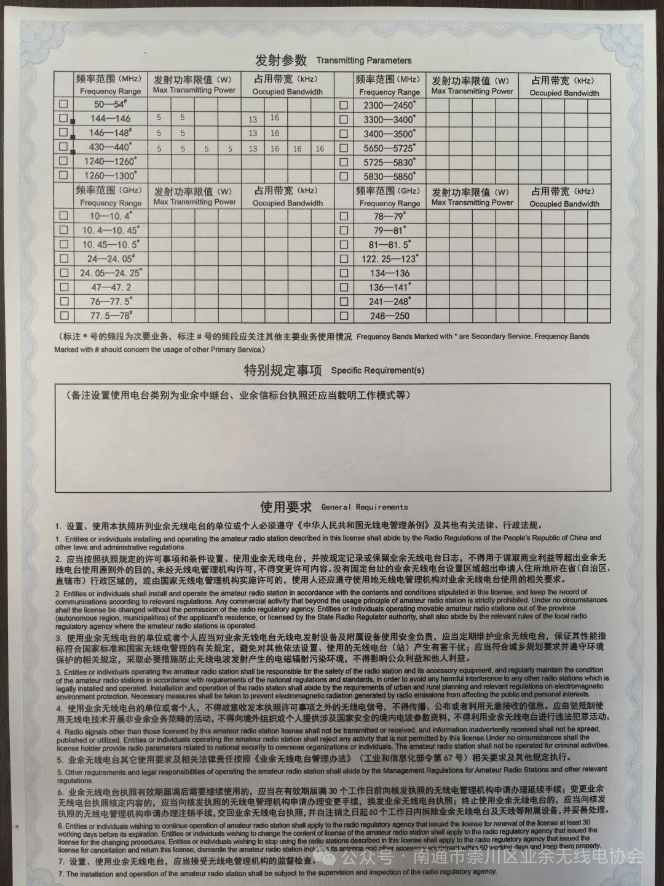
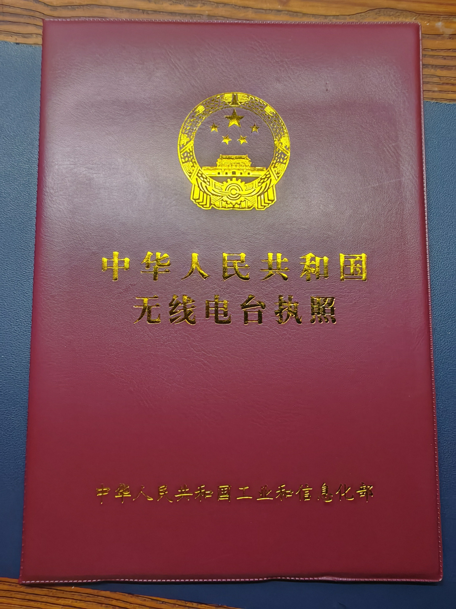

import { Aside } from '@astrojs/starlight/components';

业余无线电（Amateur Radio）是由经批准、对无线电技术有兴趣、纯为个人爱好而不涉及牟利的人员，利用指定频段进行的双向通信。想合法地"上电台说话"，通常要依次完成两件事： **先考取操作证（人证），再办理电台执照（台证）并取得呼号** 。

## 第一步：考取操作证（人证）

操作证全称业余无线电台操作技术能力验证证书，分为 **A、B、C** 三类（由低到高），持有操作证才有资格操作电台。初次入门一般从 **A 类** 考起：

- A 类：可在 $30\mathrm{MHz}$ 以上的 VHF/UHF 等频段操作，覆盖绝大多数本地通联、中继台使用场景，是绝大多数新手的首选。
- B 类：在 A 类基础上增加短波（HF， $30\mathrm{MHz}$ 以下）权限，适合想玩远距离通联（DX）的爱好者。
- C 类：更高一级，主要面向资深爱好者。

操作证样式如下，大小和材质与身份证类似，皮套需要自己从网上买。

考试为闭卷选择题，从公开题库随机抽题。**取得 A 类操作证满 6 个月** 即可报考 B 类；**取得 B 类操作证并设置 B 类电台满 2 年** 可报考 C 类。

## 第二步：设台并取得呼号（台证）

拿到操作证后，还需要为自己使用的电台设备办理 **电台执照** （设台申请），经审批后会指配一个唯一的 **呼号** ，这时才能合法发射。

- 设台需通过无线电管理机构办理，按"设备—执照—呼号"流程走。
- 呼号是业余电台的"身份证"，通联时须按规定报出呼号。
- 设备与执照一一对应，呼号按规定随人/随台指配。

<Aside type="note">
	西安市属我国业余电台呼号**第 9 分区**（9 区为陕西、甘肃、宁夏、青海），因此西安电台呼号**第三位数字为 9**，形如 **BG9XXX / BH9XXX**（第二位为字母，第四位起为后缀字母）。设台领照时，呼号由无线电管理机构按规定指配。
</Aside>

电台执照如下，A4纸大小纸质，，皮套需要自己从网上买。

<Aside type="danger">
	上文介绍的操作证在全国哪里考无所谓，哪里能抢到名额去哪里就行。

    外地同学强烈建议设台回自己家乡。因为以后每次设新台、改通联范围或每5年审执照等时，必须到设台所在地提交材料。外地同学如果在西安设台，则以后办理手续必须回西安或把材料邮到西安，非常麻烦。现在迁台也不给保留呼号，呼号必须更改（也就是说现在没有迁台这一说法，只能走电台注销，再在外地重新设台），肯定绝大部分人都不愿意这样做。

	此外，西安效率极其低下，别的地方可能一两周甚至几天就能办下执照，西安需要2个月左右这样。
</Aside>

## 第三步：完成第一次通联

- 拿到操作证、执照和呼号后，即可在允许的频段发起呼叫。
- 新手常从本地 **U/V 段中继台** 入手，学习标准通联流程（呼叫、报呼号、交换信号报告、结束语）。
- 需要注意通联礼仪与规范。

## 没有操作证能玩什么？

未取得操作证前， **不能发射** ，但仍有很多合法玩法：

- **收听 / 守听（SWL）** ：用接收机或收音机收听业余频段、短波广播、授时台（如国家授时中心 BPM）等，完全合法，是入门的重要方式。
- **学习备考** ：下载公开题库刷题，为 A/B/C 类考试做准备。
- **参加社团活动** ：跟随持证社员或集体台，在持证人操作下观摩学习。
- **动手实践** ：学习电路、天线制作、SDR 软件无线电接收等，只收不发即可。

> 注意：即使"只听不发"，也不得擅自操作他人电台；发射必须本人持有效操作证并使用已设台的设备。

## 备战 B/C 类

- 在刷熟 A 类题库的基础上，逐步扩展 B/C 类题库（法规、电学基础、传播、天线、收发信机等更深入内容）。
- 熟悉单选、多选混合题型；B、C 类还涉及短波频段、天线增益、功率计算等。
- 利用社团集体台和本地爱好者资源积累实际操作经验，为设台和晋级打基础。
