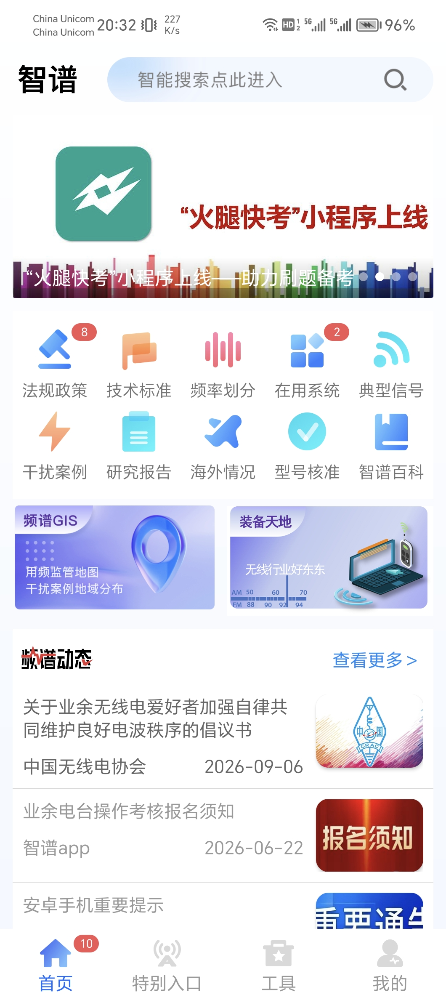
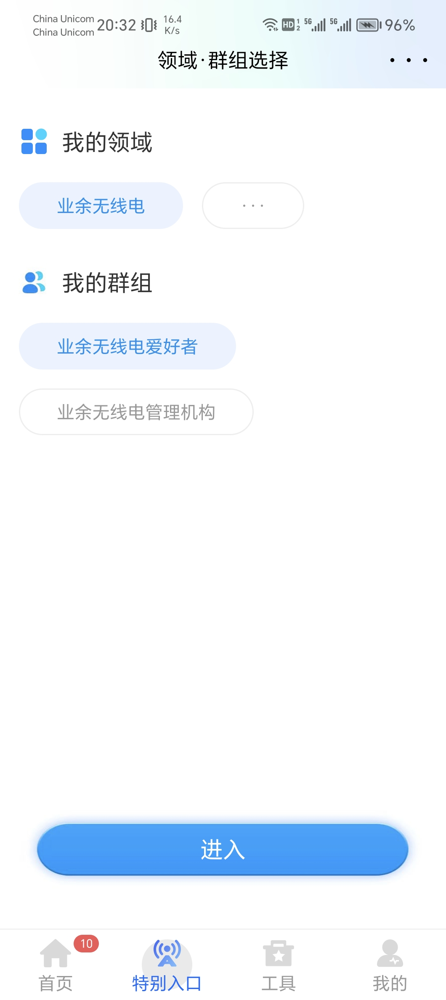
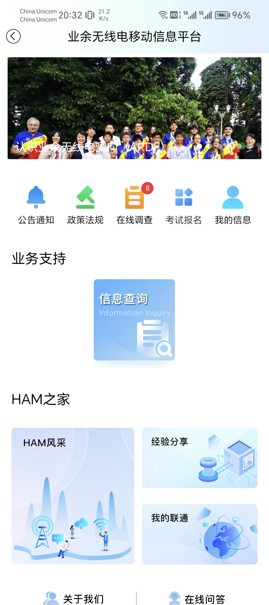
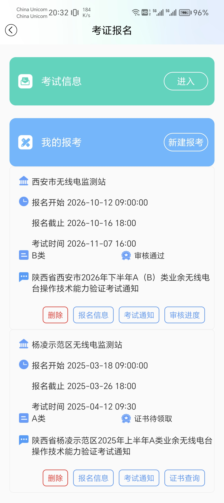
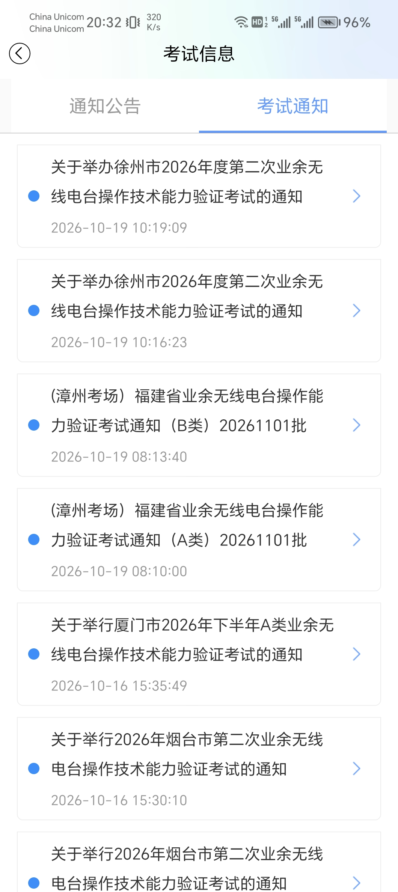
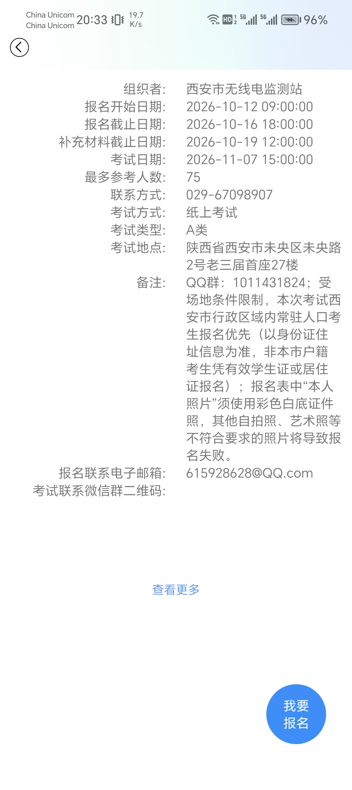

import { Aside } from '@astrojs/starlight/components';

业余无线电台操作证考试，正式名称为"业余无线电台操作技术能力验证"，由无线电管理机构组织，通过后颁发《中国无线电协会业余电台操作证书》。

## A、B、C 三类概览
闭卷考试，试题为 **单项选择题 + 多项选择题** ，有的地区为上机，有的地区（如西安市）为笔试。

| 类别 | 试卷组成 | 答题时间 | 合格标准 | 主要权限 |
| --- | --- | --- | --- | --- |
| A 类 | 40 题（单选 32 + 多选 8） | 40 分钟 | 答对 30 题 | $30\mathrm{MHz}$ 以上（VHF/UHF 等） |
| B 类 | 60 题（单选 45 + 多选 15） | 60 分钟 | 答对 45 题 | 增加短波（HF， $30\mathrm{MHz}$ 以下） |
| C 类 | 90 题（单选 70 + 多选 20） | 90 分钟 | 答对 70 题 | 最高一级 |

> 多选题须与标准答案完全一致（不多选、不少选）才能得分。题库为公开题库，可从 CRAC 官网下载或通过刷题平台练习。

## 报考条件与顺序

- 初次报考须**先考 A 类**；
- **取得 A 类操作证满 6 个月**，可报考 B 类；
- **取得 B 类操作证并设置 B 类电台满 2 年**，可报考 C 类。
- A、B 类由省/市无线电管理机构组织，**C 类由 CRAC（中国无线电协会业余无线电分会）统一组织**。

## 报名方式

报名全程线上进行，两种方式任选（信息互通）：

1. 网页端：登录CRAC官网（[https://www.crac.org.cn/](https://www.crac.org.cn/)），点击“能力验证”，选“考生入口”注册后报名。
2. 手机APP：下载"智谱"APP，进入"业余无线电移动信息平台"报名。由于陕西省内各场考试的报名一般在周内上午9\:00开始抢名额，而这个时间大家经常有课，所以一般来说需要使用智谱APP来抢考试名额。

每次报名有四个时间点：报名开始日期、报名截止日期、补充材料截止日期和考试日期。在报名开始日期到来时，需要在CRAC官网或智谱APP上正式提交报名材料，抢考点名额。报名截止日期结束后将不接受新报名。在补充材料截止日期到来前，可能很多人提交的报名信息不符合要求被打回，需要改正后重新提交，则在这个日期前提交即可，抢到的名额是暂时占住的。

抢到报名名额后，报考状态由“保存未提交”变为“报名成功待审核”，审核通过后变为“审核通过”，并需要及时下载准考证打印。准考证需要为A4彩色打印。

<Aside type="danger">
    报名材料强烈建议一次成功，因为西安市有时会因报名信息不符合要求而暂时打回，此时可以重新修改。有时会直接拒绝参考，本次报名即无效，先前抢到的名额也会丢失。到底他会暂时打回还是直接拒绝参考没找到啥规律，保险起见请一次上传符合要求的各项材料。
</Aside>

## 手机APP报名方法
智谱APP主页如下。

点击“特别入口”页面，“我的领域”选择“业余无线电”，“我的群组”选择“业余无线电爱好者”。

进入“业余无线电移动信息平台”，点击“考试报名”。

“考试报名”界面如下，查询近期考试信息点击“考试信息”右侧的“进入”。确定报名场次后点击“我的报考”右侧的“新建报考”。下方列表为历史报考事件，有删除、查看报名信息、查看考试通知、查看审核进度（未考试）或证书查询（已获得证书）等。

“考试信息”中选择“考试通知”选项卡，可查看各场次考试的详细信息。

详细信息如下，点击“查看更多”可看本次官方考试通告，点右下角“我要报名”即可进入报名信息填写界面。

## 西安市考试信息

西安市考试由 **西安市无线电监测站** 组织，以下为近年安排，具体以当年公告为准。每年报名信息会在微信公众号“西安无线电管理”上发布报名方式、报名时间、考试时间、考试地点及联系方式等信息，并于报名开始前几个工作日在CRAC官网或智谱APP上开放报名材料提交入口。

- 考试地点：未央区未央路2号老三届首座27楼。
- 考试方式：笔试。
- 名额：每年两次考试，上半年/下半年各一次。每次约300人名额，依照一天内开考时间场次，分为每场通常约75人，报满即止，建议报名开启后尽早报名。
- 优先原则：西安市行政区域内常驻人口考生优先（以身份证住址为准，非本市户籍可凭学生证或居住证明报名）。本市报名人数不足，其他地区人员也可报名参考。
- 报名材料：对于A类操作证而言，需要：
    - 本人六个月以内正面、免冠、彩色、白底证件照（电子版）。包含完整头部，头部高度在照片高度的 $\dfrac{1}{2}$ ~ $\dfrac{4}{5}$ 范围内，脸部清晰，高宽比为 $4:3$ 。分辨率不低于 $400\times 300$ 像素、不高于 $4500\times 3375$ 像素。严禁使用自拍照、生活照、艺术照、翻拍照片、PS照片等。
    - 个人身份证正反面彩色电子照片，JPG格式，无遮挡、扭曲、变形、反光、文字、头像清晰可辨。分辨率不低于 $1024\times 768$ 像素，不高于 $ 4096\times 3072$ 像素。上传时必须横置满框，禁止倒立、竖立。身份证必须在有效期内。
    - 对于西安邮电大学校内的同学，还需要上传学生证复印电子照片，必须分别上传有照片和有校徽的左右两页。
    - 对于报名B类操作证的考生，需要额外上传已取得的A类操作证的正反面复印件和电台执照的正反面复印件，电台执照因新设台或更改通联范围等原因暂时不在自己手里的，需要在报名开始前提前电话联系考点。
    - 其他问题可咨询029\-67098907。

<Aside type="danger">
    西安市A、B类考试名额每年极其抢手，A类一般在正式报名开始后半天内报满，B类一般在开始后1~2分钟内报满。想要报名的同学一定要提前保存好要提交的资料，并准时正式提交。

    没抢上名额的同学除了可以等待半年后的下一次报名，还可尝试在报名截止日期之前尝试捡漏，可能会有少量人因为不满足报名资格或因自身原因而取消报名。还可尝试报名下文所说的陕西省内其他市的考点，一般而言咸阳市和杨凌示范区距离较近，但咸阳市等考点按照惯例很可能要求必须有咸阳市户籍，不能用学生证等抵。

    证件照必须白底！
</Aside>

## 陕西省其他市

一般与西安市同时开放报名，往年常见考点信息如下，实际需以当年通知为准：
- 渭南市考点：考点位于临渭区朝阳大街光明大酒店。A类30人、B类20人。笔试。联系方式19391909517。
- 咸阳市考点：考点位于秦都区宝泉西路029艺术区泾渭大讲堂。A类30人、B类20人。只允许拥有咸阳户口的考生参考，不能用学生证等抵。笔试。联系方式029\-33343208。
- 杨凌示范区考点：考点位于展馆北路2号水利干部培训中心。A类55人、B类20人。笔试。联系方式029\-87031506。
- 铜川市考点：考点位于耀州区。A类30人、B类20人。笔试。联系方式0919\-3185958。
- 汉中市考点：考点位于汉台区西大街123号无线电管理处。A类40人、B类30人。笔试。联系方式0916\-2622336。
- 商洛市考点：考点位于商州区。A类50人、B类50人。笔试。联系方式0914\-2323322。
- 宝鸡市考点：A类100人、B类50人。笔试。联系方式0917\-3261447。
- 安康市考点：考点位于高新区花园大道无线电管理处。A类30人、B类25人。笔试。联系方式15309158808。
- 榆林市考点：考点位于榆阳区火车站对面普惠大楼。A类60人、B类20人。笔试。联系方式0912\-3891805。
- 延安市考点：考点位于宝塔区延安无锡实验学校综合楼。A类30人、B类20人。线上上机考试。联系方式0911\-8010866。

## 考试当天

笔试需自带黑色签字笔、2B铅笔和橡皮。带考证和身份证参加考试，参加B类操作证考试的考生还须另外携带A类操作证和电台执照原件。至少提前20分钟进入考场，开考20分钟后禁止进入考场。

<Aside type="danger">
    报名后一定要参考，缺考则取消后续两次考试资格。
</Aside>