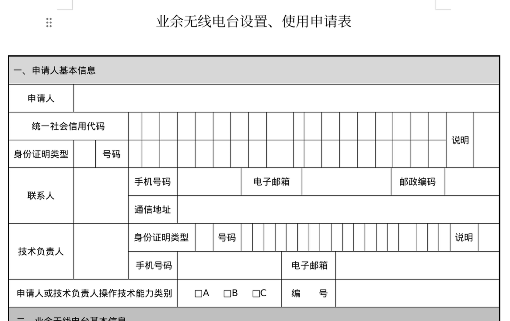
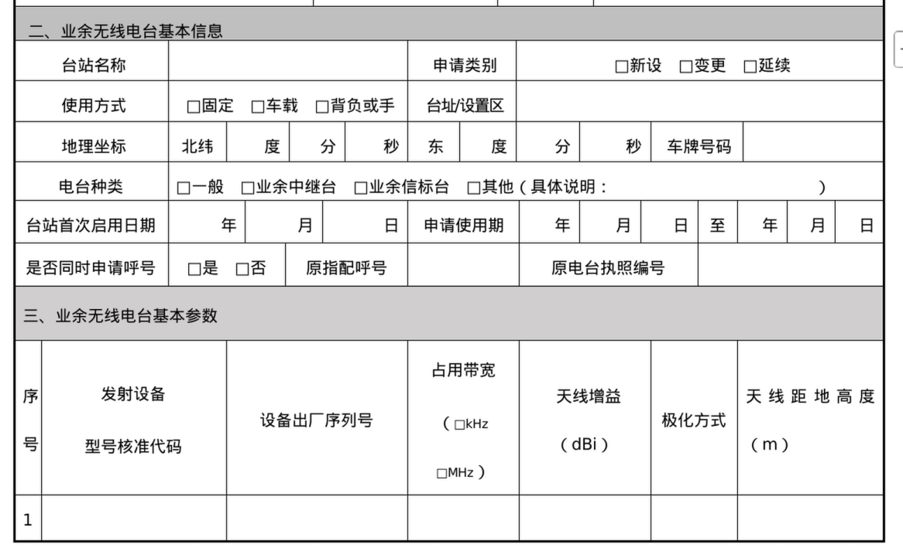
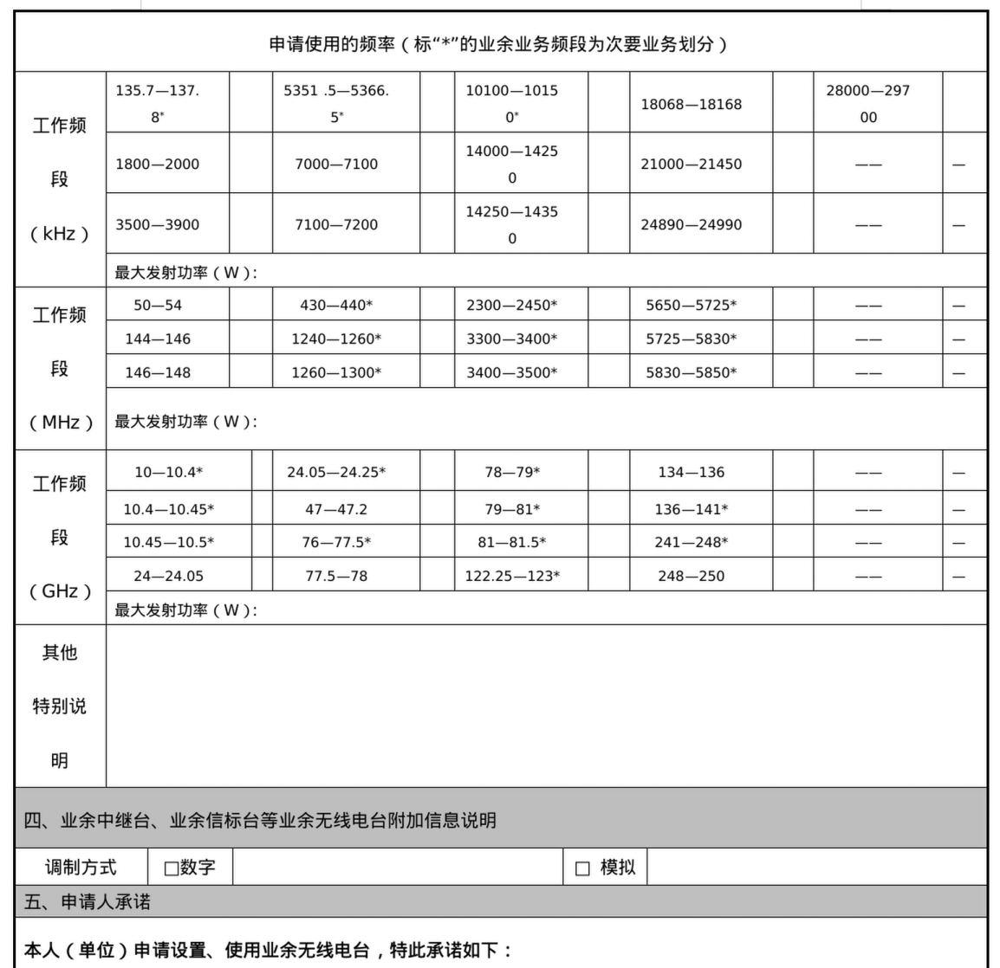
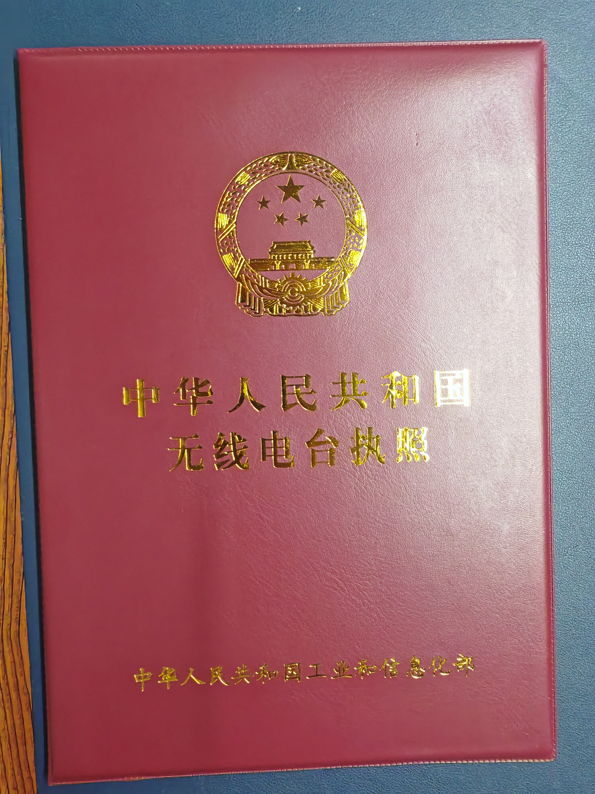
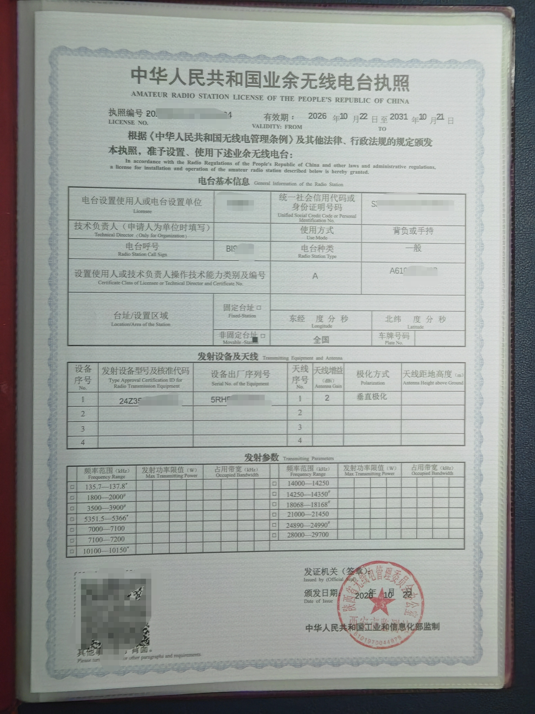
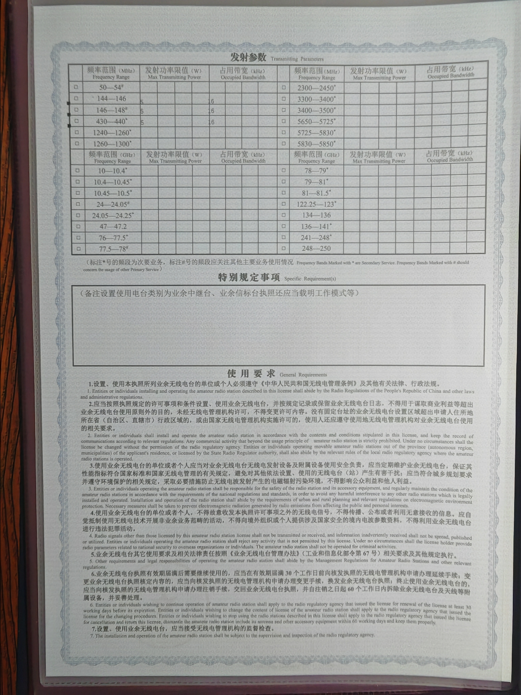

import { Aside } from '@astrojs/starlight/components';

本篇文章主要面向西邮校内在读的同学，校外师傅阅读时请注意可能有些不太适用的部分。本文也只是面向初学者的步骤引导，这些内容可能会变化，也可能会涉及不太严谨的内容，请大家以官方通知为主，关注微信公众号“西安无线电通信学会”。有不明白的地方可以给西安无协电话咨询，也可以群内向老登提问。

<Aside type="danger">
    本篇文章主要讲解在西安市的设台流程，非西安市户籍的同学请着重阅读文章末尾的“给非西安市户籍的同学的建议”小节。
</Aside>

西安无协联系方式等具体信息请阅读本网站“西安业余无线电相关机构介绍“文章。

本篇文章有错误或过时的内容请联系我们。

## 确认资质与购买电台
设台拿呼号需要至少拿到A类操作证，具体可阅读本网站“A/B/C 类考试报考指南”文章（还未施工完毕），确保在设台前自己至少已经拿到了操作证编号，而不是成绩通过了就行。

对于刚通过考试的新人而言，得先买一个电台，才能设台。注意购买的电台必须有“型号核准代码”、“设备名称”后必须带有“（业余业务）”字样、频率范围必须包含业余频段等。

不知道如何选购电台的可以阅读本网站“新手设备选购指南”文章（还未施工完毕），或建议直接群内问老登。

## 材料准备
下载《业余无线电台设置使用申请表2025改》与《个人爱好者信息表》，根据文件内所需内容进行填写，这些文件在“西安无线电通信学会”微信公众号可以下载到，也可以从本网站[下载中心](https://xupt-ham.pages.dev/downloads/)的“设台申请表”处下载。

《设置使用申请表》中大部分如何填都比较显而易见，下面是部分需要注意的地方。

“统一社会信用代码”不用填，“身份证明类型”填“S”表示使用身份证号码，“号码”即为自己身份证。西邮长安校区的同学在“邮政编码”处填“710121”。“技术负责人”整个部分不用填。

“申请人或技术负责人操作技术能力类别”对于刚考取A证的新人就勾选“A”，“编号”为操作证编号。

“台站名称”填“张三超短波业余无线电台”，“张三”换成自己真实姓名，新人第一次设台在“申请类别”勾选“新设”。第一次设台大家大多选择购买手台，对于手台而言：“电台种类”勾选“背负或手持”，“台址/设置区”填“陕西省”，“电台种类”勾选“一般”。在下面“业余无线电台基本参数”部分，“发射设备型号核准代码”和“设备出厂序列号”分别为在购买的电台的名牌上标注的“CMIT ID代码”和“S/N”，手台原装天线的“天线增益”填“ $2.15\,\mathrm{dBi}$ ”，“极化方式”填“垂直极化”，天线距地高度填“ $0\,\mathrm{m}$ ”。

<Aside type="tip">
    对于“电台种类”部分，为了方便起见，无论买的是手台、车台还是基地台，能背得动的都勾选“背负或手持”。“台址/设置区”部分详见下一小节。
</Aside>

“台站首次启用日期”和“申请使用期”不用填。刚考出A证还未设台拿呼号的在“是否同时申请呼号”部分勾选“是”，后面的“原指配呼号”和“原电台执照编号”空着不填。

后面一堆“工作频段”会勾的就勾一勾，不勾也问题不大，“最大发射功率”按电台铭牌上写的填（西安这边一般要求手台都填 $5\,\mathrm{W}$ ）。后面的比如“其他特别说明”和“业余中继台、业余信标台等业余无线电台附加信息说明”等等都不用填。“申请人承诺”中把“申请人（单位）签字（盖章）：”签上名以及写上日期。

本网站下载中心的“电台申请表与跨省申请书”处也有《业余无线电台设置、使用申请表填表说明》，里面有详细的设台过程，实在有不会的在群里问或者打电话给西安无协。

《个人爱好者信息表》内填写信息比较明了，没啥好说的填就行了。

## 全国通联范围与无固定台址
上一小节中“台址/设置区”部分填的是“陕西省”，意味着这个电台出了陕西省就不能合法发射了，对手台来说不太方便。为此强烈推荐直接申请全国通联范围与无固定台址，此时“台址/设置区”部分就要填“全国”。

在本网站下载中心下载到的压缩包中，还有《新A类操作员跨省级行政区域设置、使用业余无线电台必要性说明材料模板》，以此为模板改成自己的内容即可。注意这个说明材料没有特别严格的格式，需要将该模板文件的内容根据自己实际深度改写，不能直接照搬。

<Aside>
    西安市这个全国通联范围与无固定台址相对比较好申请，基本上电台和核准码没毛病就都能审批下来。
</Aside>

## 发送文件给无协审核
将《业余无线电台设置使用申请表2025改》、《个人爱好者信息表》和《新A类操作员跨省级行政区域设置、使用业余无线电台必要性说明材料模板》三个文件填好的电子版以附件形式发送到[316161793@qq.com](mailto:316161793@qq.com)进行审核。审核通过后联系西安无协预约现场办理时间。

## 线下办理
线下需要带的资料如下：
- 身份证原件和复印件。
- 电台设备。
- 电台设备铭牌照片打印成纸质，铭牌照片黑白还是彩色不限。
- 如果想直接申为全国无固定台址，需另打印并手写签名的《新A类操作员跨省级行政区域设置、使用业余无线电台必要性说明材料模板》，黑白不限。
- 学生证原件和复印件，包括有校徽的左右两页和有大头照的左右两页。

<Aside type="tip">
    经验说明好像有设备核准码的电台设备和身份证学生证原件带过去没啥用，保险起见还是都带上。
</Aside>

<Aside type="caution">
    对于校外师傅而言，可能需要注意工作证、居住证等问题，未成年人还需监护人身份证复印件及监护人关系证明材料等。这些本文都不打算涉及，因为对于西邮校内同学而言一般不用管。
</Aside>

上面填写的《业余无线电台设置使用申请表2025改》与《个人爱好者信息表》不用打印出来带着去线下，邮件审核通过即可。其中《业余无线电台设置使用申请表2025改》是线下现场取一张该样式的表格，现场再填一次。填表时旁边有工作人员指导，不会的地方直接问。

## 执照下发
提交上述资料后，需 **耐心** 等待学会微信公众号发布执照领取通知，如遇到自己名字在某一篇文章内公布出来，即可电话预约领取或邮寄。在西安设台时，从提交资料到执照到手需要近两个月。

目前西安市的执照只有纸质版，不像其他省有电子版，这意味着后续携带电台出门时都要把纸质版执照带上。纸质版执照是一张A4纸大小，在购物软件上可以自行买到执照封皮保护起来。大概样式如下：

## 后续执照变更
当后续需要向执照上添加/注销设备、非全国改全国通联范围、升B证、每5年审执照等任何手续时，必须把当前执照上交，并准备与初次设台时要求携带的所有文件，过程约等于重新设一次台（设备较多时可能有多张执照，无论办理什么手续都要全部上交）。只不过《业余无线电台设置使用申请表2025改》中“是否同时申请呼号”填“否”，并将自己已指配的呼号写在“原指配呼号”处。

## 户籍问题
众所周知在大一入学时把自己户口迁入学校集体户口的好处不多，麻烦一堆。在毕业后，用户籍办理设台相关业务时，全国各地无协一般只认当前户籍所在地。如果大一入学时户口迁入学校集体户口，那原则上只能认这个在西安的集体户口，而不认迁入集体户口前家乡的户口。这个集体户口在在读时无法迁出，因为迁出（如迁回家乡）必须拿到毕业证。

这种情况时，有的地方会通融一下，需要写一份户籍保证书，保证原家乡户籍就在这里，且毕业后将迁回家乡户籍。例如写一写父母户籍都在迁出前家乡、家乡有房子或财产写的自己名字等等，以及在家乡当年迁出派出所开具当年户籍迁出的证明材料等，总之比较麻烦。这一点主要对非西安市户籍的同学有影响，原因读完下面小节就明白了，对于西安市户籍的同学问题不大。

## 给非西安市户籍的同学的建议
对于在西邮在读的同学而言，都可以凭学生证在西安市设台。但设台一般需要户籍/学生证/工作证/居住证之一，一旦毕业后，学生证将在这里无法使用，又没有西安市户籍的话，在西安市这里就无法办理手续(因为上文说到每次办任何手续几乎都要学生证等在内的资料)，即使不办啥手续也需要每5年审一次执照，这时就需要迁台。

目前实际上没迁台这个说法，就是在西安市吊销执照，然后在迁入地联系当地的无协重新设台。执照注销起1年内呼号暂时不重新发放，一旦超出1年没能重新在外地设上台的话，呼号就会被重新启用并分配给其他人，相信很多人都不愿意，因为呼号几乎成为了每个HAM的身份。

在考A证时大家也都学习过，呼号第三位的数字是区号，陕西等省为9区。如果外省来就读的同学在西安设台后，毕业后可能打算迁到如家乡所在的省等，很可能跨到别的区。别的区不能自行发放9区的呼号，需要在西安市注销执照的同时让西安无协开具呼号保留函，并在1年内尽快到迁入地重新设台，原呼号是否能保留也不一定，需要看迁入地意见。

（而且在西安市设台也没啥好处，操作证和执照的发放时间特别长，办事效率特别低，办啥手续一般得线下跑一趟，法律认可的执照只有超级大一张纸质版执照而没便携的电子版等等。

不过外地不同地方设台方法与政策不同，上文仅介绍了西安市的设台流程，其他地方设台流程可能差别巨大，不同地区有方便之处也有不方便之处等，需要咨询当地无协。例如山东省的整条办理流程都在App线上完成（除非自制机器要线下验机等）、四川省的全国通联范围无固定台址的申请比较困难（需要交会费进当地学会）、上海禁止在U段发射等等。